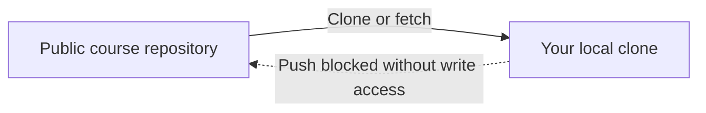
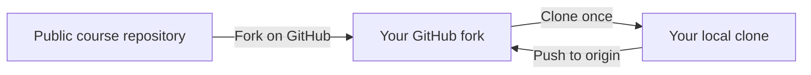

# Fork, clone, select the branch, and keep course files current

Use Ubuntu/WSL and keep the course repository under `~/courses`, separate from ROS workspaces. **Expected branch: `main`.** Use the instructor-assigned branch; changing a GitHub browser branch does not change your local files.

## How your repositories connect

### If you cloned the public course repository directly



Git initially calls the course repository `origin` in this setup. You can edit and commit locally, but pushing to the course repository requires write access. If you already cloned it this way, follow Step 2 to connect your existing clone to your fork.

### Course workflow with your own fork



Fork first so you have a GitHub repository you can push to and share for grading. In your local clone, `origin` points to your fork and `upstream` points to the public course repository. When course files change, fetch from `upstream` and merge locally, then push the updated work to `origin`.

## 1. Fork and clone (new students)

1. Sign in to GitHub, open [the course repository](https://github.com/hoanbklucky/eel4332-autonomous-vehicle-labs), and click **Fork → Create fork** under your account. Keep its name. The required indoor/outdoor activity is included on `main`.
2. In Ubuntu/WSL, replace `YOUR_USERNAME` with your actual GitHub username. Run this only for a **new** local copy:

```bash
mkdir -p ~/courses
cd ~/courses
git clone --branch main https://github.com/YOUR_USERNAME/eel4332-autonomous-vehicle-labs.git
cd eel4332-autonomous-vehicle-labs
git remote add upstream https://github.com/hoanbklucky/eel4332-autonomous-vehicle-labs.git
git fetch upstream
git switch main
git merge --no-edit upstream/main
git push -u origin main
git remote -v
git branch --show-current
code .
```

Stop on any error. `origin` is **your fork** (push work); `upstream` is **the public course repository** (receive updates). The branch must print `main`. Open the cloned folder in VS Code with **WSL: Ubuntu**. Do not use Download ZIP as your working copy: it has no Git history/remotes for updates. Reopening VS Code does not fetch course changes.

## 2. Already cloned the public course repository?

Keep your files/history; do not delete or reclone over them. Create your fork on GitHub, then run `git remote -v` and `git status`. Use the commands below if `origin` points to `hoanbklucky/eel4332-autonomous-vehicle-labs` and there is no `upstream` remote yet. Replace `YOUR_USERNAME` with your GitHub username.

```bash
cd ~/courses/eel4332-autonomous-vehicle-labs
git remote rename origin upstream
git remote add origin https://github.com/YOUR_USERNAME/eel4332-autonomous-vehicle-labs.git
git fetch origin
git remote -v
```

If either remote already exists, inspect it first; correct a URL with `git remote set-url REMOTE URL` rather than adding duplicates. Check both fetch and push URLs. Changing remotes does not alter files or commits. If working from an old ZIP, preserve it separately, clone your fork in a new folder, then review/copy your own work into that clone.

## 3. Save your work

Open a terminal in your local course repository. Check your branch and any pending changes.

```bash
git branch --show-current
git status
```

Use `main` for the final project. If you are on a different branch and have edits, save them on that branch before switching. If you need those edits on `main`, ask for help moving them.

If you have changes to keep, stage just those files using **+** in VS Code Source Control, then commit them.

```bash
git commit -m "Save project work"
```

If `git status` says your working tree is clean, skip the commit.

## 4. Get the latest course files

Once your working tree is clean, switch to `main`, fetch the course updates from `upstream`, and merge them into your local branch. Run these in order and stop if a command fails.

```bash
git switch main
git fetch upstream
git merge upstream/main
```

If Git reports a merge conflict, pause and ask for help before continuing.

## 5. Push your work to your fork

After the merge succeeds, upload your local commits to your GitHub fork.

```bash
git push -u origin main
```

Open your fork on GitHub to check that your latest work is there. Open the local project README for your next lab step.

Official references: [Fork a repository](https://docs.github.com/en/get-started/quickstart/fork-a-repo), [Syncing a fork](https://docs.github.com/en/pull-requests/collaborating-with-pull-requests/working-with-forks/syncing-a-fork), [VS Code in WSL](https://code.visualstudio.com/docs/remote/wsl).
