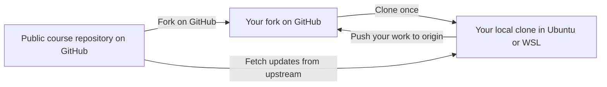

# Fork, clone, select the branch, and keep course files current

Use Ubuntu/WSL and keep the course repository under `~/courses`, separate from ROS workspaces. **Expected branch: `main`.** Use the instructor-assigned branch; changing a GitHub browser branch does not change your local files.

## How your repositories connect



In your local clone, `upstream` is the remote name for the public course repository. `origin` is the remote name for your GitHub fork. Fetch course updates from `upstream`, merge them into your local branch, then push your work to `origin`.

## 1. Fork and clone (new students)

1. Sign in to GitHub, open [the course repository](https://github.com/hoanbklucky/eel4332-autonomous-vehicle-labs), and click **Fork → Create fork** under your account. Keep its name. The required indoor/outdoor activity is included on `main`.
2. In Ubuntu/WSL, replace `YOUR_USERNAME` with your actual GitHub username. Run this only for a **new** local copy:

```bash
mkdir -p ~/courses
cd ~/courses
git clone --branch main https://github.com/YOUR_USERNAME/eel4332-autonomous-vehicle-labs.git
cd eel4332-autonomous-vehicle-labs
git remote add upstream https://github.com/hoanbklucky/eel4332-autonomous-vehicle-labs.git
git fetch upstream
git switch main
git merge --no-edit upstream/main
git push -u origin main
git remote -v
git branch --show-current
code .
```

Stop on any error. `origin` is **your fork** (push work); `upstream` is **the public course repository** (receive updates). The branch must print `main`. Open the cloned folder in VS Code with **WSL: Ubuntu**. Do not use Download ZIP as your working copy: it has no Git history/remotes for updates. Reopening VS Code does not fetch course changes.

## 2. Already cloned the public course repository?

Keep your files/history; do not delete or reclone over them. Create your fork on GitHub, then run `git remote -v` and `git status`. Use the commands below if `origin` points to `hoanbklucky/eel4332-autonomous-vehicle-labs` and there is no `upstream` remote yet. Replace `YOUR_USERNAME` with your GitHub username.

```bash
cd ~/courses/eel4332-autonomous-vehicle-labs
git remote rename origin upstream
git remote add origin https://github.com/YOUR_USERNAME/eel4332-autonomous-vehicle-labs.git
git fetch origin
git remote -v
```

If either remote already exists, inspect it first; correct a URL with `git remote set-url REMOTE URL` rather than adding duplicates. Check both fetch and push URLs. Changing remotes does not alter files or commits. If working from an old ZIP, preserve it separately, clone your fork in a new folder, then review/copy your own work into that clone.

## 3. Save your work before an update or branch change

Save editor buffers. Run `git branch --show-current`, `git status` and `git diff`. Stage intended source/configuration/maps with VS Code's **+** or `git add path/to/file` using actual paths. Then commit:

```bash
git commit -m "Save lab work before course update"
```

Do not include bags, credentials, virtual environments or ROS build/install/log directories. Back up important **ignored** files separately; ordinary commits/stashes do not protect ignored files. Push your current branch to your fork as a backup, using its actual name. Commit saves locally; push uploads. HTTPS uses supported token/credential-manager authentication or use SSH, not your GitHub account password.

If you cannot commit yet, back up important files outside the repository, then `git stash push --include-untracked -m "Before course update"`. Confirm a stash was created. Apply it with `git stash apply` only after the update succeeds, review conflicts, and commit. Keep the stash until satisfied. Do not use `reset --hard`, `clean -fdx`, Discard Changes, or a force push to update.

## 4. Select the instructor-assigned branch

With saved work and a clean working tree:

```bash
git fetch upstream
git branch --list
```

If local `main` exists, run `git switch main`. If absent, create it from the public course branch:

```bash
git switch --no-track -c main upstream/main
```

Use **one** of these switch alternatives, not both. Commits saved on your previous branch remain there. They do not automatically move to the new branch. Review which work is relevant before copying/cherry-picking it; ask the instructor if unsure. Do not merge an entire older assignment branch just to move one model edit. After updating, `git push -u origin main` creates/updates this branch in your fork and sets tracking to your fork, not upstream.

## 5. Update before every lab and final-project session

```bash
cd ~/courses/eel4332-autonomous-vehicle-labs
git remote -v
git branch --show-current
git status --short
```

Verify branch `main`, correct remotes, and no pending changes before proceeding:

```bash
git fetch upstream &&
git merge --no-edit upstream/main &&
git merge-base --is-ancestor upstream/main HEAD &&
echo "Current checkout includes the latest fetched main course commits"
git log -1 --oneline
```

Then back up the combined result to your fork:

```bash
git push -u origin main
```

The inclusion check confirms **all commits from the latest successfully fetched course branch are in your local history**, even if you also have your own commits. A clean `git status`, `Already up to date` from your fork, or a recent student commit alone does not prove this. Repeat the fetch/update when the instructor announces changes.

If your fork has newer commits and rejects the push, fetch `origin`, merge `origin/main`, resolve conflicts, and push again. Do not force-push. VS Code **Sync Changes** / ordinary Pull synchronize the tracked fork; they do not replace fetching `upstream`.

## 6. Conflicts, verification and installed software

On a conflict, stop and run `git status`. Use VS Code's Merge Editor to combine both sides, stage resolved files and `git commit` to finish. Do not blindly choose one entire side; it can remove robot settings or new course instructions. `git merge --abort` cancels an in-progress merge. Ask for help if unsure, then rerun the inclusion check after resolving.

Reopen this branch's **local lab README** and use its commands, not an old browser tab, PDF or archived lab folder. Git updates files, not installed ROS packages. For the final: restart for changed SDF/world files; rerun its build helper and source the workspace for model/script/bridge/install changes. Preserve your edited Goosebot source and maps; do not repeat the upstream clone/copy to update the course.

Official references: [Fork a repository](https://docs.github.com/en/get-started/quickstart/fork-a-repo), [Syncing a fork](https://docs.github.com/en/pull-requests/collaborating-with-pull-requests/working-with-forks/syncing-a-fork), [VS Code in WSL](https://code.visualstudio.com/docs/remote/wsl).
