# Detailed reference — optional

All required instructions are in [the concise final README](README.md). The GPS activity there supersedes this reference's earlier three-location inspection exercise. Use this file only for extra command explanations, output examples and troubleshooting.

## GPS fusion comparison method

The runnable student procedure and deliverables are in [Step 9](README.md#9-part-b--gpsrtk-localization-and-outdoor-navigation). This supplied teaching utility does not complete any existing student algorithm TODO.

- **Inputs:** `/odometry/filtered` from the existing local EKF (measured wheel-joint forward velocity plus IMU yaw rate), `/gps/fix`, and raw `/ground_truth/pose` in a **separate scoring file**. The recorder checks running EKF parameters, centered GPS mount, message frames, stationary start and clock monotonicity.
- **Initialization:** read the same campus SDF datum and adjacent mission.json Home pose used by world.launch.py. Rotate/translate local odometry into world ENU using this known initial pose and first odometry yaw. Both variants receive the same prior. There is no truth-based trajectory alignment or GPS-based heading estimate.
- **Conversion:** WGS84 latitude/longitude/altitude → ECEF → local ENU at the supplied world datum. This comparison supports ENU and heading_deg=0 only. It uses full-scale simulation meters; the old 0.06 campus factor is retired. The centered GPS mount has zero horizontal lever arm; customized noncentered mounts are rejected.
- **Prediction:** the existing odometry/IMU trajectory supplies horizontal increments. A is their sum. B predicts with the same increments, then applies independent GPS position updates. This is a **two-state x/y Kalman filter**, not a full-state EKF or `navsat_transform_node` deployment. Neither heading nor the running ROS navigation estimate is corrected.
- **Update:** `P ← P + Q`; `K = P(P + R)⁻¹`; `x ← x + K(z − x)`. The implementation uses the Joseph covariance update and rejects large Mahalanobis innovations. All tuning is explicitly recorded in metadata; it is illustrative, not a calibrated hardware uncertainty model.
- **Unknown GPS covariance:** bridge covariance-type 0/invalid matrices use WGS84 conversion of the configured angular standard deviation into a nonzero per-axis meter covariance. At campus latitude, 0.000015 degrees is approximately 1.47 m East / 1.66 m North. No zero-variance GPS updates are accepted.
- **Timing:** raw samples retain simulation timestamps. Offline replay interpolates bracketing odometry to GPS times, then compares estimates and interpolated ground truth on the same odometry times. There is no extrapolation; large gaps, resets and insufficient overlap fail clearly. This offline interpolation is not a claim of online low-latency performance.
- **Controlled case:** scale every prediction increment by 1.15 for BOTH A/B, keeping the same GPS and scoring data. Plot it separately from the unmodified case. It is an artificial calibration-error demonstration, not a measured defect in the robot. Smaller error is not assumed or manufactured by changing truth.
- **Outputs:** raw sensors.csv; separate truth.csv; metadata.json with datum, known initialization, running baseline parameters and settings; estimates.csv; metrics.json (RMSE, final/max error, accepted/rejected updates and scored fraction); comparison.png. The report completes estimates before loading truth. It publishes no ROS topics/TF or motion commands.

### If recording or reporting stops

Keep the robot at Home until READY. Start a fresh world for a fresh record. Source the correct workspace and stop SLAM/Nav2. Use a new output directory, keep the corrected GPS noise, and ensure the ordinary world launch publishes GPS, filtered odometry and raw ground truth. The raw truth bridge is already supplied; do **not** start ground_truth_map_odom_bridge.py. A publisher count alone is not proof of arriving data.

“Different EKF baseline” means runtime inputs/masks differ from the provided velocity + yaw-rate configuration; inspect them rather than silently comparing different estimators. Missing TF, moving before READY, clock reset, noncentered GPS, non-ENU datum, duplicate timestamps, odometry gaps or insufficient truth overlap require a fresh/repaired experiment. A synthetic test pass does not substitute for a WSL/Gazebo pilot.

### Live GPS-aided navigation

Required with the supplied campus map in Step 9B; see the method below.

References: [Nav2 GPS navigation](https://docs.nav2.org/jazzy/tutorials/general_tutorials/navigation2_with_gps/navigation2_with_gps/), [robot_localization GPS integration](https://github.com/cra-ros-pkg/robot_localization/blob/jazzy/doc/integrating_gps.rst), [Gazebo NavSat](https://gazebosim.org/api/sim/8/classgz_1_1sim_1_1systems_1_1NavSat.html).


## GPS / RTK navigation method

Step 9's current commands supersede older GPS-only instructions in this reference. Ordinary and RTK-like sensors are both simulated at 5 Hz in the **same drive** with independent noise. The latter is only a ~2 cm fixed-quality noise model: no corrections link, ambiguity resolution, satellite blockage or changing fix state is modeled.

### Runtime profiles

`world.launch.py gps_profile:=comparison` modifies the expanded robot description **in memory**, leaving the source Xacro untouched. The primary sensor publishes ordinary `/gps/fix`; a second centered sensor plus bridge publishes `/gps/rtk_fix`. `gps_profile:=ordinary` and `gps_profile:=rtk` select the primary sensor for live navigation. Default `model` preserves the installed model settings for existing launches. `gps_profiles.py` supplies Gaussian horizontal stddev 0.000015 / 0.0000002 degrees and vertical stddev 3.0 / 0.03 m.

The recorder validates both sensor declarations and captures both streams. Its two-state offline filters produce A/B/C estimates from identical local-EKF increments. A declared +15% increment scale is applied equally to all three only in the controlled panel. Known Home initialization and evaluation-only truth remain separate. Schema-1 legacy recordings still plot A/B; record schema 2 for the new A/B/C deliverable.

### Live GPS navigation

`gps_navigation.launch.py` validates the full-scale `campus/reference.yaml`, derives a pedestrian-only map, waits for GPS readiness, and starts its map server plus navigation-only Nav2. No AMCL or SLAM runs. The global static costmap covers the campus at 0.25 m resolution; the fine 0.025 m local grid rolls around Goosebot and retains the static pedestrian mask and live LiDAR. Grass is forbidden in both. Follow required goals A/B/Home from Step 9B; the map-free short-range activity is retired.

The live planar state is [x,y,yaw]. Initial position and global heading come from the **known commanded Home spawn**, not Gazebo truth or perfect IMU orientation. Body displacement and yaw increments come from the existing local odometry/IMU EKF. GPS positions update x/y; cross covariance can correct heading after motion. The supplied covariance model is illustrative, not hardware-calibrated. Physical GPS navigation needs appropriate global heading initialization/observability.

At each local-odometry time, the global filter publishes `map -> odom = global_pose × inverse(local_pose)`, and `/gps_nav/odometry`. It never changes the local EKF's continuous odom -> base_footprint transform. GPS and map goals use world ENU meters anchored to the SDF datum, so a saved SLAM map must not be loaded without explicitly aligning that map's origin/heading. `gps_goal.py` converts actual latitude/longitude inputs to the same ENU frame; `--home` uses the known Home configuration.

GPS fixes with up to 0.25 simulated seconds latency receive a small estimated-motion compensation. Large odometry gaps/resets, mismatched profiles, noncentered GPS or competing global localizers stop the mode. GPS uncertainty-type 0 uses a nonzero profile-dependent covariance. Rejected fixes do not refresh GPS health.

Nav2's collision monitor outputs `/gps_nav/cmd_vel_request`; the global localizer forwards it to `/cmd_vel` only while pose sources and LiDAR are fresh. A steady-clock watchdog also sends zero commands when unhealthy. Loss of accepted GPS for 2 simulated seconds, local odometry for 2 wall seconds, GPS for 20 wall seconds or scans for 5 wall seconds stops the localizer and its Nav2 launch. Request freshness is 0.5 simulated seconds with a 5-wall-second upper limit, allowing slow simulation. Normal Ctrl+C closes the gate and sends zero commands before shutting down. Keep teleop stopped, since a separate teleop publisher would bypass this command path.

Required campus-map mode uses RTK-like GPS with 0.2 m goal tolerance. Legacy filter code also supports ordinary-GPS tolerance 1.5 m, but that is not the required map-navigation mode. Those settings deliberately reflect different precision and are not equal-accuracy benchmarks. Nav2's AMCL localization indicator may be inactive in GPS mode; use the GPS-ready message and TF, and distinguish lifecycle activity from action SUCCEEDED.

### Pilot before student release

Run the comparison with both actual Gazebo sensors, inspect synchronized A/B/C metrics, then test RTK-like live initialization, map-based A/B goals, Home return, obstacle detection, command/TF ownership and shutdown. Also test GPS/scan interruption. Offline tests and synthetic CSV plots are not end-to-end ROS/Gazebo validation. These launchers are simulation teaching tools, not validated physical-robot navigation software.


## Archived expanded instructions

The following older instructions are retained for troubleshooting only. GPS procedure/deliverables are superseded by the current Step 9 above; no old three-location exercise or additional submission is required.

# Final Project — Indoor and Outdoor Goosebot Navigation

## Before you start — use the current course files

**Expected branch: `final-project-indoor-outdoor`.** This is the indoor/outdoor revision; do not merge `main` as a substitute for updates to this branch. First-time user? Fork and clone using [Setup Part 6](../lab00_setup/README.md#part-6--fork-and-clone-the-course-repository). An old ZIP download or an unchanged fork may contain obsolete commands.

In Ubuntu/WSL, save all editor files and check:

```bash
cd ~/courses/eel4332-autonomous-vehicle-labs
git remote -v
git branch --show-current
git status --short
```

`origin` must be your GitHub fork; `upstream` must be `hoanbklucky/eel4332-autonomous-vehicle-labs`. The branch must match the expected name. **If the branch differs or status lists changes, stop here:** [save/commit your work and follow the branch/update guide](../docs/UPDATING_COURSE_REPOSITORY.md) before proceeding. Do not discard edits, especially robot Xacro/configuration changes or maps.

Once on the correct branch with a clean working tree:

```bash
git fetch upstream &&
git merge --no-edit upstream/final-project-indoor-outdoor &&
git merge-base --is-ancestor upstream/final-project-indoor-outdoor HEAD &&
echo "Current checkout includes the latest fetched final-project-indoor-outdoor course commits"
git log -1 --oneline
```

**Command breakdown**

| Command / part | What it does |
|---|---|
| `git fetch upstream` (students) / `git fetch origin` (instructor) | Downloads course-branch updates without changing your working files yet. |
| `git merge --no-edit .../final-project-indoor-outdoor` | Integrates that remote branch into your current branch. Save your work first and resolve any reported conflicts. |
| `git merge-base --is-ancestor ... HEAD` | Checks that your current history contains the fetched course commit; success is exit status zero. |
| `git log -1 --oneline` | Displays the current commit so you can identify your version. |


Continue only after the inclusion check succeeds. Reopen **this local README** in VS Code (**WSL: Ubuntu**) and follow it. VS Code Sync or pulling your fork alone does not fetch instructor updates; push your combined commits to your fork after a successful update. A Git update changes files, not installed packages: rebuild only when this lab's setup says it is needed.

**Final version check:** this branch requires **both IST and campus**, the outdoor GPS experiment/navigation, and a system explanation; blocked-route testing and LiDAR tuning are optional. If your local final still says to choose one world, it has not received this revision.

> [!IMPORTANT]
> **Stop Gazebo with Ctrl+C in its launch terminal—not just the window's × button.** Closing the GUI can leave the simulation server and ROS nodes running, causing duplicate simulations or a GUI that does not match the robot/world queried from the terminal.
>
> **Before relaunching, switching worlds, or finishing:**
> 1. Stop robot motion; save any map/results you need.
> 2. Press **Ctrl+C** in each teleop, SLAM and Nav2 terminal that is running.
> 3. Press **Ctrl+C in the simulator launch terminal** (usually Terminal 1).
> 4. Wait for shutdown messages to finish and the shell prompt to return before launching again.
>
> If you already closed the window, return to its launch terminal and press Ctrl+C there. If shutdown seems incomplete, check `pgrep -af 'gz sim|gz-sim'` and identify leftover simulation processes before restarting.

## Open in VS Code through WSL

After cloning the repository, open **Windows Terminal / PowerShell**, run `wsl`, then run these commands in **Ubuntu/WSL**:

```bash
cd ~/courses/eel4332-autonomous-vehicle-labs
code .
```

Confirm VS Code shows **WSL: Ubuntu** (or your Ubuntu distribution) in the lower-left corner. Open `final_project_simulation/README.md` in Explorer. Choose **Terminal → New Terminal**; when working from this lab directory, run:

```bash
cd ~/courses/eel4332-autonomous-vehicle-labs/final_project_simulation
```

Use that Ubuntu terminal for the commands below; follow any later `cd` commands as written. This assumes VS Code is installed on Windows with the **WSL extension**. If the repository is not cloned yet, complete Lab 00's clone step first.

> **Branch preview:** this indoor/outdoor revision is on `final-project-indoor-outdoor`. Complete both required worlds below; `main` retains the earlier assignment until this revision is released.

## Mission

Use the **provided Goosebot model with its configured 2-D LiDAR** in **both IST (indoor) and campus (outdoor)**. In each world, build a short-route SLAM map, save it, restart with AMCL, navigate to **two destinations**, and return home. Complete the guided outdoor GPS experiment and live GPS navigation in the current README; LiDAR tuning is optional. Explain the measured data flow and algorithms in your own words. Physical Goosebot SLAM/Nav2 is not required; lane following remains the hardware component.

## Learning objectives

- Build and use separate indoor/outdoor occupancy maps with SLAM Toolbox and AMCL/Nav2.
- Identify sensor topics, message types and frames; distinguish measurements, estimates and commands.
- Explain which inputs the EKF, SLAM, AMCL and navigation components actually use.
- Compare one LiDAR setting indoors and inspect simulated GPS outdoors, including its noise and coordinate system.
- Support explanations with runtime evidence and reproducible configuration.

## Required project route

| Part | Required work | Saved map |
|---|---|---|
| A — IST indoors | Steps 3–6: short mapped route, two destinations and home; blocked-route testing and LiDAR tuning optional | `results/ist_map.yaml` and its image |
| B — campus outdoors | Repeat Steps 3–6 on a short campus route, two destinations and home; Step 9 guided GPS activity | `results/campus_map.yaml` and its image |
| C — system understanding | Complete [the system explanation](SYSTEM_EXPLANATION.md) using your actual topics, configuration and observations | One shared explanation covering both environments |

Complete IST first. Map enough space for your two destinations, a revisit and an alternative route; **do not map every room or the entire campus**. For campus, a route near IST and the neighboring crossings is sufficient; distant delivery pads are optional. Blocked-route testing is optional in both worlds, with no submission required. Custom worlds and mission-client programming are optional extensions, not substitutes for either required world.

## AI assistance is allowed

You may use AI tools to help write or modify code, add sensors, configure ROS 2, and debug errors for this **final project**. You are responsible for testing the resulting code/configuration and must be able to explain your submitted changes and how the system works. Write the short final explanation in your own words. AI assistance does not replace the required simulation demonstration or your understanding.

## Prerequisites and background

Complete Labs 4–5, then follow Steps 1–4 below to build Goosebot and check it in IST before mapping; repeat the readiness check when switching to campus. The separate practice-arena warm-up is optional. Keep your existing Ubuntu 24.04/WSL, ROS 2 Jazzy, and Gazebo Harmonic installation. Use VS Code's **WSL: Ubuntu integrated terminal** or a separate **Ubuntu/WSL terminal**; both work. Each long-running launch needs its own terminal. Commands omit the shell prompt. **The course workflow uses native WSL/Jazzy; Docker is an optional alternative.**

The Goosebot source is [hoanbklucky/goose, nav2 branch](https://github.com/hoanbklucky/goose/tree/nav2/11_simulation). It already supplies the body/wheels, drive plugin, stereo cameras, IMU and forward ToF. The course launcher supplies measured wheel-joint odometry and its local EKF configuration. **The narrow forward ToF is not a 360° mapping LiDAR.** The course build helper supplies the 360° LiDAR and bridge automatically. Start with those defaults; inspect/change one LiDAR setting only after completing IST mapping and saved-map navigation. Restore its baseline before starting campus.

The original Goosebot default mode uses a pre-baked map and Gazebo ground-truth localization. **Do not use that mode as your final demonstration.** This project instead uses LiDAR SLAM Toolbox for mapping, then a saved map with AMCL. This differs from the TurtleBot/Cartographer preparation in Lab 4. Stereo RTAB-Map is optional. Do not launch the original `nav2_bringup.launch.py` or `stereo_slam.launch.py` alongside the commands below.

AMCL estimates the robot's pose on a saved map by matching live scans. Nav2's supplied starting configuration uses **NavFn with Dijkstra** for the global path and **DWB** to choose local motion commands. The global costmap follows the full saved map, rather than the original Goosebot's 20 m rolling window. Use the supplied footprint and sensor defaults first; tuning comes after baseline mapping/localization/navigation.

## Provided files and required environments

| Environment | Features | Baseline / blocked world |
|---|---|---|
| **IST interior — Part A** | Photo-traced classrooms, oval hallway, two end cross-passages, north/south entrance lobbies and central side exits | `ist/ist.sdf` / `ist/ist_blocked.sdf` |
| **Florida Poly campus — Part B** | Geographic footprints, lake chain, roads and causeways; larger mapping area | `campus/campus.sdf` / `campus/campus_blocked.sdf` |
| Optional custom world | Additional practice; requires checking collision geometry and a feasible alternative route | See [optional builder guide](CREATE_YOUR_OWN_WORLD.md) |

<details>
<summary>Preview — IST oval hallway and classroom layout</summary>

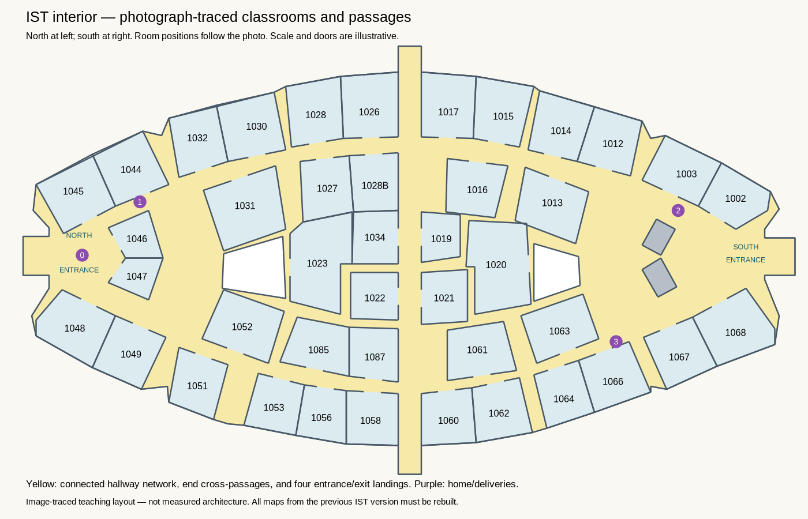

Classroom identities and relative positions come from the first image's labels/black partitions; the oval hallway, both end cross-passages and central through-passage come from the second image. **Evacuation arrows and colored zone boundaries are excluded from geometry.** Rooms 1045/1048 and 1002/1068 flank the north/south entrance lobbies. Dimensions and doors remain illustrative. Yellow is actual hallway floor, not evacuation routes. **Version 4 replaces earlier IST geometry: rebuild your SLAM map and reselect goals.**

</details>

<details>
<summary>Preview — campus layout</summary>

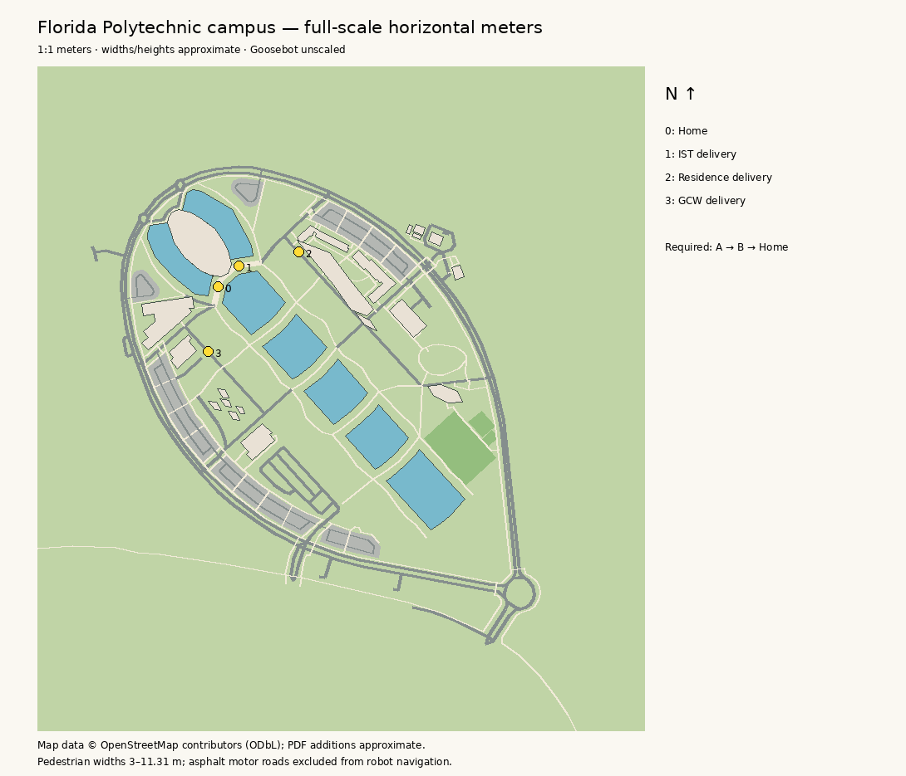

The campus now uses 1:1 horizontal meters. Some footprints/heights and path widths remain approximate. Blue water has solid collision geometry; required pedestrian-only planning forbids grass.

</details>

Other supplied files: `goosebot/world.launch.py` (world/spawn wrapper), `goosebot/slam_goosebot.yaml`, and `goosebot/nav2_goosebot.yaml` (starting configurations). The worlds' `reference.yaml` files are geometric instructor references, **not student SLAM results**. The existing [mission-client scaffold](../lab05_navigation/src/mission_client.py) remains available as an optional programming extension; its TODOs are not completed for you.

## Step-by-step procedure

#### How to read the terminal commands

Run commands in the named Ubuntu/WSL terminal. These patterns recur throughout the project:

| Syntax | Meaning |
|---|---|
| `source /opt/ros/jazzy/setup.bash` | Makes the installed ROS 2 Jazzy commands and packages available in this terminal. |
| `source ~/goosebot_ws/install/setup.bash` | Adds your built Goosebot workspace. Source it after ROS, in every new ROS terminal. It does not rebuild files or restart a robot. |
| `ros2 run PACKAGE EXECUTABLE` | Starts one installed program, such as teleop or the map saver. |
| `ros2 launch PACKAGE FILE` | Runs a launch description, often starting several nodes. This project also launches local files by absolute path. |
| `name:=value` after a launch file | Sets a launch argument, such as `world:=...` or `map:=...`. |
| `--ros-args -p name:=value` | Sets a ROS parameter on the program being run. Here `use_sim_time:=true` uses Gazebo's simulation clock. |
| `~`, `$PWD`, and `$(...)` | Your home directory, the current terminal directory, and the output of the command inside parentheses. Double quotes preserve a path as one argument. |
| A backslash at the end of a line | Continues the same command on the next line; it must be the last character. Copy the whole command. |
| `&&` between commands | Runs the next command only if the preceding command succeeds. |
| Ctrl+C | Stops the foreground program. Stop each long-running launch in its own terminal. |

The breakdowns below explain the runnable blocks; do not type table entries as additional commands.

### 1. Install dependencies, copy Goosebot source, and build

Run once in Ubuntu/WSL. This supplements your existing installation; no Ubuntu/ROS reinstall or Docker is needed.

```bash
sudo apt update
sudo apt install -y git python3-colcon-common-extensions python3-rosdep \
  ros-jazzy-ros-gz ros-jazzy-xacro ros-jazzy-robot-state-publisher \
  ros-jazzy-robot-localization ros-jazzy-slam-toolbox \
  ros-jazzy-navigation2 ros-jazzy-nav2-bringup \
  ros-jazzy-teleop-twist-keyboard python3-yaml
source /opt/ros/jazzy/setup.bash
```

In **your fork** of the course repository, copy only the provided source package (not its old build/install/virtual-environment directories). The pinned revision makes the starting model reproducible:

```bash
cd ~/courses/eel4332-autonomous-vehicle-labs
mkdir -p final_project_simulation/src
# Run this clone/copy only once. Keep your existing edited package on later updates.
git clone --filter=blob:none --sparse --single-branch --branch nav2 \
  https://github.com/hoanbklucky/goose.git /tmp/eel4332-goose-source
git -C /tmp/eel4332-goose-source sparse-checkout set 11_simulation/ros2_ws/src/goosebot_0
git -C /tmp/eel4332-goose-source checkout bffaf3cdf2b38f3b5a53a977064e0c787e046ff7
cp -r --update=none /tmp/eel4332-goose-source/11_simulation/ros2_ws/src/goosebot_0 final_project_simulation/src/
# Omit the redundant packaged snapshot; the extracted source is already copied.
rm -f final_project_simulation/src/goosebot_0/goosebot-simulation.zip
# Link, fix script permissions, install dependencies, and build this source copy.
bash final_project_simulation/goosebot/build_student_workspace.sh
```

**Command breakdown**

| Command / part | What it does |
|---|---|
| `git clone --filter=blob:none --sparse ...` | Creates a temporary upstream checkout, limiting initially downloaded file contents. |
| `sparse-checkout set .../goosebot_0` | Selects the complete Goosebot source package. |
| `checkout bffaf3c...` | Uses the pinned source revision so everyone starts with the same upstream model. |
| `cp -r --update=none ...` | Copies the package recursively while leaving existing destination files in place. |
| `rm -f .../goosebot-simulation.zip` | Removes only the redundant packaged snapshot after the extracted source is copied. |
| `bash .../build_student_workspace.sh` | Runs the course setup/build helper: configures the supplied sensors/bridges, applies the legacy GPS-noise correction, prepares the workspace and builds the package. Rerun it after course/model changes; then source and relaunch. |


**After the helper reports a successful build**, configure this terminal and check the installed package:

```bash
source /opt/ros/jazzy/setup.bash
source ~/goosebot_ws/install/setup.bash
ros2 pkg prefix goosebot_0
ros2 pkg executables goosebot_0
```

Expected prefix: `$HOME/goosebot_ws/install/goosebot_0`. The helper builds/verifies in its own process; it does not configure the parent terminal. Source this workspace again in every launch terminal. Do not run the install/prefix checks before the build succeeds.

The helper also supplies the LiDAR link/sensor, `/scan` bridge, and wheel joint-state publisher automatically. If the source was copied already, skip the clone/copy commands and run the helper from the repository root. It preserves model edits, creates the workspace source link only when absent, and refuses a link/source pointing to another checkout. Inspect and preserve files before changing such a link. The helper does not fetch a missing model; complete the full source-copy step first.


The course launcher runs the repository’s `wheel_joint_odometry.py` directly; no installed command-to-odometry executable is required. The full source package is needed: `CMakeLists.txt`, `package.xml`, `scripts/`, `launch/`, `urdf/`, `config/`, `maps/`, and `worlds/`. The recursive copy above already includes these; copying only the xacro/launch files is insufficient. Keep scripts in `scripts/`; CMake installs them into ROS's libexec directory.

The package lives in your course fork so your model edits can be committed/pushed; the workspace points to it. If the temporary clone already exists, reuse/check it instead of cloning again; the helper checks an existing workspace source link. If rosdep reports its database is uninitialized, run `sudo rosdep init` once and `rosdep update`, then retry. Do not copy old Docker build output. Rebuild after adding files or changing installation rules.

### 1a. Troubleshooting — only if an executable is not found

**If the build and executable checks in Step 1 pass, skip this section and continue to Step 2.**

**Old odometry launch error?** Stop all launches, update this checkout and use the course `world.launch.py` below. It uses measured wheel joints and no longer starts `cmd_vel_to_odom.py`.


### 2. Use the supplied robot — no sensor editing yet

The Step 1 build helper automatically configures the copied Goosebot source with a **360° LiDAR on `/scan`**, its ROS bridge, and the wheel joint-state publisher/bridge for RViz. No manual Xacro or bridge editing is required before mapping.

**Already completed the old setup?** Save/commit your work, pull the course updates, and run the Step 1 build helper again. It adds missing baseline components, preserves complete existing LiDAR settings, and stops on conflicting/partial edits rather than overwriting them. Then source the workspace and restart the simulator. Do not repeat the upstream clone/copy.

Use the defaults first: 720 samples, ±π horizontal coverage, one scan plane, 10 Hz, 0.12–12 m range, and a level mount 0.18 m above `base_link`. Keep these defaults for the required project. LiDAR tuning is an optional extension, with no submission required; the campus GPS experiment is required.

### 3. Launch the current part’s world — Terminal 1

Stop all previous Gazebo, TurtleBot, SLAM, teleop, and navigation launches with Ctrl+C before starting. Closing the Gazebo window alone can leave a server running. Use this Goosebot launch, **not** the old TurtleBot campus launch:

```bash
source /opt/ros/jazzy/setup.bash
source ~/goosebot_ws/install/setup.bash
cd ~/courses/eel4332-autonomous-vehicle-labs
ros2 launch "$PWD/final_project_simulation/goosebot/world.launch.py" \
  world:="$PWD/final_project_simulation/ist/ist.sdf"
```

**Command breakdown**

| Command / part | What it does |
|---|---|
| `ros2 launch "$PWD/.../world.launch.py"` | Starts the course world wrapper, which launches Gazebo, spawns Goosebot and starts its ROS interfaces. |
| `world:=.../ist/ist.sdf` | Selects the indoor world. For Part B use the campus command below; for the blocked test use the matching blocked world. |
| `$PWD` | Must refer to the repository root here because the path begins with `final_project_simulation/`. |


**Expected startup:** Terminal 1 starts the Gazebo server, spawns **`goosebot` into the explicitly named world**, then prints **`GOOSEBOT SPAWNED`** and opens the GUI after the create service accepts the robot. No `gz model` query is required before the window can open. Do not start another launch or `gz sim -g` while this launch starts. If spawning fails, the launch stops with an error.

If it reports **Gazebo server(s) already running**, stop the old simulation first. The launcher lists the PIDs and refuses to start; it does not kill other processes or spawn into the first world it finds. Use `pgrep -af 'gz sim|gz-sim'` to inspect leftovers. After a normal exit, wait for the launch terminal's prompt before restarting.

The GUI and server are owned by this one course launch: closing the GUI requests shutdown of its other processes too. **Ctrl+C in Terminal 1 remains the standard way to stop everything.** If the server fails, the launch shuts down its GUI/ROS nodes. This is different from manually starting a GUI-only process.

**Part B — campus Terminal 1 command (after completing IST):**

```bash
source /opt/ros/jazzy/setup.bash
source ~/goosebot_ws/install/setup.bash
cd ~/courses/eel4332-autonomous-vehicle-labs
ros2 launch "$PWD/final_project_simulation/goosebot/world.launch.py" \
  world:="$PWD/final_project_simulation/campus/campus.sdf"
```

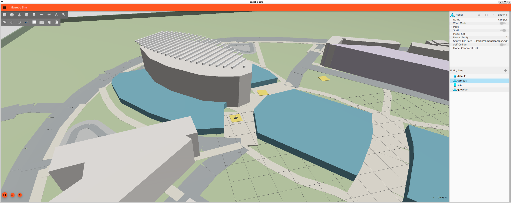

*Expected campus view: Goosebot starts at IST’s south end on the yellow Home marker. The Entity Tree lists `campus`, `sun`, and `goosebot` separately.*

See [the campus guide](campus/README.md) for expected spawn, mapping, and blocked-world instructions. The wrapper reads the home pose from the world's adjacent `mission.json`, adds mesh lookup paths, and starts the server/robot/GUI in order. Keep the entire world directory together. Goosebot does **not** need `TURTLEBOT3_MODEL`.

#### Find Goosebot in the large world

The supplied IST opening camera looks inward from **+x (south)**, so the south entrance is in the foreground. Restart the simulator after pulling camera/world changes; an explicit custom `--gui-config` can override the world's GUI settings. Orbiting the camera changes which entrance is nearest.

**To inspect Goosebot:**

1. Collapse `ist_building` (IST) or `campus` (campus) in the Entity Tree.
2. Right-click the separate **`goosebot`** entry.
3. Click **Move To**, the first item at the top of the menu. This moves the **camera**, not the robot; it is not inside the `View >` submenu.
4. Put the pointer in the 3-D scene and scroll the mouse wheel upward to zoom closer. Scroll downward to zoom out.

<details>
<summary>Example — where to find Move To in Gazebo</summary>

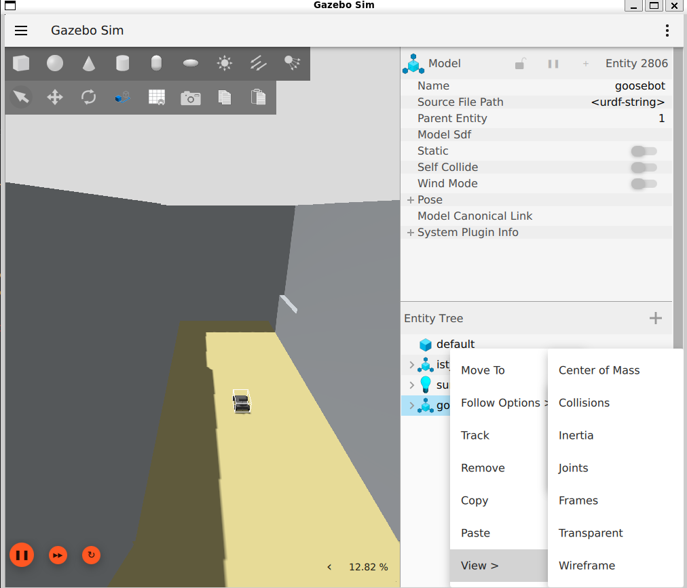

Right-click **goosebot** in the Entity Tree, then click **Move To**, the first menu item. It moves the camera, not the robot. Menu appearance can vary slightly by Gazebo version.

</details>

At whole-building zoom, the roughly 20 cm Goosebot can be only a few pixels wide. Selecting a tree entry highlights it but does not by itself move the camera.

IST starts Goosebot at **(24.85, 0)** in the centre of the **south entrance passage**, facing inward toward −x (yaw π).

<details>
<summary>Troubleshooting — robot missing, too small, or absent from the Entity Tree</summary>

**1. Check the model and actual pose.** Keep Terminal 1 running and open another Ubuntu/WSL terminal:

```bash
source /opt/ros/jazzy/setup.bash
gz model --list
gz model -m goosebot --pose
```

Use the exact name printed by the list if your local launch differs, such as `custom_bot`. The course wrapper requests the entity name `goosebot`; `custom_bot` can still appear as the URDF model name in conversion warnings. See [Gazebo's model-command reference](https://gazebosim.org/api/sim/8/model_command.html).

| Observation | What to check next |
| --- | --- |
| `goosebot` is listed at approximately (24.85, 0) with a small positive Z | It exists near home. Collapse `ist_building`, select the separate `goosebot` entry, and focus/zoom on the robot. |
| Pose has a large negative Z | It may have fallen through the floor. Save the pose and simulator log for troubleshooting. |
| Pose has different XY | Compare with the launch's printed spawn line; the robot may have moved, or a different launch/mission file is in use. |
| Terminal lists the robot but the GUI does not | Check whether the GUI is stale or connected to another running server; use the clean restart below. A GUI label such as `default` alone does not establish which server it displays. |
| No robot is listed | Inspect the full `[create-...]` log for creation errors/timeouts and check that only the intended server is running. |

**2. Restart cleanly if the GUI and terminal disagree.** Stop all old simulator launches, including the maze/warm-up, with Ctrl+C in their launch terminals. Close all Gazebo windows. Check for remaining processes:

```bash
pgrep -af 'gz sim|gz-sim'
```

No output means this check found no matching processes. If it lists processes, identify and stop the leftover course simulation before relaunching; ask the instructor if unsure. Closing a window alone may leave its server running. Then launch Step 3 **once**. Do not repeatedly spawn extra robots to solve a camera problem.

**3. Read the messages correctly.** `Entity creation successful` confirms creation was accepted, not that the robot stayed at its initial pose or is visible at the current zoom. The `gz_frame_id ... not defined in SDF. Copying ...` warning alone is not a spawn failure; retain that field and verify the ROS scan frame in Step 4.

If the problem remains, share the launch's printed spawn line, full create log, model list, robot pose, and remaining-process output. These distinguish visibility, wrong-pose, and multiple-server problems.

</details>

<a id="goosebot-readiness-check"></a>

### 4. Short Goosebot readiness check — before mapping

Use the IST or campus world already running from Step 3. Confirm manual motion, LiDAR, RobotModel and TF here; no separate practice arena or perfect-map Nav2 goal is required. No extra screenshot, report or video is required for this check.

**Terminal 2 — sensor and TF:**

```bash
source /opt/ros/jazzy/setup.bash
source ~/goosebot_ws/install/setup.bash
ros2 topic echo /scan --once --field header.frame_id
ros2 topic hz /scan
```

**Command breakdown**

| Command / part | What it does |
|---|---|
| `ros2 topic echo /scan` | Subscribes to the LiDAR topic and prints received message contents. |
| `--once` | Prints one received message and exits; it may wait if no sample arrives. |
| `--field header.frame_id` | Prints only the scan's frame name, rather than the full range array. |
| `ros2 topic hz /scan` | Estimates message arrival rate in wall-clock time. Keep it running for several samples, then Ctrl+C. |


<details>
<summary>Troubleshooting — /scan does not appear to be published yet</summary>

This warning means ROS has not discovered a publisher/type for `/scan`; it is different from a TF warning. Press Ctrl+C to stop a waiting echo/hz command before running another check. Keep Gazebo playing and allow sensor/bridge startup time.

**First check which installed model you are using:**

```bash
source /opt/ros/jazzy/setup.bash
source ~/goosebot_ws/install/setup.bash
ros2 pkg prefix goosebot_0
ros2 run xacro xacro "$(ros2 pkg prefix goosebot_0)/share/goosebot_0/urdf/robot.urdf.xacro" -o /tmp/goosebot_loaded.urdf
python3 - <<'PY'
import xml.etree.ElementTree as ET
r = ET.parse('/tmp/goosebot_loaded.urdf').getroot()
print('LiDAR link present:', r.find("link[@name='lidar_link']") is not None)
for s in r.findall("gazebo/sensor"):
    print('sensor:', s.get('name'), 'topic:', s.findtext('topic'))
PY
```

Expect your intended workspace prefix, `LiDAR link present: True`, and `lidar_sensor` on `scan`. If absent, the source edit was incomplete or the wrong package is installed/sourced. Rerun the Step 1 build helper, rebuild, source the correct workspace, and restart Terminal 1. A robot already in Gazebo will not acquire a new sensor merely because you saved the file.

**Then separate Gazebo output from ROS bridging:**

```bash
gz topic -l
ros2 topic list -t
ros2 topic info /scan --verbose
```

Find the new LiDAR's Gazebo scan topic in the list, distinct from `/tof_front/scan`. If it is `/scan`, inspect it with `gz topic -i -t /scan` and `gz topic -e -t /scan` (Ctrl+C after messages arrive). If Gazebo lists a different fully qualified scan topic, use that exact name when inspecting it and in the bridge's `gz_topic_name`; the ROS topic should remain `/scan`.

| Result | Next step |
| --- | --- |
| Installed description has no new LiDAR | Fix/source the correct model and respawn. |
| LiDAR is in the description but no Gazebo scan messages | Check the sensor block is attached to `lidar_link`, `always_on=true`, simulation is playing, and Terminal 1 has no sensor/render errors. Both supplied IST worlds include the Sensors system. |
| Gazebo scan messages arrive but ROS `/scan` is absent | Check the installed `config/ros_gz_bridge.yaml` has the new top-level bridge entry supplied by the Step 1 helper, with the exact Gazebo topic. Restart the launch to reload it and check Terminal 1 for bridge errors. |
| ROS scan messages arrive but RViz cannot display them | Continue with the TF/frame checks below; this is now a different problem. |

Do not change `gz_frame_id` or add another odometry publisher to fix a missing ROS topic. Share the installed-description check, topic lists and bridge errors if it remains unresolved.

</details>

Expect `lidar_link`. A 10 Hz simulated sensor may measure only about 1.3 Hz in wall-clock time when Gazebo runs at 13% real time. Stop `hz` with Ctrl+C, then run these one at a time (Ctrl+C after each check):

```bash
ros2 run tf2_ros tf2_echo base_footprint lidar_link
ros2 run tf2_ros tf2_echo odom base_footprint
ros2 topic echo /odometry/filtered --once
```

**Command breakdown**

| Command / part | What it does |
|---|---|
| `tf2_ros tf2_echo` | Runs the TF inspection program. |
| `base_footprint lidar_link` | Reports the LiDAR frame's pose relative to the robot footprint; checks the sensor mount. |
| `odom base_footprint` | Reports the robot footprint's pose relative to odometry; checks the moving robot transform. |
| `ros2 topic echo /odometry/filtered --once` | Shows one local EKF odometry estimate. TF and odometry checks do not start SLAM. |


Expect numerical transforms and odometry. A brief startup warning can resolve when TF arrives; persistent warnings need fixing. If the reported scan frame differs, correct the sensor frame/TF configuration. For a sensor-only RViz check, open `rviz2 --ros-args -p use_sim_time:=true` in a separate sourced terminal, use Fixed Frame `odom`, and add LaserScan `/scan` and RobotModel `/robot_description` using the click-by-click RViz setup in Step 5 below. Leave Map disabled until SLAM starts. Verify walls appear in the correct direction as you drive.

<details>
<summary>Examples — successful LiDAR scan and TF checks</summary>

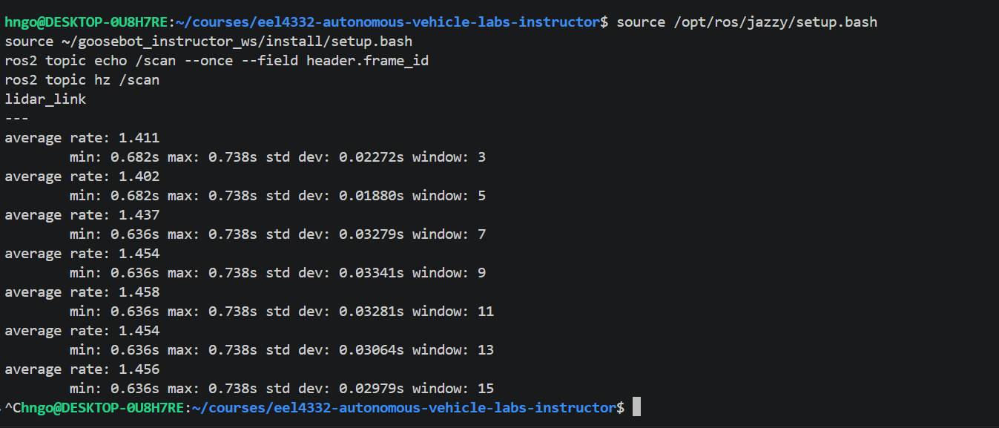

Expect **lidar_link**. The example's approximately 1.4 Hz is wall-clock delivery during slow simulation, not the configured simulated scan frequency.

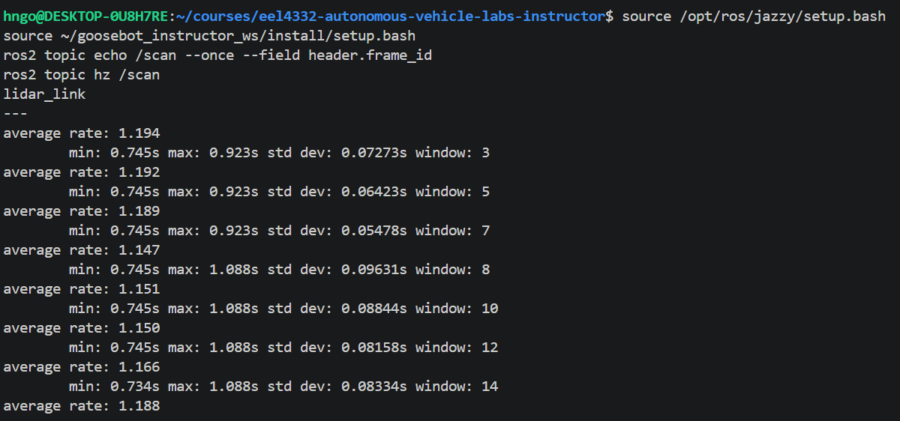

For the supplied mount, **base_footprint → lidar_link** has translation **(0, 0, 0.21) m** and zero rotation. Initial discovery warnings resolved once numerical output appeared; persistent warnings still need attention.

</details>

**Finish the readiness check in the current project world:**

1. Open RViz in **Terminal 3** using the commands below. On your first run, use the Step 5 click-by-click instructions to add **LaserScan** on `/scan`, **RobotModel** on `/robot_description`, and **TF**. Set **Fixed Frame** to `odom` and leave **Map disabled** until SLAM starts. If you already saved a mapping layout, you may load it with `-d ~/rviz_configs/goosebot_mapping.rviz`, then temporarily set its fixed frame to `odom` and disable Map.

```bash
source /opt/ros/jazzy/setup.bash
source ~/goosebot_ws/install/setup.bash
rviz2 --ros-args -p use_sim_time:=true
```

2. In **Terminal 4**, start keyboard driving:

```bash
source /opt/ros/jazzy/setup.bash
source ~/goosebot_ws/install/setup.bash
ros2 run teleop_twist_keyboard teleop_twist_keyboard \
  --ros-args -p speed:=0.81 -p turn:=1.73
```

**Command breakdown**

| Command / part | What it does |
|---|---|
| `teleop_twist_keyboard teleop_twist_keyboard` | Runs keyboard control; focus this terminal before pressing movement keys. |
| `speed:=0.81` / `turn:=1.73` | Sets the starting linear speed to 0.81 m/s and turn speed to 1.73 rad/s. |
| `i`, `j` / `l`, `k` | Move forward, turn left/right, and stop, respectively. Changing a speed setting alone does not move the robot. |


3. Focus Terminal 4. With Shift/Caps Lock off, press lowercase `i` to drive forward briefly, `j` / `l` to turn, and `k` to stop. Check nearby free space first. The keys `w/x` and `q/z` change speed settings; they do not command movement. Confirm Goosebot moves in Gazebo, scan points outline nearby structures, and RobotModel/TF have no persistent transform errors.
4. Press `k`, then Ctrl+C to stop teleop. Keep Gazebo and RViz running. Continue directly to Step 5: start SLAM in Terminal 2, enable Map on `/map`, and change RViz's fixed frame to `map` once SLAM supplies that frame. Reuse Terminal 4 for mapping teleop. Do not start the perfect-map/ground-truth navigation launch.

If the robot will not move, check terminal focus, lowercase movement keys, Gazebo playing, and competing velocity publishers. The [optional practice arena](#goosebot-warm-up) is available for further troubleshooting; it is not a prerequisite.

### 5. Build and save your map

**Terminal 2 — mapping** (after the checks):

```bash
source /opt/ros/jazzy/setup.bash
source ~/goosebot_ws/install/setup.bash
cd ~/courses/eel4332-autonomous-vehicle-labs
ros2 launch slam_toolbox online_async_launch.py use_sim_time:=true \
  slam_params_file:="$PWD/final_project_simulation/goosebot/slam_goosebot.yaml"
```

**Command breakdown**

| Command / part | What it does |
|---|---|
| `slam_toolbox online_async_launch.py` | Starts online asynchronous LiDAR SLAM; it builds a map while estimating the robot's pose. |
| `use_sim_time:=true` | Makes the mapper use the simulation clock. |
| `slam_params_file:=.../slam_goosebot.yaml` | Loads the course SLAM settings, including frame/sensor configuration. This is a parameter file, not a saved map. |


**Start these terminals in order:** Terminal 2 runs SLAM, Terminal 3 shows RViz, and Terminal 4 provides manual driving. Configure RViz before moving the robot so you can watch the map grow.

**Terminal 3 — visualization:**

```bash
source /opt/ros/jazzy/setup.bash
source ~/goosebot_ws/install/setup.bash
rviz2 --ros-args -p use_sim_time:=true
```

#### RViz setup — add displays and select their topics

If RViz is already open with `use_sim_time:=true`, reuse it. Otherwise run the Terminal 3 command above. Keep Gazebo and the Step 5 SLAM launch running.

**1. Show the Displays panel and choose the fixed frame.**

- If the left panel is missing, select **Panels → Displays**.
- Expand **Global Options** at the top. Click the value beside **Fixed Frame**, type `map`, and press Enter.
- Use `map` during SLAM and saved-map navigation. For the earlier Step 4 sensor-only check, use `odom` and leave Map disabled: no map is being built yet.
- RViz displays ROS messages, not the Gazebo building automatically. A blank grid does not mean the Gazebo world is missing.

**2. Add Map and set its Topic.**

1. Click **Add** at the bottom of the Displays panel.
2. Select the **By display type** tab, expand **rviz_default_plugins** if needed, choose **Map**, and click **OK**.
3. In the Displays panel, expand the new **Map** row with its small triangle.
4. Find the editable **Topic** property below Status. Click the blank value cell to its right, select/type **`/map`**, and press Enter. Adding a display by type does **not** necessarily choose its topic.
5. Keep its checkbox enabled. Once SLAM publishes, expect **Status: Ok** and a grey/white/black occupancy map that grows as you drive.

**“Error subscribing: Empty topic name” means the Topic cell is blank.** Set the editable Topic property; the red `Status → Topic` line reports an error and is not the field to edit. “No map received” after setting `/map` means no map message has arrived yet; check that Step 5 SLAM is running and `ros2 topic list -t` contains `/map`. Changing RViz settings alone does not create a map.

For saved-map navigation, use `/map` as well. The optional perfect-map warm-up uses **`/projected_map`** instead; do not carry that warm-up topic into final-project SLAM. If a running map publisher exists but no map arrives, inspect the Map Topic's QoS settings; the supplied map workflows use **Reliable / Transient Local**. Allow startup time and check the display's expanded Status.

**3. Add LaserScan and select the LiDAR topic.**

1. Click **Add → By display type → rviz_default_plugins → LaserScan → OK**.
2. Expand **LaserScan**, click its editable **Topic** value, choose/type **`/scan`**, and press Enter.
3. Keep its checkbox enabled. Expand Topic if needed to see QoS settings; **Best Effort** reliability is suitable for receiving sensor scans, including a Reliable publisher.
4. If points are too small, set **Style** to **Points** and increase **Size (Pixels)**, for example to `3`, if those properties are shown.
5. Expect points outlining nearby walls, not an image of the building. Do not choose `/tof_front/scan`, which is only the original narrow forward beam.

**4. Add RobotModel — it is a display type, not a topic name.**

1. Click **Add**, then select **By display type** (not **By topic**).
2. Under **rviz_default_plugins**, scroll to **RobotModel**: it is written as one word. Select it and click **OK**. If a filter/search box is shown, clear it or type `RobotModel`.
3. Expand the new **RobotModel** row in Displays.
4. Set **Description Source → Topic**.
5. Set **Description Topic → `/robot_description`**, then press Enter. This uses the expanded robot description published by `robot_state_publisher`; do not enter the Xacro filename here.
6. Keep the display enabled and **Visual Enabled** checked. If Description Topic exposes QoS settings, use **Reliable / Transient Local** to receive the retained description.
7. Expect Goosebot's chassis, wheels and added sensor, with Status Ok once its transforms are available. This does not add another robot to Gazebo.

If RobotModel is absent from the By topic tab, that is not evidence the robot description is missing: use **By display type** as above. If the display reports a transform error, return to Step 4; a valid description still needs TF to position every link.

**5. Add TF and choose an easy view.**

- Use **Add → By display type → rviz_default_plugins → TF → OK** to show coordinate frames. Toggle TF off if its axes/text clutter the map.
- In the **Views** panel, select **TopDownOrtho** for a flat overhead map, or keep Orbit. Use **Panels → Views** if the panel is hidden.
- Zoom with the mouse wheel over the 3-D view. Goosebot can be very small compared with IST; during sensor inspection you can set the view's **Target Frame** to `base_footprint` to keep the robot centred.
- Confirm scan points follow the mapped wall edges rather than forming a shifted/rotated duplicate.

**6. Save your mapping layout and reuse it next time.**

On your first run, add and configure the displays above yourself so you learn the process. Once they work:

1. In a terminal, run `mkdir -p ~/rviz_configs`.
2. In RViz, choose **File → Save Config As…** and save as `~/rviz_configs/goosebot_mapping.rviz` (use your home directory in the file chooser).
3. On later mapping sessions, replace the generic RViz command with:

```bash
rviz2 -d ~/rviz_configs/goosebot_mapping.rviz \
  --ros-args -p use_sim_time:=true
```

**Command breakdown**

| Command / part | What it does |
|---|---|
| `rviz2` | Opens the visualization program. |
| `-d .../goosebot_mapping.rviz` | Loads your saved mapping displays, topic choices and layout. Use the separate navigation configuration during Step 6. |
| `--ros-args -p use_sim_time:=true` | Uses simulation time for visualizing timestamped sensor and TF data. Loading a layout does not start SLAM or save its map. |


Keep the simulator and SLAM commands unchanged. You can skip adding the displays again when this file loads. Use **File → Save Config** (Ctrl+S) after later layout changes. A custom file is not automatically selected by every launch; explicitly use `-d` or **File → Open Config**. The configuration saves display/topic/QoS settings, tools and the view—not the SLAM map or running nodes. Save the map separately below.

<details>
<summary>RViz quick check — blank map, missing robot, or red display status</summary>

| Symptom | Check |
| --- | --- |
| Map: Empty topic name | Edit Map's Topic property to `/map`, not the Status error row. |
| Map: No map received | Start SLAM in Step 5, or the saved-map navigation launch in Step 6; confirm `/map` is published. |
| Fixed Frame `map` does not exist | Before SLAM use `odom`; during SLAM check the SLAM node and its `map → odom` transform. |
| Cannot find RobotModel | Add → **By display type**, expand rviz_default_plugins, select **RobotModel**. |
| RobotModel has no description | Set Description Source Topic and Description Topic `/robot_description`; verify robot_state_publisher remains running. |
| Scan exists but is not visible | Select `/scan`, check TF/status and reliability, then increase point size or zoom closer. |
| RobotModel/scan transform errors | Use simulation time in RViz and complete Step 4 TF checks; adding displays does not repair missing transforms. |

</details>


**Terminal 4 — driving:**

```bash
source /opt/ros/jazzy/setup.bash
source ~/goosebot_ws/install/setup.bash
ros2 run teleop_twist_keyboard teleop_twist_keyboard
```

Click inside Terminal 4 and follow **its printed key layout** (different from TurtleBot teleop). Start slowly. Map all mission routes and revisit an earlier area. For IST, map a connected hallway route covering your two destinations, a revisit and an alternative route around the test barrier; classroom interiors are optional. For campus, map a connected route near IST and neighboring crossings covering two chosen destinations. Full-world exploration is unnecessary.

<details>
<summary>Example — IST mapping in progress</summary>

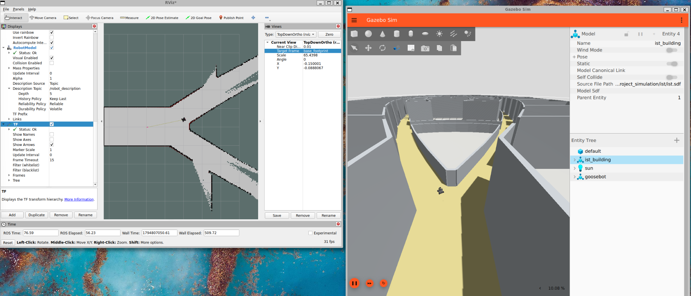

Early exploration produces a partial map around the entrance. Grey/white explored space, dark wall edges and red scan points should align. Unvisited space remains unknown. RobotModel and TF show **Status: Ok**. Continue exploring the mission routes before saving; you do not need to reproduce the exact pixels or view.

</details>

<details>
<summary>Example — campus mapping in progress</summary>

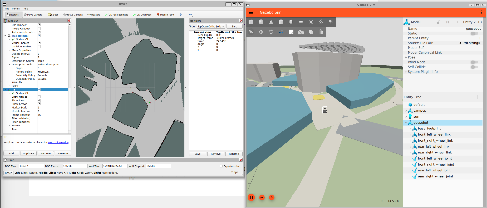

RViz on the left shows the partial occupancy map around the campus buildings; Gazebo on the right shows the same simulated environment. Map boundaries should follow the nearby building outlines, with RobotModel and TF reporting **Status: Ok**. Unexplored space remains unknown. Continue driving the delivery routes and alternative crossings before saving; your map and view need not match this screenshot exactly. The generic **2D Goal Pose** tool visible here is for this mapping layout; use the **Nav2 Goal** layout in Step 6 for navigation.

</details>

Stop robot motion. In another sourced terminal, save while SLAM and Gazebo remain running:

```bash
source /opt/ros/jazzy/setup.bash
source ~/goosebot_ws/install/setup.bash
cd ~/courses/eel4332-autonomous-vehicle-labs/final_project_simulation
mkdir -p results
MAP_NAME=ist_map  # Part B: change this to campus_map
ros2 run nav2_map_server map_saver_cli -f "$PWD/results/$MAP_NAME" \
  --ros-args -p use_sim_time:=true
```

**Command breakdown**

| Command / part | What it does |
|---|---|
| `mkdir -p results` | Creates the output directory if it does not exist. |
| `MAP_NAME=ist_map` | Sets a shell variable; use `campus_map` for Part B. Keep the assignment and save command in the same terminal. |
| `nav2_map_server map_saver_cli` | Runs a one-time map-saving program while SLAM is publishing `/map`. |
| `-f "$PWD/results/$MAP_NAME"` | Sets the output basename. The saver writes a map YAML and its image; keep them together. |
| `--ros-args -p use_sim_time:=true` | Sets simulation time on the map-saving program. |


Use `ist_map` for Part A and `campus_map` for Part B so neither map overwrites the other. Keep each YAML and its image together. For the viewing command below, substitute `campus_map` in Part B. To view the image, use an Ubuntu image viewer, or `python3 -c "from PIL import Image; Image.open('results/ist_map.pgm').save('results/ist_map.png')"` from this directory and open the PNG in VS Code (install `python3-pil` if needed). The PNG is a viewing copy; keep the original map files.

### 6. Restart and navigate on your saved map

Switch from the mapping session to a fresh localization/navigation session:

1. Save the map in Step 5, then stop teleop, SLAM, RViz and the simulator with Ctrl+C.
2. **Terminal 1:** relaunch the same baseline world using Step 3. **Do not restart SLAM.**
3. **Terminal 2:** start the AMCL/Nav2 command below and leave it running.
4. **Terminal 3:** reopen RViz using the command below while Nav2 starts; confirm the saved map and set **2D Pose Estimate**. Keep Terminal 4's teleop stopped.

**Opening RViz before Nav2 is allowed but does not prevent missing-map/TF warnings.** RViz only displays data and sends the initial-pose estimate. Brief `map frame does not exist` warnings can occur before AMCL receives its map, scans and initial pose. Do not wait for every navigation node to become active before opening RViz and initializing localization. Persistent **no map received** warnings require checking map loading, not merely changing startup order.

**Terminal 2 — AMCL/Nav2:**

The command below loads the IST map. **For Part B, replace `results/ist_map.yaml` with `results/campus_map.yaml`** in this command and any map-load troubleshooting command. Never localize campus against the IST map.

```bash
source /opt/ros/jazzy/setup.bash
source ~/goosebot_ws/install/setup.bash
cd ~/courses/eel4332-autonomous-vehicle-labs
ros2 launch "$PWD/final_project_simulation/goosebot/navigation.launch.py" \
  map:="$PWD/final_project_simulation/results/ist_map.yaml"
```

**Command breakdown**

| Command / part | What it does |
|---|---|
| `.../goosebot/navigation.launch.py` | Starts the course saved-map AMCL/Nav2 wrapper; keep this terminal running. |
| `map:=.../results/ist_map.yaml` | Selects your saved indoor map. Use `campus_map.yaml` for Part B; the YAML points to its map image. |
| Automatic map loading | The wrapper supplies the map to the map server. RViz and Gazebo are started separately; a manual load-map call is not a normal step. |


The course wrapper validates the saved YAML and its referenced image, then supplies the absolute map path both as Nav2's `map` argument and explicitly in a temporary `map_server.ros__parameters.yaml_filename`. Your original configuration is preserved. Expect **Course navigation map: ...; image: ...** with the selected files. Missing files stop startup with an explanation. The wrapper sets `slam=False`, simulation time, autostart and non-composed AMCL/Nav2; do not start a second Nav2 launch alongside it. It does not start RViz or Gazebo.

After pulling this course update, no ROS rebuild is needed for this local-file launcher. Stop the previous AMCL/Nav2 launch with Ctrl+C before using it; keep the correct simulator running. If your existing saved map has a different name, point `map:=` to that actual YAML (do not rename just the YAML without checking its image reference).

Leave Terminal 2 running; it prints logs and opens no window. Continue to RViz and set the initial pose even if costmaps are waiting for `map` TF. Once localization and navigation finish activating, expect **Managed nodes are active**. Confirm `results/ist_map.yaml` and its image exist and match the selected world.

In **Terminal 3**, close old mapping RViz windows and explicitly load the standard **Nav2** RViz layout:

```bash
source /opt/ros/jazzy/setup.bash
source ~/goosebot_ws/install/setup.bash
rviz2 -d "$(ros2 pkg prefix nav2_bringup)/share/nav2_bringup/rviz/nav2_default_view.rviz" \
  --ros-args -p use_sim_time:=true
```

**Command breakdown**

| Command / part | What it does |
|---|---|
| `$(ros2 pkg prefix nav2_bringup)` | Finds where the installed Nav2 bringup package lives. |
| `-d .../nav2_default_view.rviz` | Loads Nav2's supplied RViz layout, including Nav2 Goal and the Navigation 2 panel. |
| `2D Pose Estimate` in RViz | Provides AMCL with an initial pose for this session; the saved layout does not restore localization. |


**Expected RViz tools:** **Nav2 Goal**, **2D Pose Estimate**, and the **Navigation 2** panel. A generic `rviz2 --ros-args ...` window is useful for Step 5 mapping but may only show **2D Goal Pose**. Use the explicit `-d` command above for navigation. If the Nav2 tool/panel is missing, inspect RViz's terminal for plugin-loading errors rather than sending goals from a leftover mapping window.

**Save a separate navigation layout:** after confirming **Nav2 Goal**, **2D Pose Estimate**, the **Navigation 2** panel, Map `/map`, and LaserScan `/scan`, use **File → Save Config As…** to save `~/rviz_configs/goosebot_navigation.rviz`. Adjust/add any displays you need yourself on this first run. Do not overwrite the mapping layout or the system Nav2 configuration. On later navigation sessions, replace the standard-layout RViz command above with:

```bash
rviz2 -d ~/rviz_configs/goosebot_navigation.rviz \
  --ros-args -p use_sim_time:=true
```

Start Gazebo and AMCL/Nav2 as usual and set **2D Pose Estimate** for the new session. Loading an RViz configuration does not start navigation, load the map server, or restore AMCL localization. Keep the warm-up's `/projected_map` layout separate from these final-project `/map` layouts.

<details>
<summary>Troubleshooting — saved map or map frame still missing in Step 6</summary>

In another sourced terminal, check:

```bash
ros2 lifecycle get /map_server
ros2 lifecycle get /amcl
ros2 param get /map_server yaml_filename
ros2 topic info /map --verbose
```

**Command breakdown**

| Command / part | What it does |
|---|---|
| `ros2 lifecycle get /map_server` / `/amcl` | Reports each managed node's lifecycle state; expect `active` after successful initialization. |
| `ros2 param get /map_server yaml_filename` | Prints the actual map YAML configured on the running map server. |
| `ros2 topic info /map --verbose` | Shows the map topic type, publisher/subscriber endpoints and QoS; it does not print map pixels. |


The map server should become **active**, with `yaml_filename` equal to the absolute YAML printed by the course launcher. Map loading is automatic; **do not make a manual load-map service call part of the normal procedure**. If the path is blank or different, stop the old AMCL/Nav2 process and confirm only one map server is running before relaunching the updated wrapper. Check `ros2 node list` for duplicate-node warnings. If startup fails, inspect the first map-server error, the YAML image path, and file permissions. A valid YAML alone is insufficient if its image is missing or unreadable.

In RViz, **Map → Topic** must be `/map`, with Reliable / Transient Local QoS if a retained map is not displayed. Do not use the warm-up's `/projected_map`. AMCL still needs scans, TF and **2D Pose Estimate** to supply `map → odom`; loading a map or opening RViz does not initialize the pose. Do not restart SLAM or add a static `map → odom` publisher to hide a missing transform. Brief transform warnings before initialization can occur.

</details>

Use **2D Pose Estimate** at the starting position, dragging in its heading direction. Enable Map and LaserScan `/scan`. **Alignment means live scan points overlap the saved map's wall edges** around several sides of the robot; they should not form a shifted/rotated outline. Costmap inflation colors are clearance margins, not the physical wall. If alignment is poor, correct the initial pose before sending goals. AMCL now owns `map → odom`; the EKF still owns `odom → base_footprint`.

Send a nearby **Nav2 Goal** first, then visit **two chosen destinations and return home in each world**. Wait 3 seconds at each delivery. Clicking goals in RViz is sufficient; autonomous mission sequencing using the existing client scaffold is optional. Keep keyboard teleop stopped during navigation.

Select destinations and home on **your SLAM map**. The `mission.json` coordinates describe Gazebo/the geometric reference map, and may differ from your SLAM frame. Do not blindly copy them. Choose IST hallway destinations reachable within your mapped route. Campus destinations may be two safe points near IST; the remote pads are optional.

<details>
<summary>Example — saved-map localization and navigation in progress</summary>

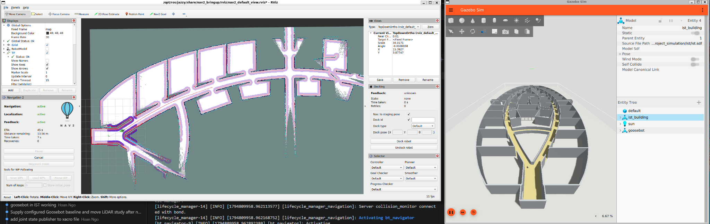

Expect **Navigation: active**, **Localization: active**, and an evolving path/costmap around the mapped walls. This screenshot shows **Feedback: active**—navigation is in progress, not yet proof that the goal was reached. For completion, wait for reached/succeeded feedback and verify Goosebot stopped at the destination. The current partial map is an example, not a substitute for exploring your mission routes.

</details>

### 7. Optional — test a blocked route

No submission or grading requirement.

For Part A, stop all launches and restart Step 3 with `ist/ist_blocked.sdf`. A campus repetition using `campus/campus_blocked.sdf` is optional. Keep your **baseline saved map**, robot, settings, and goals. Relaunch AMCL/Nav2 and initialize the pose again; do not remap the barrier.

For IST the barrier crosses the upper hallway near the central junction at (0.5, 8.2) m; the lower loop and connecting passages provide alternatives. For campus it blocks one causeway. Check that live scans/costmaps detect it. Describe the actual result: detour, changed global path, recovery, stopping, or failure. A detour alone does not establish which algorithm replanned.

### 8. Optional — compare one indoor LiDAR setting

No submission or grading requirement.

**If you choose this optional extension**, do it after IST navigation and restore defaults before campus. You do not need to build a sensor from scratch.

1. Save/commit your working baseline. Open `final_project_simulation/src/goosebot_0/urdf/robot.urdf.xacro` in VS Code.
2. Find `<sensor type="gpu_lidar" name="lidar_sensor">` and inspect its settings:

   | Setting inside the LiDAR block | Baseline | Meaning |
   | --- | --- | --- |
   | `update_rate` | 10 | Scans per simulated second. |
   | `horizontal/samples` | 720 | Number of directions measured per scan. |
   | `horizontal/min_angle`, `max_angle` | −3.14159, +3.14159 | Horizontal field of view in radians. |
   | `vertical/samples` | 1 | A single plane for 2-D SLAM. |
   | `range/min`, `max` | 0.12, 12.0 | Measurement limits in metres. |

3. Change **one setting only**: for example horizontal samples **720 → 360**, or update rate **10 → 5**. Keep the original ToF and the `scan` topic/`lidar_link` frame unchanged. Do not globally replace values throughout the file.
4. Save, stop launches with Ctrl+C, rebuild using the Step 1 helper, source your workspace and relaunch Step 3. The helper preserves your complete LiDAR's edited settings.
5. Inspect `/scan` in RViz and compare with the baseline. Fewer samples give wider angular spacing; a lower update rate gives fewer scans per simulated second. With a slow Gazebo real-time factor, wall-clock `ros2 topic hz /scan` is lower than the sensor's configured rate.
6. Restore the baseline setting before your final delivery demonstration. No screenshots or written comparison are required.

<details>
<summary>Optional — how the LiDAR link, joint, sensor and bridge are constructed</summary>

See [the beginner Xacro reference](goosebot/LIDAR_REFERENCE.md) for the complete annotated XML and field-by-field explanation. Building another sensor or changing its mount is optional, not a prerequisite for this project.

</details>

### 9. Part B — inspect GPS outdoors

**What you must do:** inspect the supplied GPS configuration, run the message checks below, collect fixes at three stationary campus locations, and explain the observations in your shared system explanation.

**No GPS code needs to be added for the supplied project.** Keep the existing Xacro, bridge and campus world settings. This is an inspection and measurement activity. Complete campus mapping and AMCL/Nav2 first, and keep the baseline LiDAR settings. This activity adds **GPS observations** to the outdoor experiment; the required navigation remains LiDAR/AMCL-based. GPS fusion is optional.

#### 9.1. Understand the three pieces

The pinned Goosebot already contains a `gps_link`, a `navsat` sensor named `gps_sensor`, and a `/gps/fix` bridge. Do not add a second GPS sensor or bridge. A sensor declaration alone is insufficient: the **world** must also run the NavSat system.

| Piece | Location | What to inspect |
|---|---|---|
| Robot sensor | `final_project_simulation/src/goosebot_0/urdf/robot.urdf.xacro` | `gps_link`, `gps_sensor`, topic `gps/fix`, frame `gps_link`, update rate and noise |
| ROS bridge | `final_project_simulation/src/goosebot_0/config/ros_gz_bridge.yaml` | `gps/fix`, `sensor_msgs/msg/NavSatFix`, `gz.msgs.NavSat`, `GZ_TO_ROS` |
| World support | `final_project_simulation/campus/campus.sdf` and `campus_blocked.sdf` | NavSat system and WGS84 spherical coordinates |

In VS Code search the Xacro for `gps_sensor`, then the bridge YAML for `gps/fix`. Record what your files actually contain. The supplied sensor uses **5 Hz in simulation**, horizontal Gaussian noise standard deviation **0.000015 degrees** (about 1.67 m latitude and 1.47 m longitude at campus latitude), and vertical standard deviation **3 m**. Gazebo Sensors 8 applies horizontal position noise in degrees; the course build helper corrects the upstream `1.5` default, which otherwise produces enormous jumps. Existing custom models may differ; report your values.

**Inspect the campus world file, not the Xacro:** open `final_project_simulation/campus/campus.sdf` in VS Code and search for `gz-sim-navsat-system` and `spherical_coordinates`. Both are already present directly under `<world>`. The Xacro defines the robot-mounted sensor; the world file supplies the geographic reference and the Gazebo NavSat system.

<details>
<summary>Reference only — XML already present in the campus .sdf world file; do not paste it into Xacro</summary>

The existing world-level settings are:

```xml
<plugin filename="gz-sim-navsat-system" name="gz::sim::systems::NavSat"/>
<spherical_coordinates>
  <surface_model>EARTH_WGS84</surface_model>
  <world_frame_orientation>ENU</world_frame_orientation>
  <latitude_deg>28.1485</latitude_deg>
  <longitude_deg>-81.8495</longitude_deg>
  <elevation>0</elevation>
  <heading_deg>0</heading_deg>
</spherical_coordinates>
```

**Do not copy this XML into `robot.urdf.xacro` or paste another copy into the world.** For the supplied files, no edit or rebuild is needed for this inspection. If a block is missing from an older checkout, first update `final-project-indoor-outdoor` using the instructions at the top of this README and restart Gazebo. Custom-world modifications are optional and outside this required activity.

</details>

This example follows [Gazebo Harmonic's spherical-coordinate/NavSat world](https://github.com/gazebosim/gz-sim/blob/gz-sim8/examples/worlds/spherical_coordinates.sdf). The model/bridge come from [the pinned Goosebot source](https://github.com/hoanbklucky/goose/tree/bffaf3cdf2b38f3b5a53a977064e0c787e046ff7/11_simulation/ros2_ws/src/goosebot_0).

#### 9.2. Launch and inspect messages

Stop SLAM/Nav2/teleop and the simulator with Ctrl+C in their launch terminals after completing campus navigation. Start a fresh **measurement-only campus session** with the same baseline world in **Terminal 1**:

```bash
source /opt/ros/jazzy/setup.bash
source ~/goosebot_ws/install/setup.bash
cd ~/courses/eel4332-autonomous-vehicle-labs
ros2 launch "$PWD/final_project_simulation/goosebot/world.launch.py" \
  world:="$PWD/final_project_simulation/campus/campus.sdf"
```

Keep Terminal 1 running. Use the keyboard-driving command in **Terminal 4** when moving between measurement locations; press `k` to stop before sampling. Keep SLAM/Nav2 stopped during these measurements. In **Terminal 2**, source the same workspace:

```bash
source /opt/ros/jazzy/setup.bash
source ~/goosebot_ws/install/setup.bash
ros2 topic info /gps/fix --verbose
ros2 topic echo /gps/fix --once
ros2 topic hz /gps/fix
```

**Command breakdown**

| Command / part | What it does |
|---|---|
| `ros2 topic info /gps/fix --verbose` | Inspects the GPS topic's message type, publisher/subscriber counts and QoS. A listed publisher alone does not prove samples are arriving. |
| `ros2 topic echo /gps/fix --once` | Receives and prints one GPS fix, including geographic coordinates and status. |
| `ros2 topic hz /gps/fix` | Measures sample arrival rate until Ctrl+C. Run it after the one-message echo has exited. |


**Expected output — check each command separately:**

| Command / field | Expected result | Meaning |
|---|---|---|
| `ros2 topic info /gps/fix --verbose` | Type `sensor_msgs/msg/NavSatFix`; normally one publisher, `ros_gz_bridge` | The Gazebo-to-ROS GPS bridge is advertised. Confirm actual samples with `echo`. |
| `Subscription count: 0` before starting echo | Allowed in this measurement-only session | No ROS consumer was subscribed at that instant; this is not a GPS failure and does not establish fusion. |
| `ros2 topic echo /gps/fix --once` | One message, then the command exits; expected `frame_id: gps_link` | A GPS sample reached ROS. The timestamp is simulation time with the supplied launch. |
| `status.status: 0` | Message reports `STATUS_FIX` | Zero here means a fix, not an error. In simulation it does not prove realistic satellite reception. |
| `status.service: 0` | May appear in bridged output | No constellation bit is set; do not interpret this as proof of a particular satellite service. |
| Latitude / longitude | Near **28.1485° / −81.8495°**, with offsets for robot position and noise | These are geographic degrees, not SLAM-map meters. Exact decimals should differ between samples. |
| Altitude | May be slightly negative | It is geographic altitude, not the GPS sensor's height above the robot. The world datum and simulated vertical noise affect it. |
| `position_covariance_type: 0`, if present | Uncertainty is unknown in the message | Even an all-zero covariance array does not establish perfect accuracy. Record the actual type. |
| `ros2 topic hz /gps/fix` | Repeated `average rate` lines until Ctrl+C | About 5 Hz only near real-time simulation; at 20% real time, roughly 1 Hz wall-clock is plausible. Do not infer the rate from the topic-info output. |

**Large jumps between nearby or stationary samples indicate a configuration problem.** In Gazebo Sensors 8, the upstream horizontal `<stddev>1.5</stddev>` is applied in degrees, causing hundred-kilometer errors. My earlier instructions incorrectly described that value as meters. The course setup now changes only that legacy GPS horizontal default to `0.000015` degrees, preserves the vertical `3.0` m setting, and leaves other custom values unchanged.

**For an existing workspace:** save your edits, update `final-project-indoor-outdoor` using the instructions at the top, stop all simulator/ROS launches with Ctrl+C, then run the Step 1 build helper again. Source the rebuilt workspace and restart the campus world. Inspect the copied Xacro: inside `gps_sensor → navsat → position_sensing → horizontal → noise`, expect `<stddev>0.000015</stddev>`. Do not replace unrelated `1.5` values. Existing fixes collected with the legacy setting should be collected again. If large offsets persist after this correction, verify the active campus world's datum and launch path. No Gazebo runtime validation of the correction was available during authoring.

Stop `hz` with Ctrl+C before the next command. Expect `sensor_msgs/msg/NavSatFix` messages containing timestamp, frame, status, latitude/longitude in **degrees**, altitude in **meters**, and covariance/type fields. Inspect `status` and `position_covariance_type`; do not assume the bridge reports known uncertainty. Record the actual frame (expected `gps_link`).

```bash
ros2 run tf2_ros tf2_echo base_footprint gps_link
```

**Command breakdown**

| Command / part | What it does |
|---|---|
| `base_footprint gps_link` | Reports the GPS sensor mount relative to the robot footprint. It does not report latitude/longitude. |
| Ctrl+C after numerical output | Ends this inspection so the terminal is available for collecting GPS samples. |


**Expected TF output for the supplied robot:**

```text
At time 0.0
- Translation: [0.000, 0.000, 0.080]
- Rotation: in Quaternion (xyzw) [0.000, 0.000, 0.000, 1.000]
- Rotation: in RPY (radian) [0.000, 0.000, 0.000]
```

This means `gps_link` is mounted **8 cm above `base_footprint`**, with aligned axes. It describes the fixed sensor mount, not the robot's geographic position or GPS accuracy. Small display differences such as `-0.000` are harmless. `At time 0.0` is normal for this static transform; it does not imply simulation is frozen. A brief initial **frame does not exist / waiting for transform** warning can occur during discovery. If numerical transforms then repeat, as in the instructor example, the warning resolved. If only warnings continue, check `robot_state_publisher`, the loaded robot description and the frame names. Edited mounts may have different values; compare against the actual fixed joints.

Stop after numerical TF appears. With a slow real-time factor, measured wall-clock Hz is lower than the 5 Hz simulated rate. The sensor frame is mounted on the robot; it is not the ROS `map` frame.

#### 9.3. Record three stationary locations

1. At Home, stop motion and collect at least five consecutive fixes. Record latitude, longitude, altitude, stamp, status and covariance type. Run `ros2 topic echo /gps/fix` in Terminal 2, let at least five messages arrive while stationary, then press Ctrl+C. A short text excerpt is sufficient.
2. Drive safely to a second visible landmark, preferably several simulation meters away, stop, and repeat.
3. Repeat at a third location. Save a screenshot or description identifying each location. Note approximate displacement and direction using your map; compare **relative movement**, not raw map coordinates against latitude/longitude.

| Location | Landmark / approximate map XY | Latitude samples (deg) | Longitude samples (deg) | Altitude (m) | Status / covariance type |
|---|---|---|---|---|---|
| A | Home | Fill from messages | Fill | Fill | Fill |
| B | Your landmark | Fill | Fill | Fill | Fill |
| C | Your landmark | Fill | Fill | Fill | Fill |

Explain why readings vary while stationary and whether the differences between locations are clear compared with that variation. The simulation does not model realistic satellite visibility, building blockage or multipath merely because buildings are drawn. Do not claim real-world GPS accuracy from these trials.

#### 9.4. Explain coordinates and actual fusion

World +x is east and +y is north (ENU). The campus now uses full-scale horizontal meters at the supplied geographic datum. Widths and footprints remain approximate; GPS profiles are synthetic, not a surveyed real-campus positioning system.

Your SLAM `map` has its own origin/heading. Latitude/longitude cannot be sent directly as a Nav2 `map`-frame XY goal or copied into an EKF's Cartesian odometry input. GPS requires geographic-to-local conversion, frame/heading alignment and covariance handling before fusion.

Inspect the course `final_project_simulation/goosebot/ekf_wheel.yaml`: does it subscribe to GPS at all? In the supplied baseline it does not; adding a bridge does not change filter inputs. Keep one owner of `map → odom` (AMCL during saved-map navigation) and one owner of `odom → base_footprint` (the local EKF). Do not add another TF publisher to make GPS appear connected.

**Required conclusion:** explain what GPS adds, what LiDAR still provides, why the required system does or does not fuse GPS, and what extra components would be needed. A working `/gps/fix` display is GPS integration/inspection evidence, not evidence of GPS-aided localization.

**Optional extension:** an instructor-validated `navsat_transform_node`/filter configuration may convert and fuse GPS. It needs consistent heading/datum, uncertainty and TF ownership; do not run a competing global filter alongside AMCL by copying an unrelated launch. See [robot_localization GPS integration](https://docs.ros.org/en/jazzy/p/robot_localization/doc/integrating_gps.html).

#### GPS troubleshooting

- Confirm campus is playing and uses the updated world. Inspect Terminal 1 for NavSat loading errors.
- Run `gz topic -l`; if `/gps/fix` exists, inspect `gz topic -i -t /gps/fix` and `gz topic -e -t /gps/fix` (Ctrl+C after receiving samples). Use the actual discovered name if different.
- No Gazebo messages: check sensor declaration, NavSat world plugin and spherical coordinates. A ROS topic publisher alone does not prove sensor samples exist.
- Gazebo messages but no ROS messages: check the installed bridge's type/direction/exact topic, correct sourced workspace, and bridge logs. Restart after configuration changes; avoid a duplicate bridge.

**INSTRUCTOR VALIDATION REQUIRED:** XML, bridge types and baseline sensor configuration were checked against source. Pilot message publication, TF, simulated rate and stationary/moving readings on course WSL before release. No Gazebo runtime test was available during authoring.

### 10. Explain and compare the complete system

Complete [SYSTEM_EXPLANATION.md](SYSTEM_EXPLANATION.md). Include a sensor/topic table, a data-flow diagram, exact EKF inputs, mapping versus localization, TF ownership, planning/control, your two sensor activities, and an indoor/outdoor comparison. Support claims with your running topics, configuration and results. This is a required course outcome, not an optional appendix.

## Success criteria

- Separate student-built IST and campus maps, each with a revisit and enough route coverage.
- AMCL scan/map alignment, two reached destinations and return home in **each** world.
- GPS messages and observations from three outdoor locations; no unsupported fusion claim.
- A correct system explanation tied to the actual configuration and evidence.

## What to submit

- **Two videos, about 2–3 minutes each:** IST and campus; mapping/revisit, indoor AMCL / outdoor GPS localization, two reached destinations and Home. Include brief sensor evidence.
- **Fork/code and evidence:** model/configuration, separate IST/campus YAML+image maps, commands/goals, ordinary-GPS/RTK-like comparison plot and error table. Exclude build/install/log, databases and bags.
- **Shared system explanation:** include each member's contribution and one problem/fix. AI assistance is allowed; test its output and explain your work in your own words.

| Assessment | Weight |
|---|---:|
| Mapping in both worlds, indoor AMCL and outdoor GPS localization | 25% |
| Navigation in both worlds | 25% |
| Ordinary-GPS/RTK-like localization experiment | 15% |
| System understanding and evidence-based explanation | 30% |
| Reproducibility and contributions | 5% |


<details>
<summary>Optional display troubleshooting — wheels or map rendering</summary>

The course helper supplies wheel joint states for RViz. If only wheel links show transform errors while chassis/LiDAR TF works, first inspect `ros2 topic echo /joint_states --once`; do not add another odometry publisher. Wheel appearance is not a mapping/localization completion requirement.

If RViz reports the shader error `active samplers with a different type refer to the same texture image unit`, save its configuration and stop only RViz. You may try `LIBGL_ALWAYS_SOFTWARE=1 rviz2 --ros-args -p use_sim_time:=true` for that process. This is a rendering diagnostic, may be slower, and is not guaranteed to fix the driver problem. Keep Gazebo/SLAM running and verify map messages independently; do not rebuild the robot to fix a graphics error.

</details>

<a id="goosebot-warm-up"></a>

<details>
<summary>Optional practice arena — manual driving and a perfect-map Nav2 goal</summary>

## Optional troubleshooting — practice arena and perfect-map navigation

**Skip this entire exercise for the normal final-project workflow.** Complete the readiness check in Step 4, then proceed directly to mapping in Step 5. This exercise does not replace the final SLAM/AMCL demonstration.

Use **native Ubuntu/WSL + ROS 2 Jazzy**, the package built in Step 1, and the **same `~/goosebot_ws` workspace** as your final. No second installation, Docker setup, or robot-model modification is required for this warm-up. If you already completed Step 1, reuse your package/workspace and preserve your edits.

This optional warm-up uses a **10 × 8 m open arena with low walls and three obstacles**, so Goosebot remains visible and there is room to steer. The original tall-wall maze is optional below. Pull the latest course repo to obtain these assets; rebuilding Goosebot is unnecessary for a world/map change.

<details>
<summary>Preview — simple practice arena</summary>

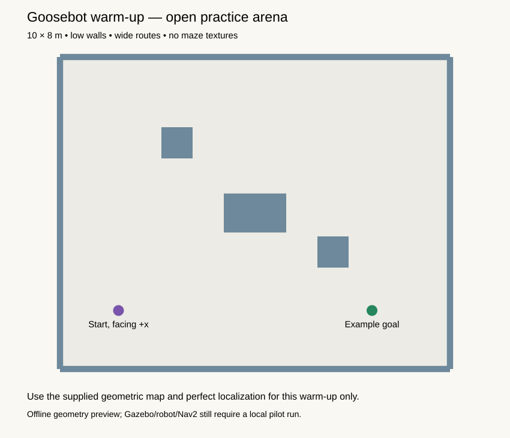

</details>

The practice arena's **perfect-map mode** provides both a pre-generated map and Gazebo ground-truth global localization. This checks Goosebot operation and Nav2 integration; **it is not SLAM and does not use AMCL**. This mode is allowed for this warm-up only; the final still requires the supplied LiDAR, your SLAM map, and AMCL.

**Terminal 1 — low-wall practice arena and Goosebot:** stop other simulator/SLAM/navigation launches first.

```bash
source /opt/ros/jazzy/setup.bash
source ~/goosebot_ws/install/setup.bash
cd ~/courses/eel4332-autonomous-vehicle-labs
ros2 launch goosebot_0 spawn_robot.launch.py \
  world:="$PWD/final_project_simulation/warmup/warmup.sdf" x:=-3.5 y:=-2.5 yaw:=0.0
```

**Terminal 2 — manual driving:**

```bash
source /opt/ros/jazzy/setup.bash
source ~/goosebot_ws/install/setup.bash
ros2 run teleop_twist_keyboard teleop_twist_keyboard \
  --ros-args -p speed:=0.1 -p turn:=0.5
```

Click inside Terminal 2 and use **lowercase keys**, with Shift and Caps Lock off. Goosebot uses different keys from TurtleBot teleop:

| Key | Effect |
| --- | --- |
| `i` | Drive forward |
| `,` | Drive backward |
| `j` / `l` | Turn left / right |
| `k` | Stop |
| `w` / `x` | Increase / decrease the linear speed setting |
| `q` / `z` | Increase / decrease both speed settings |

**A changed “speed/turn” number only changes the settings; it does not command movement.** Press `i` to move. Start at 0.1 m/s; restarting the command above resets these settings. Keep Gazebo playing and stop Nav2 while driving manually. Drive a short distance, then press `k`. Stop the robot and quit teleop with Ctrl+C. For a repeatable navigation check, stop Terminal 1 too and relaunch the practice arena at the original spawn pose.

**Terminal 2 — supplied perfect-map Nav2:** run this after teleop has stopped. Keep its original model-specific configuration; the final's LiDAR configuration is used later.

```bash
source /opt/ros/jazzy/setup.bash
source ~/goosebot_ws/install/setup.bash
cd ~/courses/eel4332-autonomous-vehicle-labs
ros2 launch goosebot_0 nav2_bringup.launch.py slam:=false use_sim_time:=true \
  map:="$PWD/final_project_simulation/warmup/reference.yaml"
```

Use this arena's `reference.yaml` with `warmup.sdf`; **do not use the maze map with the practice arena**. The supplied map is generated from obstacle geometry and is not a student SLAM result.

**Expected behavior:** Nav2 runs its navigation nodes in Terminal 2 and prints log messages; **no new window opens**. When the log says **`Managed nodes are active`**, the navigation nodes are ready. Leave Terminal 2 running and continue to Terminal 3, which opens RViz. Do not press Ctrl+C in Terminal 2 until you want to stop Nav2.

**Terminal 3 — RViz:**

```bash
source /opt/ros/jazzy/setup.bash
source ~/goosebot_ws/install/setup.bash
rviz2 -d "$(ros2 pkg prefix nav2_bringup)/share/nav2_bringup/rviz/nav2_default_view.rviz" \
  --ros-args -p use_sim_time:=true
```

Use Fixed Frame `map`; set the Map display's topic to **`/projected_map`**. Enable RobotModel with `/robot_description` and TF. The forward ToF, if displayed as LaserScan, is **`/tof_front/scan`** and gives only a narrow beam. The supplied LiDAR also publishes `/scan`; the warm-up still uses perfect-map localization. Do not initialize AMCL with 2D Pose Estimate: the ground-truth bridge supplies `map → odom` in this mode.

**Terminal 4 — check interfaces, then send one goal:**

```bash
source /opt/ros/jazzy/setup.bash
source ~/goosebot_ws/install/setup.bash
ros2 topic echo /odometry/filtered --once
ros2 topic echo /tof_front/scan --once --field header.frame_id
ros2 action send_goal /navigate_to_pose nav2_msgs/action/NavigateToPose \
  "{pose: {header: {frame_id: 'map'}, pose: {position: {x: 3.0, y: -2.5}, orientation: {w: 1.0}}}}" --feedback
```

Expect odometry/sensor messages, robot movement in Gazebo, and a **SUCCEEDED** action result. You may instead select one reachable free-space Nav2 Goal in RViz. If TF is missing, inspect `ros2 run tf2_ros tf2_echo odom base_footprint` in a sourced terminal; stop the check with Ctrl+C. Resolve warm-up startup/motion problems before modifying the model.

**No separate submission or warm-up credit is required.** Use this exercise only if you want extra practice or need to isolate startup, motion or Nav2 problems.

**Finish:** stop Nav2, RViz and the practice arena with Ctrl+C. Continue with Step 2 in this same source/workspace. Keep the warm-up's perfect-map/ground-truth launches stopped while running final-project SLAM or AMCL; each mode must have only one `map → odom` publisher.

<details>
<summary>Troubleshooting — keyboard input but no motion</summary>

Check terminal focus, lowercase movement keys, and that Gazebo is playing. Stop other teleop/Nav2 processes that may also publish velocity commands. In a separate sourced terminal, run `ros2 topic echo /cmd_vel`, then press `i` in teleop: expect nonzero `linear.x`. A bridge message saying it passed a Twist confirms receipt, not physical movement. If nonzero commands arrive but Goosebot stays still, save the full simulator/bridge log for troubleshooting. Press `k` to stop and Ctrl+C to end the topic check.

</details>

<details>
<summary>Optional challenge — original tall-wall maze</summary>

The original maze has narrow passages and tall textured walls that obstruct the camera. It is an optional extra challenge. Stop all practice-arena launches first. In Terminal 1 use:

```bash
source /opt/ros/jazzy/setup.bash
source ~/goosebot_ws/install/setup.bash
ros2 launch goosebot_0 spawn_robot.launch.py \
  world:="$(ros2 pkg prefix goosebot_0)/share/goosebot_0/worlds/maze.world" x:=-0.5
```

For perfect-map navigation, Terminal 2 must use its matching map:

```bash
source /opt/ros/jazzy/setup.bash
source ~/goosebot_ws/install/setup.bash
ros2 launch goosebot_0 nav2_bringup.launch.py slam:=false use_sim_time:=true \
  map:="$(ros2 pkg prefix goosebot_0)/share/goosebot_0/maps/maze.yaml"
```

Reuse the slow manual-driving command and RViz setup above, but select a reachable free-space goal on the maze map instead of using the arena's example coordinates.

</details>

<details>
<summary>Optional alternatives — Docker and stereo SLAM</summary>

**Docker is optional for both the warm-up and final.** The required course workflow stays native WSL/Jazzy. Students who already use Docker may follow the [upstream Docker setup](https://github.com/hoanbklucky/goose/tree/nav2/11_simulation#2-docker-setup), use the same pinned source revision as Step 1, run ROS commands inside the container, and adapt paths to its filesystem. Keep source/configuration/maps in a persistent host-mounted workspace, retain changes when containers are recreated, and demonstrate the same required outcomes. Do not copy native or old Docker `build/install/log` directories between environments.

**Stereo RTAB-Map is an optional extension**, not a prerequisite. Its [upstream live-stereo mode](https://github.com/hoanbklucky/goose/tree/nav2/11_simulation#32-mode-b--live-stereo-slam) must run separately from perfect-map localization and the final's LiDAR SLAM/AMCL. Running stereo SLAM does not replace the final mapping/AMCL/Nav2 demonstration.

</details>

<details>
<summary>Example — warm-up navigation reached a goal</summary>

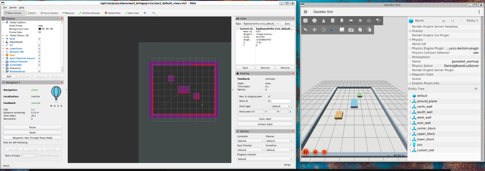

The warm-up arena has low boundary walls and three blocks. RViz shows **Feedback: reached**. Localization may show inactive here because this mode uses perfect localization, not AMCL. Use the supplied warm-up map; this is not your final SLAM map.

</details>

</details>

## Troubleshooting and references

- **No `/scan`:** check Gazebo playing, sensor enabled, topic spelling, bridge entry, and sensor-rendering plugins. A bridge does not create sensor data by itself.
- **No motion:** focus the teleop terminal; check `/cmd_vel` type with `ros2 topic info /cmd_vel --verbose` against the supplied bridge. This model expects `geometry_msgs/msg/Twist`; do not enable stamped commands on only one end.
- **TF problems:** inspect the actual scan frame; exactly one mapper/localizer owns `map → odom`. Never run the original Goosebot perfect-map bridge alongside SLAM or AMCL.
- **Far goals fail:** verify map coverage and the full-map global costmap. Do not navigate into unmapped space. Sparse outdoor structure and open-loop odometry can make campus mapping harder; start with the shorter IST route and keep campus scope near IST.
- **Robot invisible / duplicate clocks:** stop all old simulator launches; inspect leftover Gazebo processes before terminating only the stale processes you identify. Launch one world/server at a time.

References: [Goosebot source](https://github.com/hoanbklucky/goose/tree/nav2/11_simulation), [SLAM Toolbox](https://github.com/SteveMacenski/slam_toolbox), [Nav2 configuration](https://docs.nav2.org/configuration/index.html), [Gazebo sensors](https://gazebosim.org/docs/harmonic/sensors/). All required commands are above.

**INSTRUCTOR VALIDATION REQUIRED:** the new Goosebot integration and image-derived IST world have offline syntax/geometry checks, not an end-to-end Gazebo run. Pilot the readiness check in each project world, sensor rendering/TF, mapping, saved-map localization, two destinations/home in each world, the campus GPS experiment and live GPS navigation on the course WSL installation before release. Starting configurations require local verification and may need tuning.
