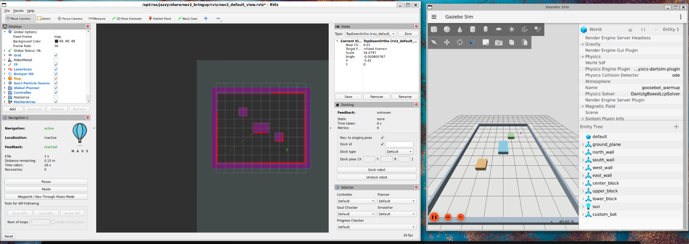

# Final Project — Goosebot SLAM and Delivery in Simulation

## Before you start — use the current course files

**Expected branch: `main`.** This is the current `main` assignment. First-time user? Fork and clone using [Setup Part 6](../lab00_setup/README.md#part-6--fork-and-clone-the-course-repository). An old ZIP download or an unchanged fork may contain obsolete commands.

In Ubuntu/WSL, save all editor files and check:

```bash
cd ~/courses/eel4332-autonomous-vehicle-labs
git remote -v
git branch --show-current
git status --short
```

`origin` must be your GitHub fork; `upstream` must be `hoanbklucky/eel4332-autonomous-vehicle-labs`. The branch must match the expected name. **If the branch differs or status lists changes, stop here:** [save/commit your work and follow the branch/update guide](../docs/UPDATING_COURSE_REPOSITORY.md) before proceeding. Do not discard edits, especially robot Xacro/configuration changes or maps.

Once on the correct branch with a clean working tree:

```bash
git fetch upstream &&
git merge --no-edit upstream/main &&
git merge-base --is-ancestor upstream/main HEAD &&
echo "Current checkout includes the latest fetched main course commits"
git log -1 --oneline
```

Continue only after the inclusion check succeeds. Reopen **this local README** in VS Code (**WSL: Ubuntu**) and follow it. VS Code Sync or pulling your fork alone does not fetch instructor updates; push your combined commits to your fork after a successful update. A Git update changes files, not installed packages: rebuild only when this lab's setup says it is needed.

**Final version check:** this branch uses the supplied Goosebot LiDAR and the IST-or-campus assignment below. The two-world/GPS revision is on a separate branch; use whichever version the instructor assigns.

> [!IMPORTANT]
> **Stop Gazebo with Ctrl+C in its launch terminal—not just the window's × button.** Closing the GUI can leave the simulation server and ROS nodes running, causing duplicate simulations or a GUI that does not match the robot/world queried from the terminal.
>
> **Before relaunching, switching worlds, or finishing:**
> 1. Stop robot motion; save any map/results you need.
> 2. Press **Ctrl+C** in each teleop, SLAM and Nav2 terminal that is running.
> 3. Press **Ctrl+C in the simulator launch terminal** (usually Terminal 1).
> 4. Wait for shutdown messages to finish and the shell prompt to return before launching again.
>
> If you already closed the window, return to its launch terminal and press Ctrl+C there. If shutdown seems incomplete, check `pgrep -af 'gz sim|gz-sim'` and identify leftover simulation processes before restarting.

## Open in VS Code through WSL

After cloning the repository, open **Windows Terminal / PowerShell**, run `wsl`, then run these commands in **Ubuntu/WSL**:

```bash
cd ~/courses/eel4332-autonomous-vehicle-labs
code .
```

Confirm VS Code shows **WSL: Ubuntu** (or your Ubuntu distribution) in the lower-left corner. Open `final_project_simulation/README.md` in Explorer. Choose **Terminal → New Terminal**; when working from this lab directory, run:

```bash
cd ~/courses/eel4332-autonomous-vehicle-labs/final_project_simulation
```

Use that Ubuntu terminal for the commands below; follow any later `cd` commands as written. This assumes VS Code is installed on Windows with the **WSL extension**. If the repository is not cloned yet, complete Lab 00's clone step first.

## Mission

Use the **provided Goosebot model with its configured 2-D LiDAR**, build your own SLAM map, and use **AMCL + Nav2** to reach three delivery locations and return home. Choose the supplied **IST interior** or **Florida Poly campus** world. Physical Goosebot SLAM/Nav2 is not required; your lane-following work is the hardware component.

## Learning objectives

Connect a robot model, sensors, bridges, TF, odometry, SLAM, localization, and navigation. Explain your own changes and diagnose problems rather than only repeating TurtleBot commands.

## AI assistance is allowed

You may use AI tools to help write or modify code, add sensors, configure ROS 2, and debug errors for this **final project**. You are responsible for testing the resulting code/configuration and must be able to explain your submitted changes and how the system works. Write the short final explanation in your own words. AI assistance does not replace the required simulation demonstration or your understanding.

## Prerequisites and background

Complete Labs 4–5, then follow Steps 1–5 below to build Goosebot and start mapping in your chosen IST or campus world. The separate practice-arena warm-up is optional. Keep your existing Ubuntu 24.04/WSL, ROS 2 Jazzy, and Gazebo Harmonic installation. Use VS Code's **WSL: Ubuntu integrated terminal** or a separate **Ubuntu/WSL terminal**; both work. Each long-running launch needs its own terminal. Commands have no leading `$` prompt. **The course instructions use native WSL/Jazzy for both the warm-up and final. Docker is an optional alternative, not an additional requirement.**

The Goosebot source is [hoanbklucky/goose, nav2 branch](https://github.com/hoanbklucky/goose/tree/nav2/11_simulation). It already supplies the body/wheels, drive plugin, stereo cameras, IMU, forward ToF, command-derived odometry, and EKF. **The narrow forward ToF is not a 360° mapping LiDAR.** The course build helper supplies the 360° LiDAR and bridge automatically. Start with those defaults; inspect/change one LiDAR setting only after completing mapping and saved-map navigation.

The original Goosebot default mode uses a pre-baked map and Gazebo ground-truth localization. **Do not use that mode as your final demonstration.** This project instead uses LiDAR SLAM Toolbox for mapping, then a saved map with AMCL. This differs from the TurtleBot/Cartographer preparation in Lab 4. Stereo RTAB-Map is optional. Do not launch the original `nav2_bringup.launch.py` or `stereo_slam.launch.py` alongside the commands below.

AMCL estimates the robot's pose on a saved map by matching live scans. Nav2's supplied starting configuration uses **NavFn with Dijkstra** for the global path and **DWB** to choose local motion commands. The global costmap follows the full saved map, rather than the original Goosebot's 20 m rolling window. Use the supplied footprint and sensor defaults first; tuning comes after baseline mapping/localization/navigation.

## Provided files and environment choice

| Environment | Features | Baseline / blocked world |
|---|---|---|
| **IST interior — recommended for a shorter project** | Photo-traced classrooms, oval hallway, two end cross-passages, north/south entrance lobbies and central side exits | `ist/ist.sdf` / `ist/ist_blocked.sdf` |
| **Florida Poly campus** | Geographic footprints, lake chain, roads and causeways; larger mapping area | `campus/campus.sdf` / `campus/campus_blocked.sdf` |
| Optional custom world | Same mission; requires checking collision geometry and a feasible alternative route | See [optional builder guide](CREATE_YOUR_OWN_WORLD.md) |

<details>
<summary>Preview — IST oval hallway and classroom layout</summary>


Classroom identities and relative positions come from the first image's labels/black partitions; the oval hallway, both end cross-passages and central through-passage come from the second image. **Evacuation arrows and colored zone boundaries are excluded from geometry.** Rooms 1045/1048 and 1002/1068 flank the north/south entrance lobbies. Dimensions and doors remain illustrative. Yellow is actual hallway floor, not evacuation routes. **Version 4 replaces earlier IST geometry: rebuild your SLAM map and reselect goals.**

</details>

<details>
<summary>Preview — campus layout</summary>


The campus is uniformly scaled to a 73 × 80 m teaching arena; some newer footprints and all building heights are approximate. Blue water has solid collision geometry. Grass remains traversable.

</details>

Other supplied files: `goosebot/world.launch.py` (world/spawn wrapper), `goosebot/slam_goosebot.yaml`, and `goosebot/nav2_goosebot.yaml` (starting configurations). The worlds' `reference.yaml` files are geometric instructor references, **not student SLAM results**. The existing [mission-client scaffold](../lab05_navigation/src/mission_client.py) remains available as an optional programming extension; its TODOs are not completed for you.

## Step-by-step procedure

### 1. Install dependencies, copy Goosebot source, and build

Run once in Ubuntu/WSL. This supplements your existing installation; no Ubuntu/ROS reinstall or Docker is needed.

```bash
sudo apt update
sudo apt install -y git python3-colcon-common-extensions python3-rosdep \
  ros-jazzy-ros-gz ros-jazzy-xacro ros-jazzy-robot-state-publisher \
  ros-jazzy-robot-localization ros-jazzy-slam-toolbox \
  ros-jazzy-navigation2 ros-jazzy-nav2-bringup \
  ros-jazzy-teleop-twist-keyboard python3-yaml
source /opt/ros/jazzy/setup.bash
```

In **your fork** of the course repository, copy only the provided source package (not its old build/install/virtual-environment directories). The pinned revision makes the starting model reproducible:

```bash
cd ~/courses/eel4332-autonomous-vehicle-labs
mkdir -p final_project_simulation/src
# Run this clone/copy only once. Keep your existing edited package on later updates.
git clone --filter=blob:none --sparse --single-branch --branch nav2 \
  https://github.com/hoanbklucky/goose.git /tmp/eel4332-goose-source
git -C /tmp/eel4332-goose-source sparse-checkout set 11_simulation/ros2_ws/src/goosebot_0
git -C /tmp/eel4332-goose-source checkout bffaf3cdf2b38f3b5a53a977064e0c787e046ff7
cp -r --update=none /tmp/eel4332-goose-source/11_simulation/ros2_ws/src/goosebot_0 final_project_simulation/src/
# Omit the redundant packaged snapshot; the extracted source is already copied.
rm -f final_project_simulation/src/goosebot_0/goosebot-simulation.zip
# Link, fix script permissions, install dependencies, and build this source copy.
bash final_project_simulation/goosebot/build_student_workspace.sh
```

**After the helper reports a successful build**, configure this terminal and check the installed package:

```bash
source /opt/ros/jazzy/setup.bash
source ~/goosebot_ws/install/setup.bash
ros2 pkg prefix goosebot_0
ros2 pkg executables goosebot_0
```

Expected prefix: `$HOME/goosebot_ws/install/goosebot_0`. The helper builds/verifies in its own process; it does not configure the parent terminal. Source this workspace again in every launch terminal. Do not run the install/prefix checks before the build succeeds.

The helper also supplies the LiDAR link/sensor, `/scan` bridge, and wheel joint-state publisher automatically. If the source was copied already, skip the clone/copy commands and run the helper from the repository root. It preserves model edits, creates the workspace source link only when absent, and refuses a link/source pointing to another checkout. Inspect and preserve files before changing such a link. The helper does not fetch a missing model; complete the full source-copy step first.


The executable list must include `cmd_vel_to_odom.py`, `ground_truth_map_odom_bridge.py`, and `stereo_camera_info_fixer.py` before launching. The full source package is needed: `CMakeLists.txt`, `package.xml`, `scripts/`, `launch/`, `urdf/`, `config/`, `maps/`, and `worlds/`. The recursive copy above already includes these; copying only the xacro/launch files is insufficient. Keep scripts in `scripts/`; CMake installs them into ROS's libexec directory.

The package lives in your course fork so your model edits can be committed/pushed; the workspace points to it. If the temporary clone already exists, reuse/check it instead of cloning again; the helper checks an existing workspace source link. If rosdep reports its database is uninitialized, run `sudo rosdep init` once and `rosdep update`, then retry. Do not copy old Docker build output. Rebuild after adding files or changing installation rules.

### 1a. Troubleshooting — only if an executable is not found

**If the build and executable checks in Step 1 pass, skip this section and continue to Step 2.**

<details>
<summary>Only if you see “executable cmd_vel_to_odom.py not found” — expand repair steps</summary>

This message can mean a missing installed script **or a script without executable permission**. The supplied source revision stores its Python scripts as non-executable files, while the launch expects installed executables. With a symlink install, executable permission on the source matters.

Stop the failed launch. In Ubuntu/WSL, repair permissions, reconfigure/build the existing package, then source it again:

```bash
source /opt/ros/jazzy/setup.bash
cd ~/goosebot_ws
ls src/goosebot_0/scripts/cmd_vel_to_odom.py
chmod +x src/goosebot_0/scripts/*.py
colcon build --symlink-install --packages-select goosebot_0 --cmake-force-configure
source install/setup.bash
ros2 pkg prefix goosebot_0
ros2 pkg executables goosebot_0
ls -l "$(ros2 pkg prefix goosebot_0)/lib/goosebot_0/cmd_vel_to_odom.py"
test -x "$(ros2 pkg prefix goosebot_0)/lib/goosebot_0/cmd_vel_to_odom.py" && echo "Executable is ready"
```

Expect all three executable names listed above and **Executable is ready**. Launch the selected project world only after a successful build/check. The package prefix must belong to **~/goosebot_ws**; if it names another workspace, open a fresh terminal and source the correct one.

If the first `ls` reports no such file, the source copy is incomplete. Repeat Step 1's **whole-package recursive copy from the pinned source** into `final_project_simulation/src/`, preserving your existing edits. Do not copy old build/install/log directories or place Python files manually inside `install/`.

The package's `CMakeLists.txt` must contain `install(PROGRAMS ... DESTINATION lib/${PROJECT_NAME})` for the three launch scripts. The provided revision already does. If your local copy differs, compare/restore that install declaration and rebuild; preserve your modified model/configuration.

</details>

### 2. Use the supplied robot — no sensor editing yet

The Step 1 build helper automatically configures the copied Goosebot source with a **360° LiDAR on `/scan`**, its ROS bridge, and the wheel joint-state publisher/bridge for RViz. No manual Xacro or bridge editing is required before mapping.

**Already completed the old setup?** Save/commit your work, pull the course updates, and run the Step 1 build helper again. It adds missing baseline components, preserves complete existing LiDAR settings, and stops on conflicting/partial edits rather than overwriting them. Then source the workspace and restart the simulator. Do not repeat the upstream clone/copy.

Use the defaults first: 720 samples, ±π horizontal coverage, one scan plane, 10 Hz, 0.12–12 m range, and a level mount 0.18 m above `base_link`. Finish Steps 3–7 before changing these settings. Your work is to build a map, localize, navigate and evaluate the delivery mission; a short LiDAR experiment comes last in Step 8.

### 3. Launch your selected world — Terminal 1

Stop all previous Gazebo, TurtleBot, SLAM, teleop, and navigation launches with Ctrl+C before starting. Closing the Gazebo window alone can leave a server running. Use this Goosebot launch, **not** the old TurtleBot campus launch:

```bash
source /opt/ros/jazzy/setup.bash
source ~/goosebot_ws/install/setup.bash
cd ~/courses/eel4332-autonomous-vehicle-labs
ros2 launch "$PWD/final_project_simulation/goosebot/world.launch.py" \
  world:="$PWD/final_project_simulation/ist/ist.sdf"
```

**Expected startup:** Terminal 1 starts the Gazebo server, spawns **`goosebot` into the explicitly named world**, then prints **`GOOSEBOT SPAWNED`** and opens the GUI after the create service accepts the robot. No `gz model` query is required before the window can open. Do not start another launch or `gz sim -g` while this launch starts. If spawning fails, the launch stops with an error.

If it reports **Gazebo server(s) already running**, stop the old simulation first. The launcher lists the PIDs and refuses to start; it does not kill other processes or spawn into the first world it finds. Use `pgrep -af 'gz sim|gz-sim'` to inspect leftovers. After a normal exit, wait for the launch terminal's prompt before restarting.

The GUI and server are owned by this one course launch: closing the GUI requests shutdown of its other processes too. **Ctrl+C in Terminal 1 remains the standard way to stop everything.** If the server fails, the launch shuts down its GUI/ROS nodes. This is different from manually starting a GUI-only process.

**Campus — alternative Terminal 1 command:**

```bash
source /opt/ros/jazzy/setup.bash
source ~/goosebot_ws/install/setup.bash
cd ~/courses/eel4332-autonomous-vehicle-labs
ros2 launch "$PWD/final_project_simulation/goosebot/world.launch.py" \
  world:="$PWD/final_project_simulation/campus/campus.sdf"
```


*Expected campus view: Goosebot starts at IST’s south end on the yellow Home marker. The Entity Tree lists `campus`, `sun`, and `goosebot` separately.*

See [the campus guide](campus/README.md) for expected spawn, mapping, and blocked-world instructions. The wrapper reads the home pose from the world's adjacent `mission.json`, adds mesh lookup paths, and starts the server/robot/GUI in order. Keep the entire world directory together. Goosebot does **not** need `TURTLEBOT3_MODEL`.

#### Find Goosebot in the large world

The supplied IST opening camera looks inward from **+x (south)**, so the south entrance is in the foreground. Restart the simulator after pulling camera/world changes; an explicit custom `--gui-config` can override the world's GUI settings. Orbiting the camera changes which entrance is nearest.

**To inspect Goosebot:**

1. Collapse `ist_building` in the Entity Tree.
2. Right-click the separate **`goosebot`** entry.
3. Click **Move To**, the first item at the top of the menu. This moves the **camera**, not the robot; it is not inside the `View >` submenu.
4. Put the pointer in the 3-D scene and scroll the mouse wheel upward to zoom closer. Scroll downward to zoom out.

<details>
<summary>Example — where to find Move To in Gazebo</summary>


Right-click **goosebot** in the Entity Tree, then click **Move To**, the first menu item. It moves the camera, not the robot. Menu appearance can vary slightly by Gazebo version.

</details>

At whole-building zoom, the roughly 20 cm Goosebot can be only a few pixels wide. Selecting a tree entry highlights it but does not by itself move the camera.

IST starts Goosebot at **(24.85, 0)** in the centre of the **south entrance passage**, facing inward toward −x (yaw π).

<details>
<summary>Troubleshooting — robot missing, too small, or absent from the Entity Tree</summary>

**1. Check the model and actual pose.** Keep Terminal 1 running and open another Ubuntu/WSL terminal:

```bash
source /opt/ros/jazzy/setup.bash
gz model --list
gz model -m goosebot --pose
```

Use the exact name printed by the list if your local launch differs, such as `custom_bot`. The course wrapper requests the entity name `goosebot`; `custom_bot` can still appear as the URDF model name in conversion warnings. See [Gazebo's model-command reference](https://gazebosim.org/api/sim/8/model_command.html).

| Observation | What to check next |
| --- | --- |
| `goosebot` is listed at approximately (24.85, 0) with a small positive Z | It exists near home. Collapse `ist_building`, select the separate `goosebot` entry, and focus/zoom on the robot. |
| Pose has a large negative Z | It may have fallen through the floor. Save the pose and simulator log for troubleshooting. |
| Pose has different XY | Compare with the launch's printed spawn line; the robot may have moved, or a different launch/mission file is in use. |
| Terminal lists the robot but the GUI does not | Check whether the GUI is stale or connected to another running server; use the clean restart below. A GUI label such as `default` alone does not establish which server it displays. |
| No robot is listed | Inspect the full `[create-...]` log for creation errors/timeouts and check that only the intended server is running. |

**2. Restart cleanly if the GUI and terminal disagree.** Stop all old simulator launches, including the maze/warm-up, with Ctrl+C in their launch terminals. Close all Gazebo windows. Check for remaining processes:

```bash
pgrep -af 'gz sim|gz-sim'
```

No output means this check found no matching processes. If it lists processes, identify and stop the leftover course simulation before relaunching; ask the instructor if unsure. Closing a window alone may leave its server running. Then launch Step 3 **once**. Do not repeatedly spawn extra robots to solve a camera problem.

**3. Read the messages correctly.** `Entity creation successful` confirms creation was accepted, not that the robot stayed at its initial pose or is visible at the current zoom. The `gz_frame_id ... not defined in SDF. Copying ...` warning alone is not a spawn failure; retain that field and verify the ROS scan frame in Step 4.

If the problem remains, share the launch's printed spawn line, full create log, model list, robot pose, and remaining-process output. These distinguish visibility, wrong-pose, and multiple-server problems.

</details>

<details>
<summary>Gazebo tips — follow the robot, turn it, or recover a flip</summary>

Select the top-level **goosebot** in the Entity Tree, not a wheel or link.

| Camera action | What it does |
|---|---|
| Right-click → **Move To** | Centers the camera on Goosebot once; does not move the robot. |
| **Follow Options → Follow** | Moves the camera with Goosebot and keeps looking at it. |
| **Follow Options → Free Look** | Moves with Goosebot while letting you look around; it still follows. |
| **Follow Options → Look At** | Follows Goosebot while aiming at a selected target, which can be another object. |
| **Stop following** | Close the menu, click inside the 3-D view, then press **Esc**. |

**Turn the robot normally:** focus the teleop terminal; use lowercase **j/l** to turn and **k** to stop. Camera controls do not steer Goosebot.

**If Goosebot flips:**

1. Stop teleop with **k**, then Ctrl+C; cancel navigation if active. **Pause Gazebo**.
2. Select the whole **goosebot** and expand **Pose**. If these fields are editable, set **Roll = 0**, **Pitch = 0**, keep the desired **Yaw**, and raise **Z** just enough for the wheels to clear the ground. Apply the edit, resume and let it settle. Avoid placing it inside walls.
3. If Pose is read-only or recovery fails, stop all launches with Ctrl+C and rerun the same world command to respawn upright. Restart SLAM/RViz for mapping, or the appropriate localization/navigation mode.

Moving the robot by editing Pose is a teleport: it can invalidate SLAM/localization. Restart the mapping session if the map becomes misaligned; initialize AMCL again for saved-map navigation. For the GPS experiment or GPS navigation, restart at fresh Home with the documented known heading rather than continuing after a teleport. Save useful results before restarting. Drive slowly and avoid obstacles/edges to reduce flips.

</details>

<a id="goosebot-readiness-check"></a>

### 4. Start mapping

Keep the selected world running in Terminal 1. Continue directly to Step 5: **start SLAM in Terminal 2, open RViz in Terminal 3 using Fixed Frame `map`, then drive in Terminal 4**. Check the robot, scans and TF while mapping; no separate readiness drive is required.

<details>
<summary>Troubleshooting only — sensor and TF checks</summary>

If mapping does not appear, use these checks in a separate sourced terminal. Stop each continuous check with Ctrl+C.

**Terminal 2 — sensor and TF:**

```bash
source /opt/ros/jazzy/setup.bash
source ~/goosebot_ws/install/setup.bash
ros2 topic echo /scan --once --field header.frame_id
ros2 topic hz /scan
```


<details>
<summary>Troubleshooting — /scan does not appear to be published yet</summary>

This warning means ROS has not discovered a publisher/type for `/scan`; it is different from a TF warning. Press Ctrl+C to stop a waiting echo/hz command before running another check. Keep Gazebo playing and allow sensor/bridge startup time.

**First check which installed model you are using:**

```bash
source /opt/ros/jazzy/setup.bash
source ~/goosebot_ws/install/setup.bash
ros2 pkg prefix goosebot_0
ros2 run xacro xacro "$(ros2 pkg prefix goosebot_0)/share/goosebot_0/urdf/robot.urdf.xacro" -o /tmp/goosebot_loaded.urdf
python3 - <<'PY'
import xml.etree.ElementTree as ET
r = ET.parse('/tmp/goosebot_loaded.urdf').getroot()
print('LiDAR link present:', r.find("link[@name='lidar_link']") is not None)
for s in r.findall("gazebo/sensor"):
    print('sensor:', s.get('name'), 'topic:', s.findtext('topic'))
PY
```

Expect your intended workspace prefix, `LiDAR link present: True`, and `lidar_sensor` on `scan`. If absent, the source edit was incomplete or the wrong package is installed/sourced. Rerun the Step 1 build helper, rebuild, source the correct workspace, and restart Terminal 1. A robot already in Gazebo will not acquire a new sensor merely because you saved the file.

**Then separate Gazebo output from ROS bridging:**

```bash
gz topic -l
ros2 topic list -t
ros2 topic info /scan --verbose
```

Find the new LiDAR's Gazebo scan topic in the list, distinct from `/tof_front/scan`. If it is `/scan`, inspect it with `gz topic -i -t /scan` and `gz topic -e -t /scan` (Ctrl+C after messages arrive). If Gazebo lists a different fully qualified scan topic, use that exact name when inspecting it and in the bridge's `gz_topic_name`; the ROS topic should remain `/scan`.

| Result | Next step |
| --- | --- |
| Installed description has no new LiDAR | Fix/source the correct model and respawn. |
| LiDAR is in the description but no Gazebo scan messages | Check the sensor block is attached to `lidar_link`, `always_on=true`, simulation is playing, and Terminal 1 has no sensor/render errors. Both supplied IST worlds include the Sensors system. |
| Gazebo scan messages arrive but ROS `/scan` is absent | Check the installed `config/ros_gz_bridge.yaml` has the new top-level bridge entry supplied by the Step 1 helper, with the exact Gazebo topic. Restart the launch to reload it and check Terminal 1 for bridge errors. |
| ROS scan messages arrive but RViz cannot display them | Continue with the TF/frame checks below; this is now a different problem. |

Do not change `gz_frame_id` or add another odometry publisher to fix a missing ROS topic. Share the installed-description check, topic lists and bridge errors if it remains unresolved.

</details>

Expect `lidar_link`. A 10 Hz simulated sensor may measure only about 1.3 Hz in wall-clock time when Gazebo runs at 13% real time. Stop `hz` with Ctrl+C, then run these one at a time (Ctrl+C after each check):

```bash
ros2 run tf2_ros tf2_echo base_footprint lidar_link
ros2 run tf2_ros tf2_echo odom base_footprint
ros2 topic echo /odometry/filtered --once
```

Expect numerical transforms and odometry. A brief startup warning can resolve when TF arrives; persistent warnings need fixing. If the reported scan frame differs, correct the sensor frame/TF configuration.

<details>
<summary>Examples — successful LiDAR scan and TF checks</summary>


Expect **lidar_link**. The example's approximately 1.4 Hz is wall-clock delivery during slow simulation, not the configured simulated scan frequency.


For the supplied mount, **base_footprint → lidar_link** has translation **(0, 0, 0.21) m** and zero rotation. Initial discovery warnings resolved once numerical output appeared; persistent warnings still need attention.

</details>


</details>

### 5. Build and save your map

**Terminal 2 — start SLAM before opening RViz:**

```bash
source /opt/ros/jazzy/setup.bash
source ~/goosebot_ws/install/setup.bash
cd ~/courses/eel4332-autonomous-vehicle-labs
ros2 launch slam_toolbox online_async_launch.py use_sim_time:=true \
  slam_params_file:="$PWD/final_project_simulation/goosebot/slam_goosebot.yaml"
```

**Start these terminals in order:** Terminal 2 runs SLAM, Terminal 3 shows RViz, and Terminal 4 provides manual driving. Configure RViz before moving the robot so you can watch the map grow.

**Terminal 3 — visualization:**

```bash
source /opt/ros/jazzy/setup.bash
source ~/goosebot_ws/install/setup.bash
rviz2 --ros-args -p use_sim_time:=true
```

#### RViz setup — add displays and select their topics

If RViz is already open with `use_sim_time:=true`, reuse it. Otherwise run the Terminal 3 command above. Keep Gazebo and the Step 5 SLAM launch running.

**1. Show the Displays panel and choose the fixed frame.**

- If the left panel is missing, select **Panels → Displays**.
- Expand **Global Options** at the top. Click the value beside **Fixed Frame**, type `map`, and press Enter.
- Keep `map` during SLAM and saved-map navigation. Start SLAM before opening RViz; there is no fixed-frame change during mapping.
- RViz displays ROS messages, not the Gazebo building automatically. A blank grid does not mean the Gazebo world is missing.

**2. Add Map and set its Topic.**

1. Click **Add** at the bottom of the Displays panel.
2. Select the **By display type** tab, expand **rviz_default_plugins** if needed, choose **Map**, and click **OK**.
3. In the Displays panel, expand the new **Map** row with its small triangle.
4. Find the editable **Topic** property below Status. Click the blank value cell to its right, select/type **`/map`**, and press Enter. Adding a display by type does **not** necessarily choose its topic.
5. Keep its checkbox enabled. Once SLAM publishes, expect **Status: Ok** and a grey/white/black occupancy map that grows as you drive.

**“Error subscribing: Empty topic name” means the Topic cell is blank.** Set the editable Topic property; the red `Status → Topic` line reports an error and is not the field to edit. “No map received” after setting `/map` means no map message has arrived yet; check that Step 5 SLAM is running and `ros2 topic list -t` contains `/map`. Changing RViz settings alone does not create a map.

For saved-map navigation, use `/map` as well. The optional perfect-map warm-up uses **`/projected_map`** instead; do not carry that warm-up topic into final-project SLAM. If a running map publisher exists but no map arrives, inspect the Map Topic's QoS settings; the supplied map workflows use **Reliable / Transient Local**. Allow startup time and check the display's expanded Status.

**3. Add LaserScan and select the LiDAR topic.**

1. Click **Add → By display type → rviz_default_plugins → LaserScan → OK**.
2. Expand **LaserScan**, click its editable **Topic** value, choose/type **`/scan`**, and press Enter.
3. Keep its checkbox enabled. Expand Topic if needed to see QoS settings; **Best Effort** reliability is suitable for receiving sensor scans, including a Reliable publisher.
4. If points are too small, set **Style** to **Points** and increase **Size (Pixels)**, for example to `3`, if those properties are shown.
5. Expect points outlining nearby walls, not an image of the building. Do not choose `/tof_front/scan`, which is only the original narrow forward beam.

**4. Add RobotModel — it is a display type, not a topic name.**

1. Click **Add**, then select **By display type** (not **By topic**).
2. Under **rviz_default_plugins**, scroll to **RobotModel**: it is written as one word. Select it and click **OK**. If a filter/search box is shown, clear it or type `RobotModel`.
3. Expand the new **RobotModel** row in Displays.
4. Set **Description Source → Topic**.
5. Set **Description Topic → `/robot_description`**, then press Enter. This uses the expanded robot description published by `robot_state_publisher`; do not enter the Xacro filename here.
6. Keep the display enabled and **Visual Enabled** checked. If Description Topic exposes QoS settings, use **Reliable / Transient Local** to receive the retained description.
7. Expect Goosebot's chassis, wheels and added sensor, with Status Ok once its transforms are available. This does not add another robot to Gazebo.

If RobotModel is absent from the By topic tab, that is not evidence the robot description is missing: use **By display type** as above. If the display reports a transform error, return to Step 4; a valid description still needs TF to position every link.

**5. Add TF and choose an easy view.**

- Use **Add → By display type → rviz_default_plugins → TF → OK** to show coordinate frames. Toggle TF off if its axes/text clutter the map.
- In the **Views** panel, select **TopDownOrtho** for a flat overhead map, or keep Orbit. Use **Panels → Views** if the panel is hidden.
- Zoom with the mouse wheel over the 3-D view. Goosebot can be very small compared with IST; during sensor inspection you can set the view's **Target Frame** to `base_footprint` to keep the robot centred.
- Confirm scan points follow the mapped wall edges rather than forming a shifted/rotated duplicate.

**6. Save your mapping layout and reuse it next time.**

On your first run, add and configure the displays above yourself so you learn the process. Once they work:

1. In a terminal, run `mkdir -p ~/rviz_configs`.
2. In RViz, choose **File → Save Config As…** and save as `~/rviz_configs/goosebot_mapping.rviz` (use your home directory in the file chooser).
3. On later mapping sessions, replace the generic RViz command with:

```bash
rviz2 -d ~/rviz_configs/goosebot_mapping.rviz \
  --ros-args -p use_sim_time:=true
```

Keep the simulator and SLAM commands unchanged. You can skip adding the displays again when this file loads. Use **File → Save Config** (Ctrl+S) after later layout changes. A custom file is not automatically selected by every launch; explicitly use `-d` or **File → Open Config**. The configuration saves display/topic/QoS settings, tools and the view—not the SLAM map or running nodes. Save the map separately below.

<details>
<summary>RViz quick check — blank map, missing robot, or red display status</summary>

| Symptom | Check |
| --- | --- |
| Map: Empty topic name | Edit Map's Topic property to `/map`, not the Status error row. |
| Map: No map received | Start SLAM in Step 5, or the saved-map navigation launch in Step 6; confirm `/map` is published. |
| Fixed Frame `map` does not exist | Keep Fixed Frame `map`; check that Terminal 2 SLAM is running and publishing `map → odom`. |
| Cannot find RobotModel | Add → **By display type**, expand rviz_default_plugins, select **RobotModel**. |
| RobotModel has no description | Set Description Source Topic and Description Topic `/robot_description`; verify robot_state_publisher remains running. |
| Scan exists but is not visible | Select `/scan`, check TF/status and reliability, then increase point size or zoom closer. |
| RobotModel/scan transform errors | Use simulation time in RViz and complete Step 4 TF checks; adding displays does not repair missing transforms. |

</details>


**Terminal 4 — driving:**

```bash
source /opt/ros/jazzy/setup.bash
source ~/goosebot_ws/install/setup.bash
ros2 run teleop_twist_keyboard teleop_twist_keyboard \
  --ros-args -p speed:=0.1 -p turn:=0.5
```

Click inside Terminal 4 and follow **its printed key layout** (different from TurtleBot teleop). Use lowercase `i` forward, `j/l` turn, and `k` stop; `speed` and `turn` set 0.1 m/s and 0.5 rad/s. Confirm motion, scan alignment and RobotModel/TF status before exploring. Map all mission routes and revisit an earlier area. For IST, cover both halves of the oval, both end cross-passages, the north/south entrance lobbies, and the central passage through both side exits; classroom interiors are optional. For campus, cover the delivery routes and alternative crossings; every remote corner is unnecessary.

<details>
<summary>Example — IST mapping in progress</summary>


Early exploration produces a partial map around the entrance. Grey/white explored space, dark wall edges and red scan points should align. Unvisited space remains unknown. RobotModel and TF show **Status: Ok**. Continue exploring the mission routes before saving; you do not need to reproduce the exact pixels or view.

</details>

<details>
<summary>Example — campus mapping in progress</summary>


RViz on the left shows the partial occupancy map around the campus buildings; Gazebo on the right shows the same simulated environment. Map boundaries should follow the nearby building outlines, with RobotModel and TF reporting **Status: Ok**. Unexplored space remains unknown. Continue driving the delivery routes and alternative crossings before saving; your map and view need not match this screenshot exactly. The generic **2D Goal Pose** tool visible here is for this mapping layout; use the **Nav2 Goal** layout in Step 6 for navigation.

</details>

Stop robot motion. In another sourced terminal, save while SLAM and Gazebo remain running:

```bash
source /opt/ros/jazzy/setup.bash
source ~/goosebot_ws/install/setup.bash
cd ~/courses/eel4332-autonomous-vehicle-labs/final_project_simulation
mkdir -p results
ros2 run nav2_map_server map_saver_cli -f "$PWD/results/final_map" \
  --ros-args -p use_sim_time:=true
```

Keep the YAML and image together. To view the image, use an Ubuntu image viewer, or `python3 -c "from PIL import Image; Image.open('results/final_map.pgm').save('results/final_map.png')"` from this directory and open the PNG in VS Code (install `python3-pil` if needed). The PNG is a viewing copy; keep the original map files.

### 6. Restart and navigate on your saved map

Switch from the mapping session to a fresh localization/navigation session:

1. Save the map in Step 5, then stop teleop, SLAM, RViz and the simulator with Ctrl+C.
2. **Terminal 1:** relaunch the same baseline world using Step 3. **Do not restart SLAM.**
3. **Terminal 2:** start the AMCL/Nav2 command below and leave it running.
4. **Terminal 3:** reopen RViz using the command below while Nav2 starts; confirm the saved map and set **2D Pose Estimate**. Keep Terminal 4's teleop stopped.

**Opening RViz before Nav2 is allowed but does not prevent missing-map/TF warnings.** RViz only displays data and sends the initial-pose estimate. Brief `map frame does not exist` warnings can occur before AMCL receives its map, scans and initial pose. Do not wait for every navigation node to become active before opening RViz and initializing localization. Persistent **no map received** warnings require checking map loading, not merely changing startup order.

**Terminal 2 — AMCL/Nav2:**

```bash
source /opt/ros/jazzy/setup.bash
source ~/goosebot_ws/install/setup.bash
cd ~/courses/eel4332-autonomous-vehicle-labs
ros2 launch "$PWD/final_project_simulation/goosebot/navigation.launch.py" \
  map:="$PWD/final_project_simulation/results/final_map.yaml"
```

The course wrapper validates the saved YAML and its referenced image, then supplies the absolute map path both as Nav2's `map` argument and explicitly in a temporary `map_server.ros__parameters.yaml_filename`. Your original configuration is preserved. Expect **Course navigation map: ...; image: ...** with the selected files. Missing files stop startup with an explanation. The wrapper sets `slam=False`, simulation time, autostart and non-composed AMCL/Nav2; do not start a second Nav2 launch alongside it. It does not start RViz or Gazebo.

After pulling this course update, no ROS rebuild is needed for this local-file launcher. Stop the previous AMCL/Nav2 launch with Ctrl+C before using it; keep the correct simulator running. If your existing saved map has a different name, point `map:=` to that actual YAML (do not rename just the YAML without checking its image reference).

Leave Terminal 2 running; it prints logs and opens no window. Continue to RViz and set the initial pose even if costmaps are waiting for `map` TF. Once localization and navigation finish activating, expect **Managed nodes are active**. Confirm `results/final_map.yaml` and its image exist and match the selected world.

In **Terminal 3**, close old mapping RViz windows and explicitly load the standard **Nav2** RViz layout:

```bash
source /opt/ros/jazzy/setup.bash
source ~/goosebot_ws/install/setup.bash
rviz2 -d "$(ros2 pkg prefix nav2_bringup)/share/nav2_bringup/rviz/nav2_default_view.rviz" \
  --ros-args -p use_sim_time:=true
```

**Expected RViz tools:** **Nav2 Goal**, **2D Pose Estimate**, and the **Navigation 2** panel. A generic `rviz2 --ros-args ...` window is useful for Step 5 mapping but may only show **2D Goal Pose**. Use the explicit `-d` command above for navigation. If the Nav2 tool/panel is missing, inspect RViz's terminal for plugin-loading errors rather than sending goals from a leftover mapping window.

**Save a separate navigation layout:** after confirming **Nav2 Goal**, **2D Pose Estimate**, the **Navigation 2** panel, Map `/map`, and LaserScan `/scan`, use **File → Save Config As…** to save `~/rviz_configs/goosebot_navigation.rviz`. Adjust/add any displays you need yourself on this first run. Do not overwrite the mapping layout or the system Nav2 configuration. On later navigation sessions, replace the standard-layout RViz command above with:

```bash
rviz2 -d ~/rviz_configs/goosebot_navigation.rviz \
  --ros-args -p use_sim_time:=true
```

Start Gazebo and AMCL/Nav2 as usual and set **2D Pose Estimate** for the new session. Loading an RViz configuration does not start navigation, load the map server, or restore AMCL localization. Keep the warm-up's `/projected_map` layout separate from these final-project `/map` layouts.

<details>
<summary>Troubleshooting — saved map or map frame still missing in Step 6</summary>

In another sourced terminal, check:

```bash
ros2 lifecycle get /map_server
ros2 lifecycle get /amcl
ros2 param get /map_server yaml_filename
ros2 topic info /map --verbose
```

The map server should become **active**, with `yaml_filename` equal to the absolute YAML printed by the course launcher. Map loading is automatic; **do not make a manual load-map service call part of the normal procedure**. If the path is blank or different, stop the old AMCL/Nav2 process and confirm only one map server is running before relaunching the updated wrapper. Check `ros2 node list` for duplicate-node warnings. If startup fails, inspect the first map-server error, the YAML image path, and file permissions. A valid YAML alone is insufficient if its image is missing or unreadable.

In RViz, **Map → Topic** must be `/map`, with Reliable / Transient Local QoS if a retained map is not displayed. Do not use the warm-up's `/projected_map`. AMCL still needs scans, TF and **2D Pose Estimate** to supply `map → odom`; loading a map or opening RViz does not initialize the pose. Do not restart SLAM or add a static `map → odom` publisher to hide a missing transform. Brief transform warnings before initialization can occur.

</details>

Use **2D Pose Estimate** at the starting position, dragging in its heading direction. Enable Map and LaserScan `/scan`. **Alignment means live scan points overlap the saved map's wall edges** around several sides of the robot; they should not form a shifted/rotated outline. Costmap inflation colors are clearance margins, not the physical wall. If alignment is poor, correct the initial pose before sending goals. AMCL now owns `map → odom`; the EKF still owns `odom → base_footprint`.

Send a nearby **Nav2 Goal** first, then visit three chosen delivery locations and return home. Wait 3 seconds at each delivery. Clicking goals in RViz is sufficient; autonomous mission sequencing using the existing client scaffold is optional. Keep keyboard teleop stopped during navigation.

**Choose destinations in RViz:** click **Nav2 Goal**, then click and drag in a free area of your saved map. The click selects the destination; dragging sets the final heading. Select Home the same way; no coordinates from `mission.json` are needed. IST example destinations are in the hallway near 1044, 1003, and 1066.

**Check completion:** Navigation/Localization **active** means the system is running. **Feedback: active** means a goal is in progress. Count a goal as reached only after **succeeded** feedback and confirming the robot arrived and stopped.

<details>
<summary>Expected view — IST navigation in progress</summary>


**Left: RViz** shows the saved map, laser scans and colored obstacle-clearance margins. **Right: Gazebo** shows the simulated robot in IST. In this example, Navigation and Localization are active, and **Feedback: active** with distance remaining means the robot is still travelling. Wait for **succeeded** and verify it stopped at the chosen destination before counting the goal as reached. Your map and camera view may differ.

</details>

### 7. Test one blocked route

Stop all launches and restart Step 3 with `ist/ist_blocked.sdf` (or `campus/campus_blocked.sdf`). Keep your **baseline saved map**, robot, settings, and goals. Relaunch AMCL/Nav2 and initialize the pose again; do not remap the barrier.

For IST the barrier crosses the upper hallway near the central junction at (0.5, 8.2) m; the lower loop and connecting passages provide alternatives. For campus it blocks one causeway. Check that live scans/costmaps detect it. Describe the actual result: detour, changed global path, recovery, stopping, or failure. A detour alone does not establish which algorithm replanned.

### 8. Explore LiDAR settings — after mapping and localization/navigation

**Do this last**, after you have saved your baseline map and demonstrated AMCL/Nav2. You do not need to build a sensor from scratch.

1. Save/commit your working baseline. Open `final_project_simulation/src/goosebot_0/urdf/robot.urdf.xacro` in VS Code.
2. Find `<sensor type="gpu_lidar" name="lidar_sensor">` and inspect its settings:

   | Setting inside the LiDAR block | Baseline | Meaning |
   | --- | --- | --- |
   | `update_rate` | 10 | Scans per simulated second. |
   | `horizontal/samples` | 720 | Number of directions measured per scan. |
   | `horizontal/min_angle`, `max_angle` | −3.14159, +3.14159 | Horizontal field of view in radians. |
   | `vertical/samples` | 1 | A single plane for 2-D SLAM. |
   | `range/min`, `max` | 0.12, 12.0 | Measurement limits in metres. |

3. Change **one setting only**: for example horizontal samples **720 → 360**, or update rate **10 → 5**. Keep the original ToF and the `scan` topic/`lidar_link` frame unchanged. Do not globally replace values throughout the file.
4. Save, stop launches with Ctrl+C, rebuild using the Step 1 helper, source your workspace and relaunch Step 3. The helper preserves your complete LiDAR's edited settings.
5. Inspect `/scan` in RViz and compare with the baseline. Fewer samples give wider angular spacing; a lower update rate gives fewer scans per simulated second. With a slow Gazebo real-time factor, wall-clock `ros2 topic hz /scan` is lower than the sensor's configured rate.
6. Restore the baseline setting before your final delivery demonstration. Add **two or three sentences** about your change and observation to the existing short explanation; no additional report or video is required.

<details>
<summary>Optional — how the LiDAR link, joint, sensor and bridge are constructed</summary>

See [the beginner Xacro reference](goosebot/LIDAR_REFERENCE.md) for the complete annotated XML and field-by-field explanation. Building another sensor or changing its mount is optional, not a prerequisite for this project.

</details>

## What to submit

- **One video, about 3–5 minutes:** show your LiDAR/scan display, mapping and a revisit, saved-map localization, successful navigation to three deliveries and home, and a brief blocked-route attempt. Clips may be joined; do not record the entire setup.
- **Your fork/code:** the configured Goosebot source, SLAM/Nav2 configuration, saved map YAML/image, and the commands you used. Include the single-setting LiDAR experiment or note its restored baseline. Commit source/configuration; exclude `build/`, `install/`, `log/`, databases, and bags.
- **A short explanation in your own words, about one page:** what you changed; how scans, TF, odometry, SLAM, AMCL, planning and control fit together; one problem/fix; the blocked-route result; and why simulation success does not prove physical Goosebot readiness. List each member's contribution.

No long report, custom planner implementation, or mandatory mission-client implementation is required. Assessment: mapping/localization 40%, navigation/obstacle test 35%, explanation/reproducibility 20%, end-of-project LiDAR settings observation 5%. Diagnose and retain failed attempts rather than presenting ground-truth localization as your solution.

<details>
<summary>Optional display troubleshooting — wheels or map rendering</summary>

The course helper supplies wheel joint states for RViz. If only wheel links show transform errors while chassis/LiDAR TF works, first inspect `ros2 topic echo /joint_states --once`; do not add another odometry publisher. Wheel appearance is not a mapping/localization completion requirement.

If RViz reports the shader error `active samplers with a different type refer to the same texture image unit`, save its configuration and stop only RViz. You may try `LIBGL_ALWAYS_SOFTWARE=1 rviz2 --ros-args -p use_sim_time:=true` for that process. This is a rendering diagnostic, may be slower, and is not guaranteed to fix the driver problem. Keep Gazebo/SLAM running and verify map messages independently; do not rebuild the robot to fix a graphics error.

</details>

<a id="goosebot-warm-up"></a>

<details>
<summary>Optional practice arena — manual driving and a perfect-map Nav2 goal</summary>

## Optional troubleshooting — practice arena and perfect-map navigation

**Skip this entire exercise for the normal final-project workflow.** Follow Steps 4–5 directly: start SLAM, open RViz using `map`, then drive. This exercise does not replace the final SLAM/AMCL demonstration.

Use **native Ubuntu/WSL + ROS 2 Jazzy**, the package built in Step 1, and the **same `~/goosebot_ws` workspace** as your final. No second installation, Docker setup, or robot-model modification is required for this warm-up. If you already completed Step 1, reuse your package/workspace and preserve your edits.

This optional warm-up uses a **10 × 8 m open arena with low walls and three obstacles**, so Goosebot remains visible and there is room to steer. The original tall-wall maze is optional below. Pull the latest course repo to obtain these assets; rebuilding Goosebot is unnecessary for a world/map change.

<details>
<summary>Preview — simple practice arena</summary>


</details>

The practice arena's **perfect-map mode** provides both a pre-generated map and Gazebo ground-truth global localization. This checks Goosebot operation and Nav2 integration; **it is not SLAM and does not use AMCL**. This mode is allowed for this warm-up only; the final still requires the supplied LiDAR, your SLAM map, and AMCL.

**Terminal 1 — low-wall practice arena and Goosebot:** stop other simulator/SLAM/navigation launches first.

```bash
source /opt/ros/jazzy/setup.bash
source ~/goosebot_ws/install/setup.bash
cd ~/courses/eel4332-autonomous-vehicle-labs
ros2 launch goosebot_0 spawn_robot.launch.py \
  world:="$PWD/final_project_simulation/warmup/warmup.sdf" x:=-3.5 y:=-2.5 yaw:=0.0
```

**Terminal 2 — manual driving:**

```bash
source /opt/ros/jazzy/setup.bash
source ~/goosebot_ws/install/setup.bash
ros2 run teleop_twist_keyboard teleop_twist_keyboard \
  --ros-args -p speed:=0.1 -p turn:=0.5
```

Click inside Terminal 2 and use **lowercase keys**, with Shift and Caps Lock off. Goosebot uses different keys from TurtleBot teleop:

| Key | Effect |
| --- | --- |
| `i` | Drive forward |
| `,` | Drive backward |
| `j` / `l` | Turn left / right |
| `k` | Stop |
| `w` / `x` | Increase / decrease the linear speed setting |
| `q` / `z` | Increase / decrease both speed settings |

**A changed “speed/turn” number only changes the settings; it does not command movement.** Press `i` to move. Start at 0.1 m/s; restarting the command above resets these settings. Keep Gazebo playing and stop Nav2 while driving manually. Drive a short distance, then press `k`. Stop the robot and quit teleop with Ctrl+C. For a repeatable navigation check, stop Terminal 1 too and relaunch the practice arena at the original spawn pose.

**Terminal 2 — supplied perfect-map Nav2:** run this after teleop has stopped. Keep its original model-specific configuration; the final's LiDAR configuration is used later.

```bash
source /opt/ros/jazzy/setup.bash
source ~/goosebot_ws/install/setup.bash
cd ~/courses/eel4332-autonomous-vehicle-labs
ros2 launch goosebot_0 nav2_bringup.launch.py slam:=false use_sim_time:=true \
  map:="$PWD/final_project_simulation/warmup/reference.yaml"
```

Use this arena's `reference.yaml` with `warmup.sdf`; **do not use the maze map with the practice arena**. The supplied map is generated from obstacle geometry and is not a student SLAM result.

**Expected behavior:** Nav2 runs its navigation nodes in Terminal 2 and prints log messages; **no new window opens**. When the log says **`Managed nodes are active`**, the navigation nodes are ready. Leave Terminal 2 running and continue to Terminal 3, which opens RViz. Do not press Ctrl+C in Terminal 2 until you want to stop Nav2.

**Terminal 3 — RViz:**

```bash
source /opt/ros/jazzy/setup.bash
source ~/goosebot_ws/install/setup.bash
rviz2 -d "$(ros2 pkg prefix nav2_bringup)/share/nav2_bringup/rviz/nav2_default_view.rviz" \
  --ros-args -p use_sim_time:=true
```

Use Fixed Frame `map`; set the Map display's topic to **`/projected_map`**. Enable RobotModel with `/robot_description` and TF. The forward ToF, if displayed as LaserScan, is **`/tof_front/scan`** and gives only a narrow beam. The supplied LiDAR also publishes `/scan`; the warm-up still uses perfect-map localization. Do not initialize AMCL with 2D Pose Estimate: the ground-truth bridge supplies `map → odom` in this mode.

**Terminal 4 — check interfaces, then send one goal:**

```bash
source /opt/ros/jazzy/setup.bash
source ~/goosebot_ws/install/setup.bash
ros2 topic echo /odometry/filtered --once
ros2 topic echo /tof_front/scan --once --field header.frame_id
ros2 action send_goal /navigate_to_pose nav2_msgs/action/NavigateToPose \
  "{pose: {header: {frame_id: 'map'}, pose: {position: {x: 3.0, y: -2.5}, orientation: {w: 1.0}}}}" --feedback
```

Expect odometry/sensor messages, robot movement in Gazebo, and a **SUCCEEDED** action result. You may instead select one reachable free-space Nav2 Goal in RViz. If TF is missing, inspect `ros2 run tf2_ros tf2_echo odom base_footprint` in a sourced terminal; stop the check with Ctrl+C. Resolve warm-up startup/motion problems before modifying the model.

**No separate submission or warm-up credit is required.** Use this exercise only if you want extra practice or need to isolate startup, motion or Nav2 problems.

**Finish:** stop Nav2, RViz and the practice arena with Ctrl+C. Continue with Step 2 in this same source/workspace. Keep the warm-up's perfect-map/ground-truth launches stopped while running final-project SLAM or AMCL; each mode must have only one `map → odom` publisher.

<details>
<summary>Troubleshooting — keyboard input but no motion</summary>

Check terminal focus, lowercase movement keys, and that Gazebo is playing. Stop other teleop/Nav2 processes that may also publish velocity commands. In a separate sourced terminal, run `ros2 topic echo /cmd_vel`, then press `i` in teleop: expect nonzero `linear.x`. A bridge message saying it passed a Twist confirms receipt, not physical movement. If nonzero commands arrive but Goosebot stays still, save the full simulator/bridge log for troubleshooting. Press `k` to stop and Ctrl+C to end the topic check.

</details>

<details>
<summary>Optional challenge — original tall-wall maze</summary>

The original maze has narrow passages and tall textured walls that obstruct the camera. It is an optional extra challenge. Stop all practice-arena launches first. In Terminal 1 use:

```bash
source /opt/ros/jazzy/setup.bash
source ~/goosebot_ws/install/setup.bash
ros2 launch goosebot_0 spawn_robot.launch.py \
  world:="$(ros2 pkg prefix goosebot_0)/share/goosebot_0/worlds/maze.world" x:=-0.5
```

For perfect-map navigation, Terminal 2 must use its matching map:

```bash
source /opt/ros/jazzy/setup.bash
source ~/goosebot_ws/install/setup.bash
ros2 launch goosebot_0 nav2_bringup.launch.py slam:=false use_sim_time:=true \
  map:="$(ros2 pkg prefix goosebot_0)/share/goosebot_0/maps/maze.yaml"
```

Reuse the slow manual-driving command and RViz setup above, but select a reachable free-space goal on the maze map instead of using the arena's example coordinates.

</details>

<details>
<summary>Optional alternatives — Docker and stereo SLAM</summary>

**Docker is optional for both the warm-up and final.** The required course workflow stays native WSL/Jazzy. Students who already use Docker may follow the [upstream Docker setup](https://github.com/hoanbklucky/goose/tree/nav2/11_simulation#2-docker-setup), use the same pinned source revision as Step 1, run ROS commands inside the container, and adapt paths to its filesystem. Keep source/configuration/maps in a persistent host-mounted workspace, retain changes when containers are recreated, and demonstrate the same required outcomes. Do not copy native or old Docker `build/install/log` directories between environments.

**Stereo RTAB-Map is an optional extension**, not a prerequisite. Its [upstream live-stereo mode](https://github.com/hoanbklucky/goose/tree/nav2/11_simulation#32-mode-b--live-stereo-slam) must run separately from perfect-map localization and the final's LiDAR SLAM/AMCL. Running stereo SLAM does not replace the final mapping/AMCL/Nav2 demonstration.

</details>

<details>
<summary>Example — warm-up navigation reached a goal</summary>



The warm-up arena has low boundary walls and three blocks. RViz shows **Feedback: reached**. Localization may show inactive here because this mode uses perfect localization, not AMCL. Use the supplied warm-up map; this is not your final SLAM map.

</details>

</details>

## Troubleshooting and references

- **No `/scan`:** check Gazebo playing, sensor enabled, topic spelling, bridge entry, and sensor-rendering plugins. A bridge does not create sensor data by itself.
- **No motion:** focus the teleop terminal; check `/cmd_vel` type with `ros2 topic info /cmd_vel --verbose` against the supplied bridge. This model expects `geometry_msgs/msg/Twist`; do not enable stamped commands on only one end.
- **TF problems:** inspect the actual scan frame; exactly one mapper/localizer owns `map → odom`. Never run the original Goosebot perfect-map bridge alongside SLAM or AMCL.
- **Far goals fail:** verify map coverage and the full-map global costmap. Do not navigate into unmapped space. Sparse outdoor structure and open-loop odometry can make campus mapping harder; IST is the shorter starting option.
- **Robot invisible / duplicate clocks:** stop all old simulator launches; inspect leftover Gazebo processes before terminating only the stale processes you identify. Launch one world/server at a time.

References: [Goosebot source](https://github.com/hoanbklucky/goose/tree/nav2/11_simulation), [SLAM Toolbox](https://github.com/SteveMacenski/slam_toolbox), [Nav2 configuration](https://docs.nav2.org/configuration/index.html), [Gazebo sensors](https://gazebosim.org/docs/harmonic/sensors/). All required commands are above.

**INSTRUCTOR VALIDATION REQUIRED:** the new Goosebot integration and image-derived IST world have offline syntax/geometry checks, not an end-to-end Gazebo run. Pilot the SLAM-first startup in the selected project world, sensor rendering/TF, mapping, saved-map localization, all deliveries, and both blocked variants on the course WSL installation before release. Starting configurations require local verification and may need tuning.
