# Final Project — Indoor and Outdoor Goosebot Navigation

Use **`main`**. Complete IST first, then campus. Build and save a SLAM map in IST. For campus, go directly to Step 9 and use the supplied map for navigation. Navigate with **AMCL indoors** and **RTK-like GPS fusion with the supplied pedestrian-only campus map outdoors**, reaching **two destinations and Home** in each. Compare localization accuracy on one campus drive using wheel odometry/IMU alone, ordinary GPS fusion, and RTK-like GPS fusion. Live navigation with non-RTK GPS strategies, blocked-route testing, and LiDAR tuning are optional. Physical SLAM/Nav2 and mission-client coding are optional; lane following remains the hardware component.

## From simulated sensors to navigation

Gazebo starts with the 3D world described by [IST’s SDF](ist/ist.sdf) or [campus’s SDF](campus/campus.sdf). Goosebot uses simulated measurements to build its own 2D model of that environment.

| Component | Role in this project |
|---|---|
| **Gazebo and ROS 2 bridges** | Gazebo simulates the world, robot motion, and sensors. The bridges make simulated readings available to ROS 2. For example, LiDAR publishes ranges on `/scan`, and simulated wheel joint motion is used to compute wheel odometry. |
| **Sensor fusion (local EKF)** | Combines wheel-derived forward speed with IMU yaw rate to estimate robot motion. This provides local odometry for mapping and navigation. Outdoors, a second filter combines this wheel/IMU motion estimate with RTK-like GPS fixes to estimate Goosebot’s pose on the supplied campus map. |
| **SLAM Toolbox** | Uses LiDAR scans and local odometry to estimate the robot’s trajectory and build a map as you drive. Successive scans reveal free space along the beams and obstacles where beams hit. |
| **Occupancy map** | A 2D grid of free, occupied, and unknown space. During mapping, SLAM Toolbox publishes the live grid on `/map`. Saving writes a YAML file with resolution, origin, and image filename, plus the grid image. During navigation, a map server loads the selected map and publishes it on `/map`. |
| **Localization and Nav2** | Indoors, AMCL matches live LiDAR scans to the saved IST map to estimate the robot’s pose. Outdoors, GPS-aided localization provides the pose on the supplied pedestrian-only campus map. Nav2 uses that pose and costmaps built from map data and live obstacles to plan a path and send velocity commands to Goosebot. |
| **RViz** | Subscribes to ROS 2 data and displays the occupancy map, live scans, robot pose, and planned path in a common coordinate frame. A saved `.rviz` file stores display settings. |

**Occupancy map and costmaps.** The occupancy map records which cells are free, occupied, or unknown. Nav2 builds costmaps from map data and live obstacle readings to decide where Goosebot can drive and which routes give it more clearance. A cell next to a wall can be free in the occupancy map and still have a high cost because it is close to the wall. The global planner uses the global costmap to choose a route. The local controller uses the local costmap to follow that route and avoid nearby obstacles.

As you drive in Step 5, watch the **LaserScan** display change immediately and the **Map** display grow as you explore. The scan shows what the LiDAR measures now. The map shows what SLAM has inferred from measurements collected along the drive.

## Before you start

Complete Labs 4–5. Use your existing Ubuntu/WSL, ROS 2 Jazzy and Gazebo Harmonic installation. Work in your course fork; `origin` is your fork and `upstream` is the public course repository. Save your edits before updating; do not discard model or map changes.

```bash
cd ~/courses/eel4332-autonomous-vehicle-labs
git branch --show-current
git status --short
```

The branch should be `main`. If it differs or files are modified, follow [the update guide](../docs/UPDATING_COURSE_REPOSITORY.md) first. With the correct branch and a clean working tree:

```bash
git fetch upstream &&
git merge --no-edit upstream/main &&
git merge-base --is-ancestor upstream/main HEAD &&
echo "Current checkout includes the latest fetched main course commits"
git log -1 --oneline
```

**Command breakdown:** `fetch` downloads course updates; `merge` incorporates them; `merge-base --is-ancestor` checks they are included; `&&` continues only after success. Updating Git files does not rebuild your robot.

## Terminal conventions

Use four Ubuntu/WSL terminals: **1 Gazebo**, **2 SLAM or AMCL/Nav2**, **3 RViz**, **4 teleop/checks**. Open VS Code with `code .` from this checkout and confirm **WSL: Ubuntu**.

| Syntax | Meaning |
|---|---|
| `source /opt/ros/jazzy/setup.bash` then `source ~/goosebot_ws/install/setup.bash` | Enable ROS, then this built workspace in each new ROS terminal. |
| `ros2 run PACKAGE PROGRAM` / `ros2 launch PACKAGE FILE` | Run one program / a launch description. Local launch files may use an absolute path. |
| `name:=value` / `--ros-args -p name:=value` | A launch argument / a ROS parameter. `use_sim_time:=true` uses Gazebo's clock. |
| `~`, `$PWD`, `$(...)` | Home directory, current directory, and command output. Quotes keep a path together. |
| Trailing `\` | Continue the same command on the next line; copy all lines. |
| Ctrl+C | Stop the foreground program in its launch terminal. Closing only a GUI can leave processes running. |

**Before switching worlds or modes:** stop motion, save maps, then Ctrl+C teleop, SLAM/Nav2, RViz and Gazebo. Wait for prompts. Run only one simulator and one owner of `map → odom` (SLAM while mapping, AMCL while navigating). The perfect-map/ground-truth mode is optional practice only.

## 1. Setup — once, then rebuild when needed

Install missing packages:

```bash
sudo apt update
sudo apt install -y git python3-colcon-common-extensions python3-rosdep \
  ros-jazzy-ros-gz ros-jazzy-xacro ros-jazzy-robot-state-publisher \
  ros-jazzy-robot-localization ros-jazzy-slam-toolbox \
  ros-jazzy-navigation2 ros-jazzy-nav2-bringup \
  ros-jazzy-teleop-twist-keyboard ros-jazzy-rqt-graph python3-yaml
source /opt/ros/jazzy/setup.bash
```

**First setup only:** copy the complete pinned Goosebot package and build it. Existing users keep their edited package and rerun only the build helper.

```bash
cd ~/courses/eel4332-autonomous-vehicle-labs
mkdir -p final_project_simulation/src
# Run this clone/copy only once. Keep your existing edited package on later updates.
git clone --filter=blob:none --sparse --single-branch --branch nav2 \
  https://github.com/hoanbklucky/goose.git /tmp/eel4332-goose-source
git -C /tmp/eel4332-goose-source sparse-checkout set 11_simulation/ros2_ws/src/goosebot_0
git -C /tmp/eel4332-goose-source checkout bffaf3cdf2b38f3b5a53a977064e0c787e046ff7
cp -r --update=none /tmp/eel4332-goose-source/11_simulation/ros2_ws/src/goosebot_0 final_project_simulation/src/
# Omit the redundant packaged snapshot; the extracted source is already copied.
rm -f final_project_simulation/src/goosebot_0/goosebot-simulation.zip
# Required for Python launch executables with --symlink-install.
bash final_project_simulation/goosebot/build_student_workspace.sh
```

**Command breakdown:** the sparse clone selects the complete `goosebot_0` package; the pinned commit fixes its starting version; `cp -r --update=none` preserves existing destination files. The helper links this source into `~/goosebot_ws`, configures LiDAR/bridges, fixes executable permissions and the legacy GPS noise, installs dependencies, and builds.

### Verify the Goosebot installation

The first two commands load ROS 2 Jazzy and your built course workspace into this terminal. The last two show where ROS 2 found `goosebot_0` and which programs are available through `ros2 run`.

```bash
source /opt/ros/jazzy/setup.bash
source ~/goosebot_ws/install/setup.bash
ros2 pkg prefix goosebot_0
ros2 pkg executables goosebot_0
```

Expect the prefix inside `~/goosebot_ws`. The course launcher runs `wheel_joint_odometry.py` directly from this repository. Do not copy old build/install/log directories.

## 2. Use the supplied robot

LiDAR, `/scan` bridge, wheel visualization and GPS already exist after setup. **No sensor XML needs to be pasted.** Keep defaults for baseline mapping/navigation. After source/configuration changes, stop launches, rerun the Step 1 helper, source the workspace and relaunch; saving a file does not change a spawned robot.

## 3. Launch the current part’s world — Terminal 1

```bash
source /opt/ros/jazzy/setup.bash
source ~/goosebot_ws/install/setup.bash
cd ~/courses/eel4332-autonomous-vehicle-labs
ros2 launch "$PWD/final_project_simulation/goosebot/world.launch.py" \
  world:="$PWD/final_project_simulation/ist/ist.sdf"
```

**Command breakdown:** `world.launch.py` starts Gazebo, spawns Goosebot and starts its ROS interfaces; `world:=` selects the SDF file. Follow Step 9 for the campus launch. Expect `GOOSEBOT SPAWNED`. If a server is already running, stop its launch before retrying.

<a id="goosebot-readiness-check"></a>

Wait for **WHEEL_ODOMETRY_READY** before continuing. After updating the checkout, stop any running launches and restart with the command above.

<details>
<summary>Check wheel odometry and EKF inputs</summary>

In another sourced terminal, run:

```bash
ros2 param get /ekf_filter_node odom0
ros2 topic echo /wheel/odometry --once --field twist.twist
```

The first command checks the EKF input; expect `/wheel/odometry`. The second prints one wheel-derived velocity message. Only forward speed is fused from wheels; the IMU supplies yaw rate. The wheel node publishes no TF; the local EKF owns `odom → base_footprint`. Configuration: [ekf_wheel.yaml](goosebot/ekf_wheel.yaml), loaded directly from this checkout. No rebuild is needed for these Python/config changes if the wheel-state bridge is already installed; if `/joint_states` is absent, rerun the existing build helper. Missing/stale wheel data stops the course launch; there is no command fallback.

</details>

To find the robot: collapse the building in Gazebo's Entity Tree, right-click **goosebot → Move To**, then zoom. This moves the camera.

<details>
<summary>Gazebo tips — follow the robot, turn it, or recover a flip</summary>

Select the top-level **goosebot** in the Entity Tree, not a wheel or link.

| Camera action | What it does |
|---|---|
| Right-click → **Move To** | Centers the camera on Goosebot once; does not move the robot. |
| **Follow Options → Follow** | Moves the camera with Goosebot and keeps looking at it. |
| **Follow Options → Free Look** | Moves with Goosebot while letting you look around; it still follows. |
| **Follow Options → Look At** | Follows Goosebot while aiming at a selected target, which can be another object. |
| **Stop following** | Close the menu, click inside the 3-D view, then press **Esc**. |

**Turn the robot normally:** focus the teleop terminal; use lowercase **j/l** to turn and **k** to stop. Camera controls do not steer Goosebot.

**If Goosebot flips:**

1. Stop teleop with **k**, then Ctrl+C; cancel navigation if active. **Pause Gazebo**.
2. Select the whole **goosebot** and expand **Pose**. If these fields are editable, set **Roll = 0**, **Pitch = 0**, keep the desired **Yaw**, and raise **Z** just enough for the wheels to clear the ground. Apply the edit, resume and let it settle. Avoid placing it inside walls.
3. If Pose is read-only or recovery fails, stop all launches with Ctrl+C and rerun the same world command to respawn upright. Restart SLAM/RViz for mapping, or the appropriate localization/navigation mode.

Moving the robot by editing Pose is a teleport: it can invalidate SLAM/localization. Restart the mapping session if the map becomes misaligned; initialize AMCL again for saved-map navigation. For the GPS experiment or GPS navigation, restart at fresh Home with the documented known heading rather than continuing after a teleport. Save useful results before restarting. Drive slowly and avoid obstacles/edges to reduce flips.

</details>

## 4. Start SLAM — Terminal 2

Keep the IST world playing in Terminal 1. Start SLAM **before opening RViz**, then keep this launch running:

```bash
source /opt/ros/jazzy/setup.bash
source ~/goosebot_ws/install/setup.bash
cd ~/courses/eel4332-autonomous-vehicle-labs
ros2 launch slam_toolbox online_async_launch.py use_sim_time:=true \
  slam_params_file:="$PWD/final_project_simulation/goosebot/slam_goosebot.yaml"
```

**Command breakdown:** `online_async_launch.py` starts LiDAR SLAM; `slam_params_file:=` loads course settings. SLAM supplies the `map` frame and builds `/map` from scans.

## 5. Open RViz, drive and save

**Terminal 3 — open RViz after SLAM starts:**


```bash
source /opt/ros/jazzy/setup.bash
source ~/goosebot_ws/install/setup.bash
rviz2 --ros-args -p use_sim_time:=true
```

For your first run, add these yourself using **Add → By display type → rviz_default_plugins**:

| Display | Setting |
|---|---|
| LaserScan | Topic `/scan`; Best Effort reliability |
| RobotModel | Description Source: Topic; Description Topic: `/robot_description` |
| TF | Enable for frame checks; hide later if cluttered |
| Map | Topic `/map`; Reliable / Transient Local if needed |

Set **Global Options → Fixed Frame: map** and keep Map enabled on `/map`. Choose **Views → TopDownOrtho**. Expect the robot, scans and an initial occupancy map; the map grows as you drive. Keep this fixed frame throughout mapping. A blank Map Topic causes “Empty topic name”; edit the Topic property, not the red Status row.

**Quick RViz check.** In the Displays panel, uncheck **LaserScan** and notice that the live LiDAR points disappear while the occupancy map stays visible. Recheck **LaserScan**, then uncheck **Map** to see the current scan by itself. Re-enable **Map** before continuing. These checkboxes only change what RViz shows. SLAM Toolbox keeps receiving scans and updating the map.

**Terminal 4 — start keyboard driving:**

Use these starting teleop settings for IST. Reduce speed near tight corners if needed. These parameters affect keyboard driving; Nav2 has separate autonomous speed limits.

```bash
source /opt/ros/jazzy/setup.bash
source ~/goosebot_ws/install/setup.bash
ros2 run teleop_twist_keyboard teleop_twist_keyboard \
  --ros-args -p speed:=0.81 -p turn:=1.73
```

**Command breakdown:** `speed` and `turn` set 0.81 m/s and 1.73 rad/s. Focus this terminal: lowercase **i** forward, **j/l** turn, **k** stop. Confirm robot motion, scan alignment and RobotModel/TF status, then explore a connected route to your two destinations and revisit an earlier area. Cover an alternative IST route; full-building exploration is unnecessary.

<details>
<summary>Troubleshooting only — missing map, scans or transforms</summary>

If RViz reports **Frame [map] does not exist**, keep Fixed Frame `map` and check Terminal 2 for SLAM startup errors. RViz cannot create this frame. Missing transforms can also cause scan “queue is full” messages.

Run in a separate sourced terminal only if the robot/scans are missing:

```bash
source /opt/ros/jazzy/setup.bash
source ~/goosebot_ws/install/setup.bash
ros2 topic echo /scan --once --field header.frame_id
ros2 topic hz /scan
```

Expect `lidar_link` and arriving scans. Ctrl+C the rate check, then run these one at a time:

```bash
ros2 run tf2_ros tf2_echo base_footprint lidar_link
ros2 run tf2_ros tf2_echo odom base_footprint
```

**Command breakdown:** `echo --once --field` prints one selected message field; `hz` measures wall-clock arrival rate; `tf2_echo A B` reports frame B relative to A. Numerical TF should appear after discovery; Ctrl+C each continuous check. Slow simulation produces less than the configured 10 Hz wall-clock scan rate.

</details>

<details>
<summary>Expected mapping views</summary>

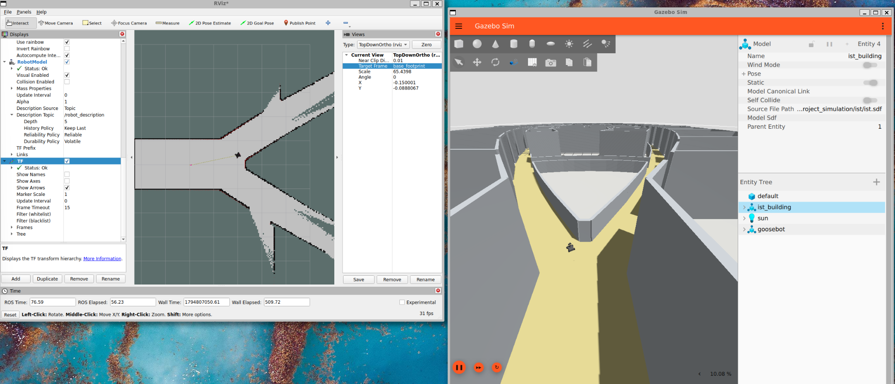

The occupancy map grows as you drive. Scans should align with nearby boundaries; unexplored space remains unknown.

</details>

**Save the RViz layout:** `mkdir -p ~/rviz_configs`, then **File → Save Config As** → `~/rviz_configs/goosebot_mapping.rviz`. Next time load it with `rviz2 -d ~/rviz_configs/goosebot_mapping.rviz --ros-args -p use_sim_time:=true`. Configure displays once; reuse afterward. This saves the display layout, not the SLAM map.

Stop robot motion and save the map in another sourced terminal while SLAM and Gazebo stay running:

```bash
source /opt/ros/jazzy/setup.bash
source ~/goosebot_ws/install/setup.bash
cd ~/courses/eel4332-autonomous-vehicle-labs/final_project_simulation
mkdir -p results
MAP_NAME=ist_map
ros2 run nav2_map_server map_saver_cli -f "$PWD/results/$MAP_NAME" \
  --ros-args -p use_sim_time:=true
```

**Command breakdown:** `MAP_NAME` sets the IST map name and `-f` sets the output basename. Keep the YAML and image together.

## 6. IST — restart and navigate

Stop all launches as described above. Relaunch **the same world** in Terminal 1; leave SLAM stopped.

**Terminal 2 — AMCL/Nav2:**

```bash
source /opt/ros/jazzy/setup.bash
source ~/goosebot_ws/install/setup.bash
cd ~/courses/eel4332-autonomous-vehicle-labs
ros2 launch "$PWD/final_project_simulation/goosebot/navigation.launch.py" \
  map:="$PWD/final_project_simulation/results/ist_map.yaml"
```

**Command breakdown:** this IST wrapper loads your map automatically and starts AMCL/Nav2. Do not manually call a load-map service during normal startup. For campus, follow Step 9 for the accuracy comparison and GPS-aided navigation.

**Terminal 3 — navigation RViz:**

```bash
source /opt/ros/jazzy/setup.bash
source ~/goosebot_ws/install/setup.bash
rviz2 -d "$(ros2 pkg prefix nav2_bringup)/share/nav2_bringup/rviz/nav2_default_view.rviz" \
  --ros-args -p use_sim_time:=true
```

**Command breakdown:** `$(ros2 pkg prefix ...)` finds Nav2's installed package; `-d` loads its layout. Expect **Nav2 Goal**, **2D Pose Estimate**, and the **Navigation 2** panel.

1. **Initialize localization:** click **2D Pose Estimate**, then click and drag on the saved map at the robot's current position, pointing in its heading direction. Repeat this after restarting AMCL.
2. **Check alignment:** laser points should overlap the map's walls. Correct the initial pose if they do not. Brief map/TF warnings can occur before initialization.
3. **Choose a destination:** click **Nav2 Goal**, then click and drag in a free area of the map. The click selects the destination; dragging sets the final heading. Use the map in RViz; no coordinates from `mission.json` are needed.
4. Try a nearby goal first, then visit **two chosen destinations and Home**; wait 3 seconds at each destination. Keep teleop stopped. Choose Home on the saved map too.
5. **Check completion:** Navigation/Localization **active** means the system is running. **Feedback: active** means a goal is in progress. Count a goal as reached only after **succeeded** feedback and confirming the robot arrived and stopped.

**Save the RViz layout:** choose **File → Save Config As** and save `~/rviz_configs/goosebot_navigation.rviz` (create the directory with `mkdir -p ~/rviz_configs` if needed). On later sessions, start Gazebo and AMCL/Nav2 as above, then open your layout:

```bash
rviz2 -d ~/rviz_configs/goosebot_navigation.rviz --ros-args -p use_sim_time:=true
```

The layout saves display settings, not localization. Set **2D Pose Estimate** again each session and check scan alignment before sending goals.

<details>
<summary>Expected view — IST navigation in progress</summary>

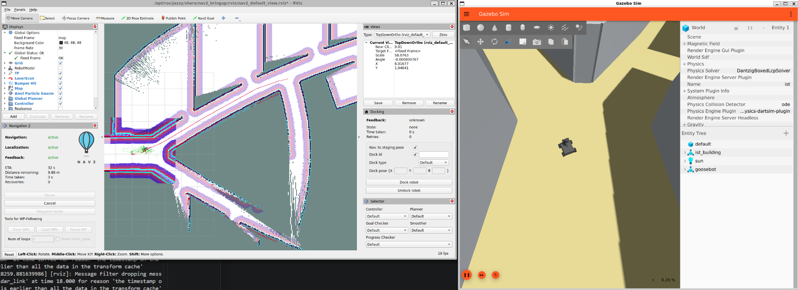

**Left: RViz** shows the saved map, laser scans and colored obstacle-clearance margins. **Right: Gazebo** shows the simulated robot in IST. In this example, Navigation and Localization are active, and **Feedback: active** with distance remaining means the robot is still travelling. Wait for **succeeded** and verify it stopped at the chosen destination before counting the goal as reached. Your map and camera view may differ.

</details>

<details>
<summary>Optional extensions — blocked route and LiDAR tuning (no submission)</summary>

Skip these for the required project. There are no extra screenshots, discussion questions or grading requirements.

### Optional: IST blocked route

Restart with `ist/ist_blocked.sdf`, keeping your baseline **IST map**, robot settings and goals. Restart AMCL/Nav2 and set the initial pose; do not remap the barrier. Show whether the robot detours, stops, recovers or fails. Campus blocked-route testing is optional.

### Optional: indoor LiDAR tuning

After IST baseline navigation, open `final_project_simulation/src/goosebot_0/urdf/robot.urdf.xacro`. Inside **lidar_sensor**, change only **horizontal/samples: 720 → 360** or **update_rate: 10 → 5**.

Stop launches, run the Step 1 helper, source and relaunch IST. Compare scans under similar conditions. Restore the baseline and rebuild before campus.

</details>

<a id="9-part-b--inspect-gps-outdoors"></a>
<a id="9-part-b--gps-fusion-comparison"></a>

### 9. Part B — GPS/RTK localization and outdoor navigation

#### Before fusion — investigate raw sensor data

**Terminal 1 — shared setup for this investigation and the comparison:** stop old launches and start fresh at campus Home:

```bash
source /opt/ros/jazzy/setup.bash
source ~/goosebot_ws/install/setup.bash
cd ~/courses/eel4332-autonomous-vehicle-labs
ros2 launch "$PWD/final_project_simulation/goosebot/world.launch.py" \
  world:="$PWD/final_project_simulation/campus/campus.sdf" gps_profile:=comparison
```

Wait for Gazebo and Goosebot to load; click **Play** if paused. Keep Terminal 1 running. Leave SLAM, AMCL, GPS navigation and the comparison recorder stopped during this investigation. In each inspection terminal, source ROS and your course workspace as in the earlier steps.

**Start with one GPS reading.** In a sourced inspection terminal, run these commands while Goosebot is stationary:

```bash
ros2 topic list -t
ros2 topic echo /gps/fix --once
```

The first command lists topic names and message types. Find `/gps/fix` in the list. The second prints one ordinary GPS fix and exits. Look for `latitude` and `longitude` in degrees, `altitude` in meters, and the timestamp under `header`.

Use the topic list to find the RTK-like GPS, IMU, wheel joint states, and 2-D LiDAR. Replace `/gps/fix` in the example with each topic name to read one message while Goosebot is parked.

**Topic hints:** The 2-D LiDAR publishes distance readings on `/scan`. For the wheels, read `/joint_states`, which reports each wheel joint’s rotation angle and angular speed. The wheel odometry node uses wheel rotation and robot geometry to estimate the robot’s motion and publishes that estimate on `/wheel/odometry`.

**In your report**, record the topic name and a short excerpt of the raw message for each source, including ordinary GPS. For long arrays such as LiDAR ranges, a few values are enough.

#### View the ROS 2 node graph

Keep the campus simulation running from the raw sensor activity. In the same sourced inspection terminal, run:

```bash
ros2 run rqt_graph rqt_graph
```

Select **Nodes/Topics (all)** and click **Refresh** if needed. In your report, include one screenshot and label the two topics entering `/ekf_filter_node`: `/wheel/odometry` and `/imu/data`.

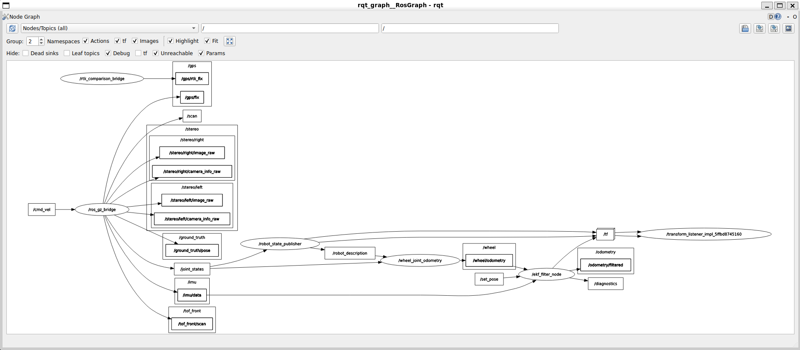

*Example campus graph with **Hide → Dead sinks** and **Leaf topics** unchecked. Look for `/odometry/filtered` to the right of `/ekf_filter_node`.*

**How to read the graph.** Ovals are nodes (programs). Small rectangles are topics (named channels for messages). Follow the arrows from the publishing node through the topic to the subscribing node. Larger boxes such as `/wheel` group topics by namespace.

| Connection | What flows through it |
|---|---|
| `/ros_gz_bridge` → `/joint_states` → `/wheel_joint_odometry` | Gazebo wheel rotation readings. The wheel odometry node uses these readings and robot geometry from `/robot_description` to estimate motion. |
| `/wheel_joint_odometry` → `/wheel/odometry` → `/ekf_filter_node` | Wheel-derived motion. The local EKF uses the forward speed from this message. |
| `/ros_gz_bridge` → `/imu/data` → `/ekf_filter_node` | Simulated IMU readings. The local EKF uses yaw rate to estimate how fast the robot is turning. |

The EKF publishes filtered odometry on `/odometry/filtered` and sends the `odom` → `base_footprint` transform on `/tf`. The graph can hide outputs with no subscribers, including when **Hide → Dead sinks** is checked. To check who publishes the filtered output directly, run `ros2 topic info /odometry/filtered --verbose` in a sourced terminal.

<a id="a-compare-localization-on-one-drive"></a>

#### A. Required — compare localization on one drive

Earlier GPS screenshots/results used the former 0.06 campus scale and/or command-derived baseline and illustrate output format only. Record a **new run in a new output folder** for the wheel/IMU baseline; report your own values.

**Question:** how does GPS precision affect localization? Two independent simulated sensors measure the same drive:

| Estimate | Input | Horizontal noise standard deviation |
|---|---|---|
| A | Existing odometry + IMU | No GPS |
| B | A + ordinary GPS | About 1.5–1.7 m per axis |
| C | A + RTK-like GPS | About 2 cm per axis |

The profiles model **measurement noise only**—not real RTK correction links, multipath or loss of RTK fix. Add no XML and do not edit Xacro. Install plotting dependencies once: `sudo apt install -y python3-numpy python3-matplotlib python3-pil`.

**After capturing the raw readings and node graph:** restart the comparison-profile world at fresh Home using the Terminal 1 command above, then start the recorder below.

**Terminal 2 — record, then report:**

```bash
source /opt/ros/jazzy/setup.bash
source ~/goosebot_ws/install/setup.bash
cd ~/courses/eel4332-autonomous-vehicle-labs
ros2 launch "$PWD/final_project_simulation/goosebot/gps_compare.launch.py" \
  output:="$PWD/final_project_simulation/results/gps_rtk_comparison"
```

Keep still until **READY**. Use Terminal 4's Step 5 teleop to drive a safe **10–20 m loop with turns**. Stop with **k**, wait three simulated seconds, then **Ctrl+C in Terminal 2** to save.

**Minimum recording distance: 5 m of total travel after READY.** This is distance travelled along the route, not distance from Home; turning in place does not count. Aim for 10–20 m to leave a margin. The report rejects shorter recordings. If it reports “Recorded route shorter than 5 m,” repeat with a longer route and a **new output directory**. If you already drove that far, inspect the recording/odometry before repeating. Generate the report only after the recorder has saved and exited:


```bash
python3 final_project_simulation/goosebot/gps_compare.py report \
  --input final_project_simulation/results/gps_rtk_comparison
```

**Command breakdown:** `gps_profile:=comparison` supplies ordinary `/gps/fix` and RTK-like `/gps/rtk_fix` simultaneously. The recorder saves raw sensor data and separate evaluation-only truth. `report` replays supplied position filters and writes **`comparison.png`** and **`metrics.json`**. Use a new output directory for another run; files are not overwritten.

**Open `comparison.png` to see the plots.** Its **left column** shows the unmodified recorded experiment; its **right column** adds an artificial +15% prediction scale error equally to A/B/C. The top row shows routes; the bottom row shows position error over time (lower is better). Do not describe the controlled column as unmodified robot performance.

**`metrics.json` contains named sections, not visual columns:**

| In `comparison.png` | Section inside `metrics.json` |
|---|---|
| Left column — unmodified | `metrics → unmodified` |
| Right column — artificial +15% scale error | `metrics → controlled_scale_error` |

For the required results table, expand **`metrics → unmodified`** in VS Code. Use **`baseline` for A**, **`fused` for B**, and **`rtk` for C**. Copy `rmse_m` into the RMSE column and `final_error_m` into the final-error column; both are in meters. The terminal prints the same values as **RMSE / final error**. Use your own run's values, not the example below.

Ground truth scores horizontal position error only; it never enters a filter. Both GPS position filters use the known commanded Home pose/heading as their starting reference.

<details>
<summary>Expected output — recording, report, plot and JSON examples</summary>

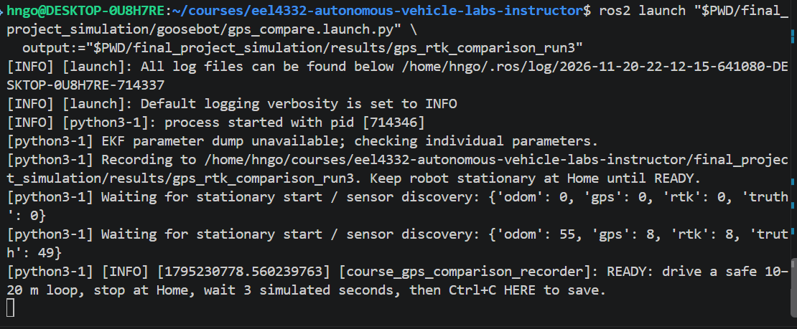

Wait for **READY** before driving. The parameter-dump fallback message is informational when individual checks succeed.

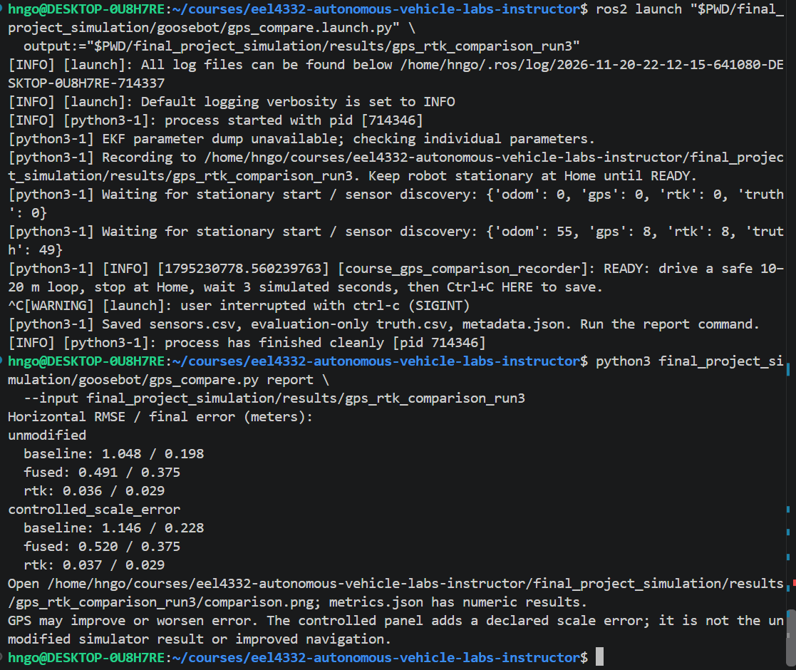

After Ctrl+C, expect **Saved sensors.csv, evaluation-only truth.csv, metadata.json** and a clean exit. Run the report next; it prints separate `unmodified` and `controlled_scale_error` results.

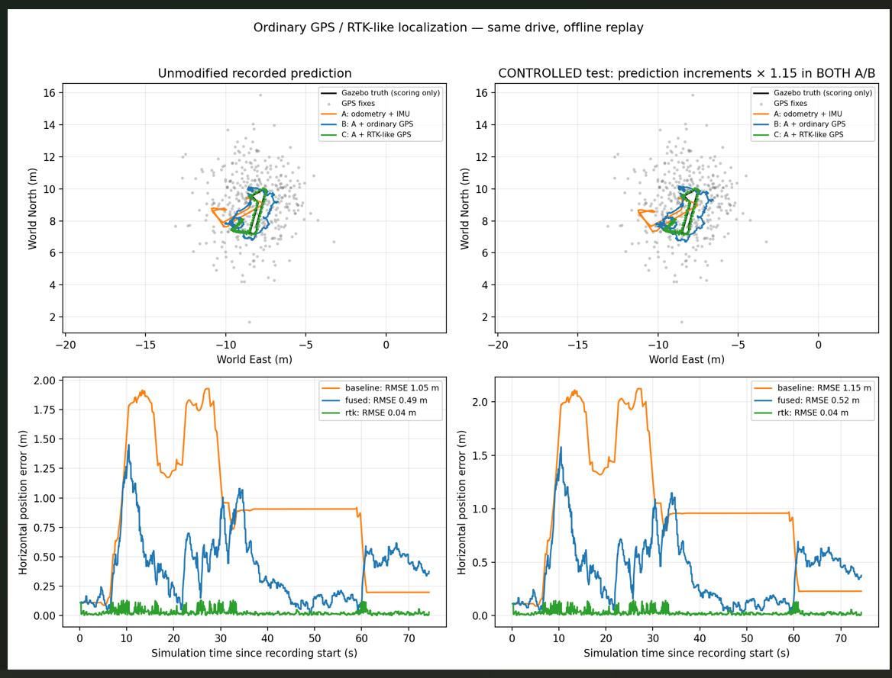

This instructor pilot shows ordinary GPS reducing overall RMSE while giving a worse final error than odometry alone; the idealized RTK-like estimate is more accurate in this run. Improvement is not guaranteed. The title's “BOTH A/B” wording is from this example's plot label; the artificial prediction scale is applied equally to A/B/C.

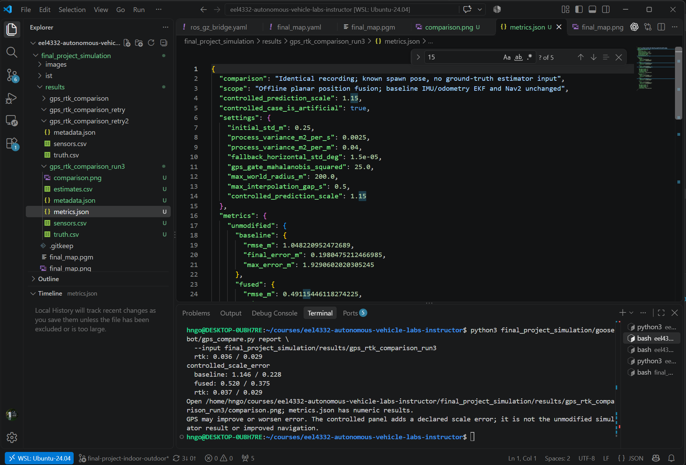

The JSON screenshot shows `metrics → unmodified → baseline`, including `rmse_m` and `final_error_m`. Scroll down for `fused`, `rtk`, and the separate controlled case. These screenshots use the instructor checkout and a run-specific folder; use your own checkout/output path.

</details>

**Submit:** the plot and this table from the unmodified case, plus two sentences explaining the measured differences. Briefly state whether the controlled case changes your conclusion.

| Estimate | Horizontal RMSE (m) | Final position error (m) |
|---|---|---|
| A — odometry + IMU | Fill | Fill |
| B — A + ordinary GPS | Fill | Fill |
| C — A + RTK-like GPS | Fill | Fill |

RMSE is root mean square distance to Gazebo truth at matching timestamps. GPS need not improve an already accurate estimate. This experiment evaluates localization, not navigation success.

<a id="gps-aided-outdoor-navigation"></a>

#### B. Required — RTK-like GPS navigation using the campus map

The campus now uses **1:1 horizontal meters**; Goosebot and sensor ranges are unscaled. The supplied map matches the world and GPS east/north frame. **No new mapping or manual alignment is needed for this navigation activity.** The launch loads the supplied pedestrian-only map for you. The old short-range/map-free navigation exercise is retired.

**Updating an existing run:** stop all launches, pull the complete update and restart at the new Home. Old campus coordinates and recordings from the former 0.06 world need to be replaced with a fresh run. Generated assets are committed—no mesh generation or ROS rebuild is needed for this update. Do not mix old world files with the new map.

**Terminal 1 — fresh full-scale campus with RTK-like GPS:**

```bash
source /opt/ros/jazzy/setup.bash
source ~/goosebot_ws/install/setup.bash
cd ~/courses/eel4332-autonomous-vehicle-labs
ros2 launch "$PWD/final_project_simulation/goosebot/world.launch.py" \
  world:="$PWD/final_project_simulation/campus/campus.sdf" gps_profile:=rtk
```

**Before starting Terminal 2:** wait until Gazebo has finished loading and Goosebot appears at Home. If the simulation is paused, click **Play**. Keep the robot stationary; leave SLAM, AMCL and teleop stopped. Keep Terminal 1 running throughout the activity. Use these readiness checks rather than a fixed number of seconds.

**Terminal 2 — GPS localization, campus map and Nav2:**

```bash
source /opt/ros/jazzy/setup.bash
source ~/goosebot_ws/install/setup.bash
cd ~/courses/eel4332-autonomous-vehicle-labs
ros2 launch "$PWD/final_project_simulation/goosebot/gps_navigation.launch.py" \
  profile:=rtk reference_map:="$PWD/final_project_simulation/campus/reference.yaml"
```

Wait for **GPS_LOCALIZATION_READY**, then **CAMPUS_MAP_READY**, and active Nav2 nodes. **Do not send navigation goals until all three are ready.** The GPS filter owns `map → odom`; the wheel/IMU EKF owns `odom → base_footprint`. Home position/heading are known launch settings, not measured ground truth.

**Command breakdown:** `gps_profile:=rtk` selects simulated RTK-like noise; `profile:=rtk` selects matching filter uncertainty. `reference_map:=` validates the matching full-scale map, builds the pedestrian-only grid, and starts the map server. Grass and travel along asphalt motor lanes are forbidden in both costmaps. Short crossings across asphalt are permitted where mapped pedestrian pavement continues on both sides; separate sidewalks and interior non-asphalt paved corridors remain permitted. GPS estimates pose; the supplied map supports global planning; live LiDAR detects obstacles. There is no AMCL or 2D Pose Estimate. The map is supplied knowledge, not perfect localization or student SLAM evidence.

**Terminal 3 — full-map navigation view:**

```bash
source /opt/ros/jazzy/setup.bash
source ~/goosebot_ws/install/setup.bash
cd ~/courses/eel4332-autonomous-vehicle-labs
rviz2 -d "$PWD/final_project_simulation/goosebot/gps_reference_navigation.rviz" \
  --ros-args -p use_sim_time:=true
```

Check scans overlap nearby map building edges. **Localization: inactive** refers to absent AMCL; use the GPS-ready message. The global map covers the campus; the local costmap rolls around Goosebot. Non-asphalt interior paved routes and sidewalks alongside asphalt roads are included; a generic road label does not block them. Map resolution is 0.25 m to keep full-campus planning practical; the local grid is 0.025 m. The configured footprint is 0.20 × 0.20 m. Widths use the instructor’s map measurements where matched, with a 3 m minimum for unmeasured walks; see [widths/access](campus/WIDTHS_AND_ACCESS.md).

**Terminal 4 — reach A, then B, then Home:**

```bash
source /opt/ros/jazzy/setup.bash
source ~/goosebot_ws/install/setup.bash
cd ~/courses/eel4332-autonomous-vehicle-labs
python3 final_project_simulation/goosebot/gps_goal.py --waypoint A && \
python3 final_project_simulation/goosebot/gps_goal.py --waypoint B && \
python3 final_project_simulation/goosebot/gps_goal.py --home
```

Each command waits for its goal to finish; `&&` continues only after success. Expect **SUCCEEDED** after each. `--waypoint` reads GPS-aligned meter coordinates from `campus/mission.json`; no coordinates need to be copied. A and B are about 20 m along mapped routes from Home, on opposite sides, keeping the exercise local while testing full-map planning beyond current LiDAR range. Outdoor forward speed is capped at 1.0 m/s; Nav2 may slow for turns or obstacles; keyboard speed is separate. You may also use **Nav2 Goal** on permitted pedestrian paths/sidewalks.

**Current campus map — after connectivity corrections**

The updated pedestrian network is loaded in RViz alongside the matching Gazebo world. Sidewalks and short permitted crossings remain connected; asphalt lanes outside those crossings stay forbidden. In this screenshot no goal is active, so **Feedback: unknown** is expected. **Localization: inactive** refers to absent AMCL.

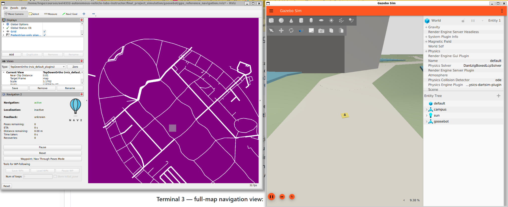

**Example campus navigation run**

These instructor screenshots show the RViz/Gazebo views during a live run. They were captured before the latest pavement-gap and bend-join corrections, so small gaps/notches in these images should not be treated as expected features of the updated map. Timing and exact paths vary.

**1. Campus overview:** the white pedestrian network is permitted; purple regions are forbidden. Gazebo shows the corresponding campus pavement and water.

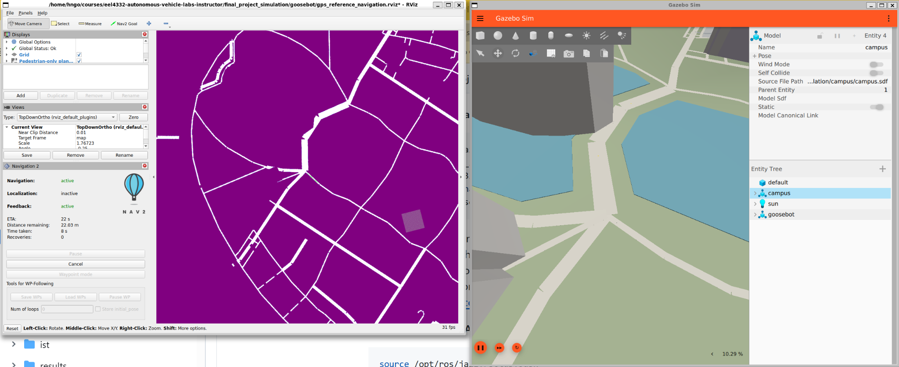

**2. Following a path:** the planned path stays on the permitted pavement, and the small Goosebot moves along it in Gazebo. RViz shows **Navigation: active** and **Feedback: active**.

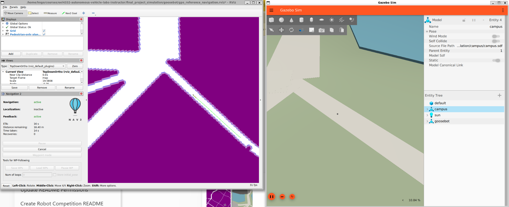

**3. Goal reached:** RViz shows **Feedback: reached**, zero remaining distance and ETA, with Goosebot stopped on the pavement. **Localization: inactive** is expected here because AMCL is absent; GPS localization is provided separately.

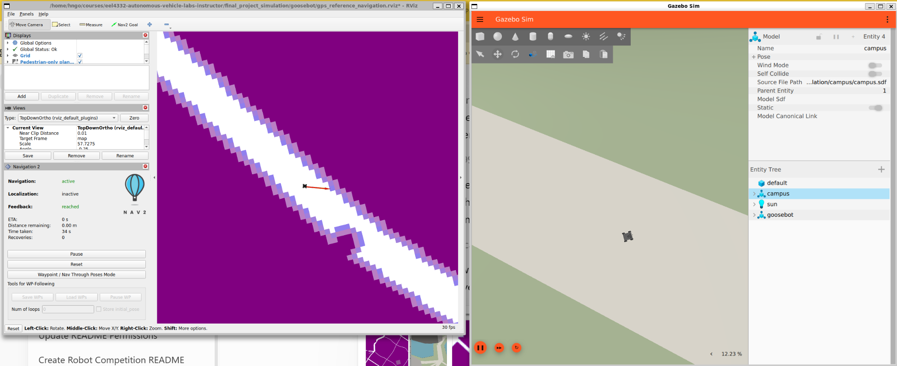

**Submit:** a campus video showing GPS readiness, the global path staying on pedestrian paths/sidewalks, and A, B and Home reached. Explain the distinct GPS, prior-map and LiDAR roles. Briefly demonstrate grass and asphalt-lane goals away from permitted crossings are rejected; cancel it before continuing. Do not disable the pedestrian mask or shrink the footprint. Cancel navigation if localization or motion behaves unexpectedly.

See [map details and checks](goosebot/GPS_MAP_EXTENSION.md). Step 9A compares localization accuracy from one recorded manual drive. This live navigation activity uses RTK-like GPS.

#### C. Optional — ordinary GPS + encoders + IMU + LiDAR

Try the [budget localization experiment](goosebot/BUDGET_LOCALIZATION.md) to measure a lower-cost sensor combination on one recorded manual drive. It compares encoder/gyro alone, + ordinary GPS, + ordinary GPS/LiDAR map matching, and a LiDAR-without-GPS control. The guide includes full terminal commands and an optional controlled GPS-withholding replay.

This uses measured simulated wheel-joint velocities, **not command-derived odometry**. It reports offline horizontal RMSE/final/maximum error; no live navigation or hardware-accuracy claim is made. It is optional and ungraded; use your own recording to assess its performance.

### 10. Write your individual report

Use the [Word report template](Goosebot_Final_Project_Report_Template.docx). Paste your results in project order and briefly explain what each result shows. End with a short reflection on the indoor and outdoor runs.

## What to submit

- **Individual report.** Use the [Word report template](Goosebot_Final_Project_Report_Template.docx) to paste results from the required project steps, briefly explain each result, and reflect on indoor and outdoor mapping and navigation.
- **Two navigation videos or video links, about 2–3 minutes each.** Submit one for IST and one for campus. Show navigation to two destinations and back Home using AMCL in IST and RTK-like GPS localization on campus. Use goals A and B on the supplied pedestrian-only campus map. Make sure the instructor can open both links if you submit links.
- **GitHub repository link.** Link to your individual project repository and give the instructor access. Include your model/configuration, your saved IST map (YAML and image), and the commands and goals needed to reproduce your runs. Exclude build, install, and log directories, databases, and ROS bags.

AI assistance is allowed. Test its output and explain your work in your own words.

| Deliverable | Weight |
|---|---:|
| Individual report | 50% |
| IST navigation video | 20% |
| Campus navigation video | 20% |
| GitHub repository and reproducibility | 10% |
|---|---:|

<a id="goosebot-warm-up"></a>

## Optional reference

The practice-arena/perfect-map warm-up has **no required submission**. See the [detailed command and troubleshooting reference](COMMAND_REFERENCE.md) for that exercise, extra output examples, model diagnostics and full command breakdowns. All required steps are above. Step 9 separates the offline localization comparison from the live GPS navigation mode. Indoor AMCL remains unchanged.


### Campus map startup check

After `GPS_LOCALIZATION_READY`, wait for `CAMPUS_MAP_READY` and then Nav2 activation. The supplied helper configures and activates `/map_server`, then verifies a reliable, transient-local `/map` against the selected campus map before starting Nav2. Large maps may take time to load. A startup failure stops this launch; inspect the first map-server/helper error rather than sending a navigation goal. Stop older GPS navigation launches before restarting.

If RViz says **No map received**, check `ros2 lifecycle get /map_server`: it must be `active`. Having a publisher alone does not confirm map publication. Update this branch and restart the GPS navigation launch to use the startup check. If the robot moved, restart the world at fresh Home before restarting GPS localization.

If the map is publishing but RViz reports the GLSL sampler error, close RViz and try software rendering for RViz only:

```bash
LIBGL_ALWAYS_SOFTWARE=true rviz2 -d "$PWD/final_project_simulation/goosebot/gps_reference_navigation.rviz" \
  --ros-args -p use_sim_time:=true
```

This is a rendering diagnostic; it does not activate an inactive map server.
