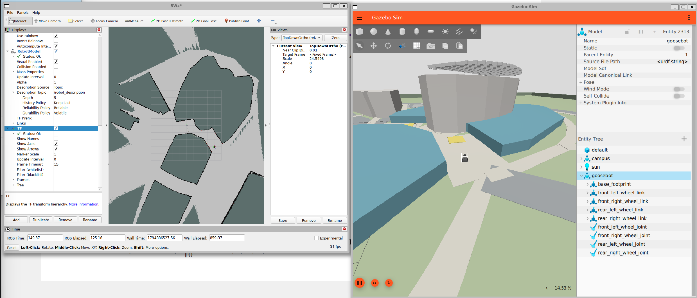

# Final Project — Indoor and Outdoor Goosebot Navigation

Use **`final-project-indoor-outdoor`**. Complete IST first, then campus. Build a SLAM map in each world. Navigate with **AMCL indoors** and **GPS fusion outdoors**, reaching **two destinations and Home** in each. Also complete the ordinary-GPS/RTK-like localization experiment below. Blocked-route testing and LiDAR tuning are optional, with no required submission. Physical SLAM/Nav2 and mission-client coding are optional; lane following remains the hardware component.

## Before you start

Complete Labs 4–5. Use your existing Ubuntu/WSL, ROS 2 Jazzy and Gazebo Harmonic installation. Work in your course fork; `origin` is your fork and `upstream` is the public course repository. Save your edits before updating; do not discard model or map changes.

```bash
cd ~/courses/eel4332-autonomous-vehicle-labs
git branch --show-current
git status --short
```

The branch should be `final-project-indoor-outdoor`. If it differs or files are modified, follow [the update guide](../docs/UPDATING_COURSE_REPOSITORY.md) first. With the correct branch and a clean working tree:

```bash
git fetch upstream &&
git merge --no-edit upstream/final-project-indoor-outdoor &&
git merge-base --is-ancestor upstream/final-project-indoor-outdoor HEAD &&
echo "Current checkout includes the latest fetched final-project-indoor-outdoor course commits"
git log -1 --oneline
```

**Command breakdown:** `fetch` downloads course updates; `merge` incorporates them; `merge-base --is-ancestor` checks they are included; `&&` continues only after success. Updating Git files does not rebuild your robot.

## Terminal conventions

Use four Ubuntu/WSL terminals: **1 Gazebo**, **2 SLAM or AMCL/Nav2**, **3 RViz**, **4 teleop/checks**. Open VS Code with `code .` from this checkout and confirm **WSL: Ubuntu**.

| Syntax | Meaning |
|---|---|
| `source /opt/ros/jazzy/setup.bash` then `source ~/goosebot_ws/install/setup.bash` | Enable ROS, then this built workspace in each new ROS terminal. |
| `ros2 run PACKAGE PROGRAM` / `ros2 launch PACKAGE FILE` | Run one program / a launch description. Local launch files may use an absolute path. |
| `name:=value` / `--ros-args -p name:=value` | A launch argument / a ROS parameter. `use_sim_time:=true` uses Gazebo's clock. |
| `~`, `$PWD`, `$(...)` | Home directory, current directory, and command output. Quotes keep a path together. |
| Trailing `\` | Continue the same command on the next line; copy all lines. |
| Ctrl+C | Stop the foreground program in its launch terminal. Closing only a GUI can leave processes running. |

**Before switching worlds or modes:** stop motion, save maps, then Ctrl+C teleop, SLAM/Nav2, RViz and Gazebo. Wait for prompts. Run only one simulator and one owner of `map → odom` (SLAM while mapping, AMCL while navigating). The perfect-map/ground-truth mode is optional practice only.

## 1. Setup — once, then rebuild when needed

Install missing packages:

```bash
sudo apt update
sudo apt install -y git python3-colcon-common-extensions python3-rosdep \
  ros-jazzy-ros-gz ros-jazzy-xacro ros-jazzy-robot-state-publisher \
  ros-jazzy-robot-localization ros-jazzy-slam-toolbox \
  ros-jazzy-navigation2 ros-jazzy-nav2-bringup \
  ros-jazzy-teleop-twist-keyboard python3-yaml
source /opt/ros/jazzy/setup.bash
```

**First setup only:** copy the complete pinned Goosebot package and build it. Existing users keep their edited package and rerun only the build helper.

```bash
cd ~/courses/eel4332-autonomous-vehicle-labs
mkdir -p final_project_simulation/src
# Run this clone/copy only once. Keep your existing edited package on later updates.
git clone --filter=blob:none --sparse --single-branch --branch nav2 \
  https://github.com/hoanbklucky/goose.git /tmp/eel4332-goose-source
git -C /tmp/eel4332-goose-source sparse-checkout set 11_simulation/ros2_ws/src/goosebot_0
git -C /tmp/eel4332-goose-source checkout bffaf3cdf2b38f3b5a53a977064e0c787e046ff7
cp -r --update=none /tmp/eel4332-goose-source/11_simulation/ros2_ws/src/goosebot_0 final_project_simulation/src/
# Omit the redundant packaged snapshot; the extracted source is already copied.
rm -f final_project_simulation/src/goosebot_0/goosebot-simulation.zip
# Link, fix script permissions, install dependencies, and build this source copy.
bash final_project_simulation/goosebot/build_student_workspace.sh
```

**Command breakdown:** the sparse clone selects the complete `goosebot_0` package; the pinned commit fixes its starting version; `cp -r --update=none` preserves existing destination files. The helper links this source into `~/goosebot_ws`, configures LiDAR/bridges, fixes executable permissions and the legacy GPS noise, installs dependencies, and builds.

```bash
source /opt/ros/jazzy/setup.bash
source ~/goosebot_ws/install/setup.bash
ros2 pkg prefix goosebot_0
ros2 pkg executables goosebot_0
```

Expect the prefix inside `~/goosebot_ws` and executables `cmd_vel_to_odom.py`, `ground_truth_map_odom_bridge.py`, `stereo_camera_info_fixer.py`. Do not copy old build/install/log directories. 

## 2. Use the supplied robot

LiDAR, `/scan` bridge, wheel visualization and GPS already exist after setup. **No sensor XML needs to be pasted.** Keep defaults for baseline mapping/navigation. After source/configuration changes, stop launches, rerun the Step 1 helper, source the workspace and relaunch; saving a file does not change a spawned robot.

## 3. Launch the current part’s world — Terminal 1

```bash
source /opt/ros/jazzy/setup.bash
source ~/goosebot_ws/install/setup.bash
cd ~/courses/eel4332-autonomous-vehicle-labs
ros2 launch "$PWD/final_project_simulation/goosebot/world.launch.py" \
  world:="$PWD/final_project_simulation/ist/ist.sdf"
```

**Command breakdown:** `world.launch.py` starts Gazebo, spawns Goosebot and starts its ROS interfaces; `world:=` selects the SDF file. **Part B:** change only the world path to `campus/campus.sdf`. Expect `GOOSEBOT SPAWNED`. If a server is already running, stop its launch before retrying.

To find the robot: collapse the building in Gazebo's Entity Tree, right-click **goosebot → Move To**, then zoom. This moves the camera.

<details>
<summary>Gazebo tips — follow the robot, turn it, or recover a flip</summary>

Select the top-level **goosebot** in the Entity Tree, not a wheel or link.

| Camera action | What it does |
|---|---|
| Right-click → **Move To** | Centers the camera on Goosebot once; does not move the robot. |
| **Follow Options → Follow** | Moves the camera with Goosebot and keeps looking at it. |
| **Follow Options → Free Look** | Moves with Goosebot while letting you look around; it still follows. |
| **Follow Options → Look At** | Follows Goosebot while aiming at a selected target, which can be another object. |
| **Stop following** | Close the menu, click inside the 3-D view, then press **Esc**. |

**Turn the robot normally:** focus the teleop terminal; use lowercase **j/l** to turn and **k** to stop. Camera controls do not steer Goosebot.

**If Goosebot flips:**

1. Stop teleop with **k**, then Ctrl+C; cancel navigation if active. **Pause Gazebo**.
2. Select the whole **goosebot** and expand **Pose**. If these fields are editable, set **Roll = 0**, **Pitch = 0**, keep the desired **Yaw**, and raise **Z** just enough for the wheels to clear the ground. Apply the edit, resume and let it settle. Avoid placing it inside walls.
3. If Pose is read-only or recovery fails, stop all launches with Ctrl+C and rerun the same world command to respawn upright. Restart SLAM/RViz for mapping, or the appropriate localization/navigation mode.

Moving the robot by editing Pose is a teleport: it can invalidate SLAM/localization. Restart the mapping session if the map becomes misaligned; initialize AMCL again for saved-map navigation. For the GPS experiment or GPS navigation, restart at fresh Home with the documented known heading rather than continuing after a teleport. Save useful results before restarting. Drive slowly and avoid obstacles/edges to reduce flips.

</details>

<a id="goosebot-readiness-check"></a>

## 4. Start SLAM — Terminal 2

Keep Gazebo playing in Terminal 1. Start SLAM **before opening RViz**, then keep this launch running:

```bash
source /opt/ros/jazzy/setup.bash
source ~/goosebot_ws/install/setup.bash
cd ~/courses/eel4332-autonomous-vehicle-labs
ros2 launch slam_toolbox online_async_launch.py use_sim_time:=true \
  slam_params_file:="$PWD/final_project_simulation/goosebot/slam_goosebot.yaml"
```

**Command breakdown:** `online_async_launch.py` starts LiDAR SLAM; `slam_params_file:=` loads course settings. SLAM supplies the `map` frame and builds `/map` from scans.

## 5. Open RViz, drive and save

**Terminal 3 — open RViz after SLAM starts:**


```bash
source /opt/ros/jazzy/setup.bash
source ~/goosebot_ws/install/setup.bash
rviz2 --ros-args -p use_sim_time:=true
```

For your first run, add these yourself using **Add → By display type → rviz_default_plugins**:

| Display | Setting |
|---|---|
| LaserScan | Topic `/scan`; Best Effort reliability |
| RobotModel | Description Source: Topic; Description Topic: `/robot_description` |
| TF | Enable for frame checks; hide later if cluttered |
| Map | Topic `/map`; Reliable / Transient Local if needed |

Set **Global Options → Fixed Frame: map** and keep Map enabled on `/map`. Choose **Views → TopDownOrtho**. Expect the robot, scans and an initial occupancy map; the map grows as you drive. Keep this fixed frame throughout mapping. A blank Map Topic causes “Empty topic name”; edit the Topic property, not the red Status row.

**Terminal 4 — start slow keyboard driving:**

```bash
source /opt/ros/jazzy/setup.bash
source ~/goosebot_ws/install/setup.bash
ros2 run teleop_twist_keyboard teleop_twist_keyboard \
  --ros-args -p speed:=0.1 -p turn:=0.5
```

**Command breakdown:** `speed` and `turn` set 0.1 m/s and 0.5 rad/s. Focus this terminal: lowercase **i** forward, **j/l** turn, **k** stop. Confirm robot motion, scan alignment and RobotModel/TF status, then explore a connected route to your two destinations and revisit an earlier area. Cover an alternative IST route; full-building/full-campus exploration is unnecessary.

<details>
<summary>Troubleshooting only — missing map, scans or transforms</summary>

If RViz reports **Frame [map] does not exist**, keep Fixed Frame `map` and check Terminal 2 for SLAM startup errors. RViz cannot create this frame. Missing transforms can also cause scan “queue is full” messages.

Run in a separate sourced terminal only if the robot/scans are missing:

```bash
source /opt/ros/jazzy/setup.bash
source ~/goosebot_ws/install/setup.bash
ros2 topic echo /scan --once --field header.frame_id
ros2 topic hz /scan
```

Expect `lidar_link` and arriving scans. Ctrl+C the rate check, then run these one at a time:

```bash
ros2 run tf2_ros tf2_echo base_footprint lidar_link
ros2 run tf2_ros tf2_echo odom base_footprint
```

**Command breakdown:** `echo --once --field` prints one selected message field; `hz` measures wall-clock arrival rate; `tf2_echo A B` reports frame B relative to A. Numerical TF should appear after discovery; Ctrl+C each continuous check. Slow simulation produces less than the configured 10 Hz wall-clock scan rate.

</details>

<details>
<summary>Expected mapping views</summary>




The occupancy map grows as you drive. Scans should align with nearby boundaries; unexplored space remains unknown.

</details>

**Save the RViz layout:** `mkdir -p ~/rviz_configs`, then **File → Save Config As** → `~/rviz_configs/goosebot_mapping.rviz`. Next time load it with `rviz2 -d ~/rviz_configs/goosebot_mapping.rviz --ros-args -p use_sim_time:=true`. Configure displays once; reuse afterward. This saves the display layout, not the SLAM map.

Stop robot motion and save the map in another sourced terminal while SLAM and Gazebo stay running:

```bash
source /opt/ros/jazzy/setup.bash
source ~/goosebot_ws/install/setup.bash
cd ~/courses/eel4332-autonomous-vehicle-labs/final_project_simulation
mkdir -p results
MAP_NAME=ist_map  # Part B: change this to campus_map
ros2 run nav2_map_server map_saver_cli -f "$PWD/results/$MAP_NAME" \
  --ros-args -p use_sim_time:=true
```

**Command breakdown:** `MAP_NAME` chooses `ist_map` or `campus_map`; `-f` sets the output basename. The saver writes YAML plus an image. Keep both together and save each world separately.

## 6. IST — restart and navigate

Stop all launches as described above. Relaunch **the same world** in Terminal 1; leave SLAM stopped.

**Terminal 2 — AMCL/Nav2:**

```bash
source /opt/ros/jazzy/setup.bash
source ~/goosebot_ws/install/setup.bash
cd ~/courses/eel4332-autonomous-vehicle-labs
ros2 launch "$PWD/final_project_simulation/goosebot/navigation.launch.py" \
  map:="$PWD/final_project_simulation/results/ist_map.yaml"
```

**Command breakdown:** this IST wrapper loads your map automatically and starts AMCL/Nav2. Do not manually call a load-map service during normal startup. For campus, save your map in Step 5, then use Step 9's experiment and GPS-aided navigation instead of this AMCL launch.

**Terminal 3 — navigation RViz:**

```bash
source /opt/ros/jazzy/setup.bash
source ~/goosebot_ws/install/setup.bash
rviz2 -d "$(ros2 pkg prefix nav2_bringup)/share/nav2_bringup/rviz/nav2_default_view.rviz" \
  --ros-args -p use_sim_time:=true
```

**Command breakdown:** `$(ros2 pkg prefix ...)` finds Nav2's installed package; `-d` loads its layout. Expect **Nav2 Goal**, **2D Pose Estimate**, and the **Navigation 2** panel.

1. **Initialize localization:** click **2D Pose Estimate**, then click and drag on the saved map at the robot's current position, pointing in its heading direction. Repeat this after restarting AMCL.
2. **Check alignment:** laser points should overlap the map's walls. Correct the initial pose if they do not. Brief map/TF warnings can occur before initialization.
3. **Choose a destination:** click **Nav2 Goal**, then click and drag in a free area of the map. The click selects the destination; dragging sets the final heading. Use the map in RViz; no coordinates from `mission.json` are needed.
4. Try a nearby goal first, then visit **two chosen destinations and Home**; wait 3 seconds at each destination. Keep teleop stopped. Choose Home on the saved map too.
5. **Check completion:** Navigation/Localization **active** means the system is running. **Feedback: active** means a goal is in progress. Count a goal as reached only after **succeeded** feedback and confirming the robot arrived and stopped.

**Save the RViz layout:** choose **File → Save Config As** and save `~/rviz_configs/goosebot_navigation.rviz` (create the directory with `mkdir -p ~/rviz_configs` if needed). On later sessions, start Gazebo and AMCL/Nav2 as above, then open your layout:

```bash
rviz2 -d ~/rviz_configs/goosebot_navigation.rviz --ros-args -p use_sim_time:=true
```

The layout saves display settings, not localization. Set **2D Pose Estimate** again each session and check scan alignment before sending goals.

<details>
<summary>Expected view — IST navigation in progress</summary>


**Left: RViz** shows the saved map, laser scans and colored obstacle-clearance margins. **Right: Gazebo** shows the simulated robot in IST. In this example, Navigation and Localization are active, and **Feedback: active** with distance remaining means the robot is still travelling. Wait for **succeeded** and verify it stopped at the chosen destination before counting the goal as reached. Your map and camera view may differ.

</details>

<details>
<summary>Optional extensions — blocked route and LiDAR tuning (no submission)</summary>

Skip these for the required project. There are no extra screenshots, discussion questions or grading requirements.

### Optional: IST blocked route

Restart with `ist/ist_blocked.sdf`, keeping your baseline **IST map**, robot settings and goals. Restart AMCL/Nav2 and set the initial pose; do not remap the barrier. Show whether the robot detours, stops, recovers or fails. Campus blocked-route testing is optional.

### Optional: indoor LiDAR tuning

After IST baseline navigation, open `final_project_simulation/src/goosebot_0/urdf/robot.urdf.xacro`. Inside **lidar_sensor**, change only **horizontal/samples: 720 → 360** or **update_rate: 10 → 5**.

Stop launches, run the Step 1 helper, source and relaunch IST. Compare scans under similar conditions. Restore the baseline and rebuild before campus.

</details>

<a id="9-part-b--inspect-gps-outdoors"></a>
<a id="9-part-b--gps-fusion-comparison"></a>

### 9. Part B — GPS/RTK localization and outdoor navigation

#### A. Compare localization on one drive

**Question:** how does GPS precision affect localization? Two independent simulated sensors measure the same drive:

| Estimate | Input | Horizontal noise standard deviation |
|---|---|---|
| A | Existing odometry + IMU | No GPS |
| B | A + ordinary GPS | About 1.5–1.7 m per axis |
| C | A + RTK-like GPS | About 2 cm per axis |

The profiles model **measurement noise only**—not real RTK correction links, multipath or loss of RTK fix. Add no XML and do not edit Xacro. Install plotting dependencies once: `sudo apt install -y python3-numpy python3-matplotlib`.

**Terminal 1:** stop old launches and start fresh at campus Home:

```bash
source /opt/ros/jazzy/setup.bash
source ~/goosebot_ws/install/setup.bash
cd ~/courses/eel4332-autonomous-vehicle-labs
ros2 launch "$PWD/final_project_simulation/goosebot/world.launch.py" \
  world:="$PWD/final_project_simulation/campus/campus.sdf" gps_profile:=comparison
```

**Terminal 2 — record, then report:**

```bash
source /opt/ros/jazzy/setup.bash
source ~/goosebot_ws/install/setup.bash
cd ~/courses/eel4332-autonomous-vehicle-labs
ros2 launch "$PWD/final_project_simulation/goosebot/gps_compare.launch.py" \
  output:="$PWD/final_project_simulation/results/gps_rtk_comparison"
```

Keep still until **READY**. Use Terminal 4's Step 5 teleop to drive a safe **10–20 m loop with turns**. Stop with **k**, wait three simulated seconds, then **Ctrl+C in Terminal 2**. Generate the report:

```bash
python3 final_project_simulation/goosebot/gps_compare.py report \
  --input final_project_simulation/results/gps_rtk_comparison
```

**Command breakdown:** `gps_profile:=comparison` supplies ordinary `/gps/fix` and RTK-like `/gps/rtk_fix` simultaneously. The recorder saves raw sensor data and separate evaluation-only truth. `report` replays supplied position filters and writes **`comparison.png`** and **`metrics.json`**. Use a new output directory for another run; files are not overwritten.

The **left column** shows unmodified predictions; the **right** applies an artificial +15% prediction scale error equally to A/B/C to illustrate correction under a known error. Do not report that column as unmodified robot performance. Ground truth scores horizontal position error only; it never enters a filter. Both filters use the known commanded Home pose/heading as their starting reference.

**Submit:** the plot and this table from the unmodified case, plus two sentences explaining the measured differences. Briefly state whether the controlled case changes your conclusion.

| Estimate | Horizontal RMSE (m) | Final position error (m) |
|---|---|---|
| A — odometry + IMU | Fill | Fill |
| B — A + ordinary GPS | Fill | Fill |
| C — A + RTK-like GPS | Fill | Fill |

RMSE is root mean square distance to Gazebo truth at matching timestamps. GPS need not improve an already accurate estimate. This experiment evaluates localization, not navigation success.

<a id="gps-aided-outdoor-navigation"></a>

#### B. Navigate using live GPS fusion

Stop all launches. Restart **Terminal 1's campus command above with `gps_profile:=rtk`**. Stay at fresh Home; keep SLAM, AMCL and teleop stopped. This is a separate live mode, not replay.

**Terminal 2 — GPS localization and Nav2:**

```bash
source /opt/ros/jazzy/setup.bash
source ~/goosebot_ws/install/setup.bash
cd ~/courses/eel4332-autonomous-vehicle-labs
ros2 launch "$PWD/final_project_simulation/goosebot/gps_navigation.launch.py" profile:=rtk
```

Wait for **GPS_LOCALIZATION_READY**, then **Managed nodes are active**. The supplied live x/y/yaw EKF uses GPS positions and local odometry/IMU motion; it owns `map → odom`. The local EKF keeps `odom → base_footprint`. Initial global heading comes from the known Home spawn command, not a perfect IMU orientation or ground truth.

**Terminal 3 — GPS navigation view:**

```bash
source /opt/ros/jazzy/setup.bash
source ~/goosebot_ws/install/setup.bash
cd ~/courses/eel4332-autonomous-vehicle-labs
rviz2 -d "$PWD/final_project_simulation/goosebot/gps_navigation.rviz" \
  --ros-args -p use_sim_time:=true
```

1. Confirm RobotModel, LiDAR, the rolling global costmap and **Nav2 Goal** appear. No saved map or **2D Pose Estimate** is needed; AMCL is not running. Use Terminal 2's GPS-ready message, not the panel's AMCL localization indicator.
2. Send a nearby **Nav2 Goal**, then reach **two safe destinations and Home**. Choose short goals within about 6 m in already observed free space, on paved routes. LiDAR still marks obstacles; unknown space is not planned through.
3. To return to the known Home, run in a sourced **Terminal 4** from the repository root:

```bash
python3 final_project_simulation/goosebot/gps_goal.py --home
```

The helper sends a GPS-aligned ENU goal and reports **SUCCEEDED**. It also accepts `--latitude`, `--longitude`, and `--yaw-deg` using actual waypoint readings. RViz goals are GPS-aligned **meters**, not geographic degrees.

**Command breakdown:** `gps_profile:=rtk` changes runtime sensor noise without editing source; `profile:=rtk` selects matching live-filter uncertainty. The launch starts navigation-only Nav2 after initialization, with rolling LiDAR costmaps and no AMCL/map server. **Do not load `campus_map.yaml` in this mode**: a SLAM map's coordinates need not match the GPS datum. Your campus SLAM map remains a mapping deliverable.

**Submit:** the campus video showing GPS readiness, two reached destinations and Home; explain GPS's localization role versus LiDAR's obstacle role. Meter-noise navigation is an optional open-area trial: restart the world with `gps_profile:=ordinary` and navigation with `profile:=ordinary`. Its goal tolerance is 1.5 m versus 0.2 m for RTK-like mode, so do not compare reached-goal counts as equal-precision tests.

<details>
<summary>Checks and limitations</summary>

The profiles are idealized simulations, not hardware RTK. Matching profile settings, a centered antenna and fresh stationary Home start are required. In a physical robot, global heading needs an appropriate initialization/sensor solution. The navigation motion gate stops requests on stale GPS/odometry/scan data; a failed localizer shuts down its Nav2 launch. Do not run another global TF publisher or teleop alongside it.

GPS should stay near 28.1485°, −81.8495°. For degree-scale jumps, update the branch, rerun the Step 1 helper, source and respawn. No ROS rebuild is needed solely for the new local-file launchers. See [method/diagnostics](COMMAND_REFERENCE.md#gps-rtk-navigation-method) for filter and TF details.

</details>

### 10. Explain the system

Submit one shared **2–3 page explanation plus a topic table/diagram**, using [the system worksheet](SYSTEM_EXPLANATION.md). Explain sensor roles, actual EKF inputs, TF, SLAM versus AMCL, and goal → planning → control → motion. Include your GPS experiment observations and indoor/outdoor comparison. The GPS comparison code is supplied; students do not implement a filter. Step 9 supplies live GPS-aided campus navigation as well as the localization comparison.

## What to submit

- **Two videos, about 2–3 minutes each:** IST and campus; mapping/revisit, indoor AMCL / outdoor GPS localization, two reached destinations and Home. Include brief sensor evidence.
- **Fork/code and evidence:** model/configuration, separate IST/campus YAML+image maps, commands/goals, ordinary-GPS/RTK-like comparison plot and error table. Exclude build/install/log, databases and bags.
- **Shared system explanation:** include each member's contribution and one problem/fix. AI assistance is allowed; test its output and explain your work in your own words.

| Assessment | Weight |
|---|---:|
| Mapping in both worlds, indoor AMCL and outdoor GPS localization | 25% |
| Navigation in both worlds | 25% |
| Ordinary-GPS/RTK-like localization experiment | 15% |
| System understanding and evidence-based explanation | 30% |
| Reproducibility and contributions | 5% |

<a id="goosebot-warm-up"></a>

## Optional reference

The practice-arena/perfect-map warm-up has **no required submission**. See the [detailed command and troubleshooting reference](COMMAND_REFERENCE.md) for that exercise, extra output examples, model diagnostics and full command breakdowns. All required steps are above. Step 9 separates the offline localization comparison from the live GPS navigation mode. Indoor AMCL remains unchanged.

**INSTRUCTOR VALIDATION REQUIRED:** profile generation, fusion math, TF composition, gating, scoring, plotting and Nav2 parameters have offline tests and synthetic-data checks. The dual-sensor bridge and live GPS/Nav2 launch still require a course-machine pilot; no end-to-end Gazebo navigation result is claimed.
