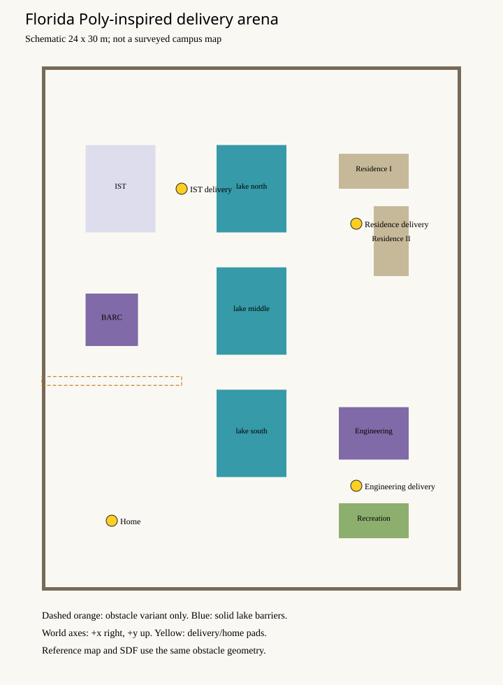

# Campus-inspired simulation environment

This **24 × 30 m teaching arena** is inspired by the supplied Florida Polytechnic campus images: IST/BARC on one side, residences/engineering on the other, and a central chain of lakes with crossing routes. It is schematic, compressed, and **not geographically accurate or to scale**. Open ground is traversable; sidewalk colors are visual cues, not enforced lane boundaries. The lakes are raised solid blue obstacles, not water physics or a real shoreline.



## What is provided?

- `campus.sdf`: baseline Gazebo world, without external world/mesh downloads.
- `campus_blocked.sdf`: identical world with an orange route barrier.
- `campus.launch.py`: launches the world and reuses installed ROBOTIS Waffle spawning, bridges, and robot-state publisher. No package build or system-file edits are needed for these local files.
- `reference.yaml` / `reference.pgm`: **geometric reference map**, not a SLAM result. Obstacles are generated from the same geometry as the world.
- `reference_goals.csv`: delivery coordinates for the reference map only.
- `generate_campus.py`: recreates the world/map/plan and checks route connectivity.

Install the Lab 4 TurtleBot3 dependencies first. Stop all existing simulator, SLAM, navigation, and keyboard processes before switching to this world. Run all commands from your course repository root in WSL/Ubuntu. Repeat source/export commands in every new terminal.

## 1. Launch the campus — Terminal 1

```bash
source /opt/ros/jazzy/setup.bash
source ~/turtlebot3_ws/install/setup.bash
export TURTLEBOT3_MODEL=waffle
cd ~/courses/eel4332-autonomous-vehicle-labs
ros2 launch "$PWD/final_project_simulation/campus/campus.launch.py"
```

Home/spawn is **world x = -8 m, y = -11 m, yaw = 0 rad** (facing +x). Check that `waffle` appears in Gazebo's Entity Tree. Only one Gazebo server should run.

## 2. Create your own map — Terminal 2

```bash
source /opt/ros/jazzy/setup.bash
source ~/turtlebot3_ws/install/setup.bash
export TURTLEBOT3_MODEL=waffle
ros2 launch turtlebot3_cartographer cartographer.launch.py use_sim_time:=True
```

In **Terminal 3**, drive slowly around both sides of the lakes and through the gaps between them; visit each delivery pad and return toward home:

```bash
source /opt/ros/jazzy/setup.bash
source ~/turtlebot3_ws/install/setup.bash
export TURTLEBOT3_MODEL=waffle
ros2 run turtlebot3_teleop teleop_keyboard
```

Keep keyboard focus in Terminal 3. `w/x` changes forward speed, `a/d` changes turning speed, and `s` or Space stops. Mapping the whole arena will take longer than Lab 4's small obstacle world. You only need sufficient mapped coverage for all delivery routes and the alternative route used in the obstacle trial.

Stop motion, keep the simulator/mapper running, then save in **Terminal 4**:

```bash
source /opt/ros/jazzy/setup.bash
source ~/turtlebot3_ws/install/setup.bash
export TURTLEBOT3_MODEL=waffle
cd ~/courses/eel4332-autonomous-vehicle-labs/final_project_simulation
mkdir -p results
ros2 run nav2_map_server map_saver_cli -f "$PWD/results/campus_map" --ros-args -p use_sim_time:=true
```

Keep `campus_map.yaml` and its image together. This is the student's map for the final; the supplied reference map is an instructor check/fallback only if explicitly allowed.

## 3. Navigate on your map

Stop keyboard, Cartographer, and simulator with Ctrl+C. Restart the campus using Terminal 1's command. In another terminal:

```bash
source /opt/ros/jazzy/setup.bash
source ~/turtlebot3_ws/install/setup.bash
export TURTLEBOT3_MODEL=waffle
cd ~/courses/eel4332-autonomous-vehicle-labs
ros2 launch turtlebot3_navigation2 navigation2.launch.py use_sim_time:=True map:="$PWD/final_project_simulation/results/campus_map.yaml"
```

Initialize AMCL with **2D Pose Estimate** at home on your saved map. Check scan/wall alignment as in Lab 5, then test nearby goals before the full mission. Stop any localization teleop before autonomous goals.

**Coordinate warning:** Gazebo world coordinates and a student's SLAM-map coordinates need not match. Select the three yellow-pad destinations and home in RViz2 on **your own saved map** and record those map-frame coordinates. Do not copy the reference coordinates into a mission using a different map.

| Location | World/reference-map x (m) | y (m) | Example yaw (rad) |
|---|---:|---:|---:|
| Home | -8 | -11 | 0 |
| IST delivery | -4 | 8 | 0 |
| Residence delivery | 6 | 6 | 0 |
| Engineering delivery | 6 | -9 | 0 |

For an **instructor reference-map check**, substitute `final_project_simulation/campus/reference.yaml` in the navigation command. Set the initial pose to (-8, -11, 0) in that reference map; `reference_goals.csv` then uses the same coordinate frame. Do not label the provided map as student-generated SLAM.

## 4. Reproducible obstacle trial

Stop all baseline processes and launch the alternative world:

```bash
source /opt/ros/jazzy/setup.bash
source ~/turtlebot3_ws/install/setup.bash
export TURTLEBOT3_MODEL=waffle
cd ~/courses/eel4332-autonomous-vehicle-labs
ros2 launch "$PWD/final_project_simulation/campus/campus.launch.py" world_file:=campus_blocked.sdf
```

Run navigation with the **original baseline map**, the same goals, and a fresh AMCL initial pose. Do not remap the added barrier. The fixed barrier is centered at **(-8, -3) m**, dimensions **8 × 0.5 × 1 m**, in Gazebo world coordinates. It obstructs the west-side route toward IST; an alternative around its east end remains open. Check that live laser/costmap data sees it, and record the observed response. Do not assume a detour proves global replanning.

## Regenerate or modify

```bash
python3 final_project_simulation/campus/generate_campus.py
```

This checks connectivity with 0.4 m center clearance, then overwrites the generated SDF, reference-map, and SVG files. Edit geometry only in the generator so the map and world stay consistent. It does not implement students' mission-client TODOs.

**Validation status:** Python syntax, SDF XML structure, map dimensions, obstacle consistency, and baseline/blocked route connectivity are checked offline. Gazebo/ROS are not installed in the authoring workspace. The instructor must run both world launches, verify Waffle spawning/scan/TF, map the arena, and test Nav2/obstacle behavior on the course WSL system before assigning it. Geometric connectivity is not proof of successful Nav2 execution.
