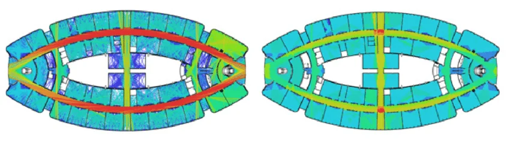

# IST interior — image-derived teaching world

Choose this world or the outdoor campus for the **same Goosebot final project**. All installation, sensor-assignment, launch, mapping, navigation, and submission commands are in the [main project README](../README.md). This folder does not require a second setup procedure.

## What the model represents

- An approximately **56 × 28 m** oval building with a continuous main hallway, outer classroom band, simplified inner rooms, end atria, and a central cross passage.
- The supplied photograph's orientation is retained: **north at left**, south at right. World +x points right on this diagram; +y points up. This is not a geographic north-up map.
- Room labels such as 1045, 1044, 1031, 1003 and 1066 identify approximate locations. The red/green/yellow routes in the references indicate the hallway/evacuation routes, **not physical walls**.
- Wall height 2.4 m, thickness 0.16 m, open classroom doorways around 1.2 m, and dimensions/partitions are illustrative. No measurements were supplied. This is a teaching reconstruction, **not a surveyed floor plan, digital twin, or evacuation model**. Not all real rooms/details are represented.
- Both variants have actual wall collision geometry. No roof allows inspection from above. Yellow floor strips identify the corridor visually and do not block motion. Classroom interiors can be explored, but delivery pads are in the hallway.

Source images supplied by the instructor

User-supplied reference images; no measured scale. They are visual references, not occupancy maps.

## Files and locations

| File | Purpose |
|---|---|
| `ist.sdf` | Baseline world, no robot embedded |
| `ist_blocked.sdf` | Same world plus an orange upper-hallway barrier |
| `generate_ist.py` | Standard-library generator; edit here and regenerate to customize |
| `ist_plan.svg`, `ist_plan.png` | Overhead layout preview (PNG rendered from SVG) |
| `reference.yaml`, `reference.pgm` | Geometric instructor reference, not a student SLAM result |
| `mission.json` | World/reference-frame home and suggested hall destinations |

The Goosebot launch wrapper reads Home from `mission.json`: **(-23, 0) m, yaw π/2**. Suggested deliveries are near 1044, 1003, and 1066. Select coordinates on your own saved SLAM map because its origin/rotation may differ.

The blocked variant places a **2.8 × 0.35 × 1 m** barrier at **(0, 9.25) m**, yaw π/2, across the upper hallway. It leaves the lower oval route and central passage available. Use the same baseline map for the blocked trial.

To regenerate SDFs, map, SVG and mission: `python3 final_project_simulation/ist/generate_ist.py` from the repository root. The script does not regenerate the PNG preview; render the SVG separately after changing geometry. Map geometry and SDF walls come from the same wall list. Regeneration overwrites these generated files.

**Offline checks:** Python/XML syntax, matching box geometry/map, reachable hall destinations in both variants at 0.25 m grid clearance. **Still requires instructor pilot:** Gazebo rendering, sensors/TF, odometry, SLAM, AMCL, and actual Nav2 driving. A geometric path does not guarantee the robot/controller can traverse it.
