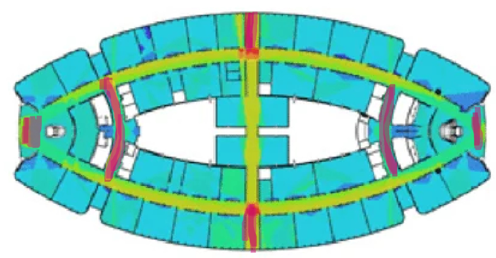

# IST interior — classrooms and architectural hallways

Use this world or the campus for the same Goosebot final project. All setup, LiDAR, launch, mapping and navigation commands remain in the [main project README](../README.md).

## How the two references are used — version 4

- **First image: classroom locations and labels.** Use the numbered rooms and underlying black partitions. **Ignore all red, green and blue evacuation arrows/zone boundaries.** They do not define walls, corridors, indentations, or extra exits.
- **Second image: hallway architecture.** The model has a continuous oval hallway, a curved cross-passage near each end, a straight central passage continuing through both sides, and north/south entrance lobbies.
- The north entrance is at the **left**, between 1045 and 1048. The south entrance is at the **right**, between 1002 and 1068.
- Outer classroom bands are continuous. The earlier gaps at evacuation-color boundaries and route-shaped central-room jogs have been removed. The clean plan above has no evacuation-route overlay; yellow denotes actual hallway floor only.

There are 42 labeled room locations. Their order and relative placement come from the first image; footprints are fitted to the hallway architecture in the second. The images are not measured architectural drawings, so dimensions, precise footprint corners, and doors remain approximate. Some internal/service-room doors are omitted; delivery goals belong in the hallway. White areas are protected non-circulation/atrium/service spaces, not additional shortcuts. This is a one-level teaching model, not a surveyed floor plan or evacuation model.

Reference 1 — classroom labels (evacuation colors are ignored)

This original photo is preserved as a reference. Its colored route/zone overlays are excluded from the model geometry.

Reference 2 — hallway network

Use the oval, both end cross-passages, central through-passage, and end lobbies shown here to interpret the clean plan.

## Files and use

| File | Purpose |
|---|---|
| `layout.json` | Explicit source policy, room placements, architectural corridor network, walls, protected areas and mission points |
| `generate_ist.py` | Standard-library generator; no map download or extra Python geometry package required |
| `ist.sdf`, `ist_blocked.sdf` | Baseline and blocked worlds with matching visual/collision walls |
| `ist_plan.svg`, `ist_plan.png` | Clean layout preview, without evacuation routes; PNG rendered from SVG separately |
| `reference.yaml`, `reference.pgm` | Geometric instructor map, not a student SLAM result |
| `mission.json` | Home and example hall deliveries in the world/reference frame |

The Goosebot launch reads home automatically: **(-22.9, 0) m, yaw π/2**, near the north entrance. Example deliveries remain near **1044, 1003 and 1066**. Select actual coordinates on your own saved SLAM map.

The blocked world adds a **2.2 × 0.35 × 1 m** barrier at **(0.5, 8.2) m**, yaw π/2, across the upper hallway near the central junction. The lower loop and connecting passages remain reachable. Use your original baseline SLAM map for the blocked trial.

To regenerate worlds, map, SVG and mission, run `python3 final_project_simulation/ist/generate_ist.py` from the repository root. It overwrites generated assets; PNG rendering is separate. The assumed scale is 0.1 m per reference pixel. `layout.json` records the source policy so route overlays are not reintroduced as geometry.

**Updating:** rebuild your SLAM map and reselect goals after pulling version 4. Earlier IST maps no longer match the revised walls and hallway widths.

**Checked offline:** Python/XML syntax, room non-overlap, deterministic generation, map/wall geometry, mission reachability, all four entrance/exit landings and both end cross-passages in baseline/blocked variants at 0.20 m grid clearance. **Still requires instructor pilot:** Gazebo rendering, sensors/TF, SLAM, AMCL and actual Nav2 driving. A geometric path does not guarantee successful controller execution.
