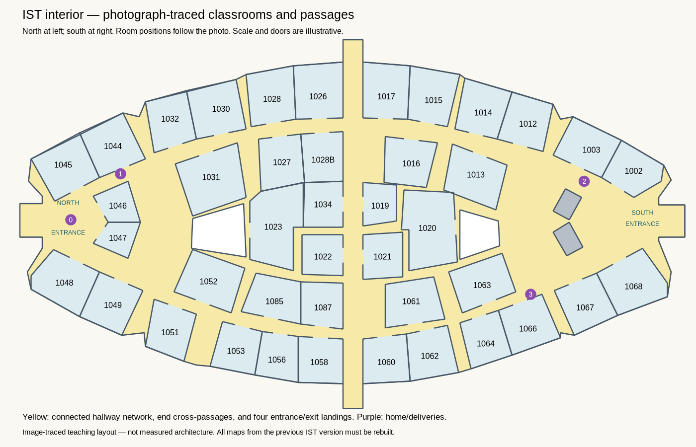
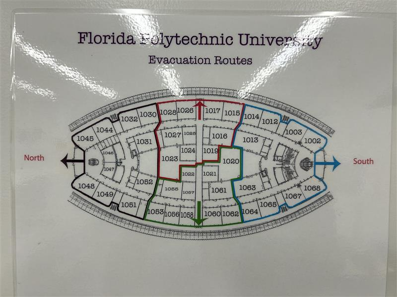

# IST interior — photograph-traced teaching world

Use this world or the campus for the same Goosebot final project. All required setup, LiDAR, launch, mapping and navigation commands remain in the [main project README](../README.md).

## Layout corrections — version 3

- **North entrance at the left, south entrance at the right.** These are open entrance lobbies. Rooms **1045/1048** flank the north lobby; **1002/1068** flank the south lobby, as in the photograph. They no longer occupy the entrance centers.
- The main oval hallway connects to **curved cross-passages near both ends**, behind the entrance-side rooms/stair areas, and the **central passage extends through the upper and lower sides** to exit landings.
- **42 labeled room footprints** are manually digitized from the evacuation-plan photograph. Room order, unequal widths, inner rooms, central core and left/right asymmetry follow that image rather than evenly spaced oval sectors. The central labels include 1027, 1028B, 1034, 1023, 1022, 1085, 1087, 1016, 1019, 1020, 1021 and 1061.
- White atrium areas are protected by low simulated railings. Stair areas are closed teaching obstacles, not working stairs. The world represents one level only.

**Accuracy:** this is an image-traced teaching reconstruction. Room positions follow the photograph, but perspective, line thickness and small labels limit precision. The assumed scale is 0.1 m per source pixel (main building approximately 52 × 26 m, plus entrance landings). Wall heights/thickness, doors and landing depths are illustrative. Exact measured architecture cannot be recovered from the photo alone. This is not an evacuation model or surveyed floor plan.

Reference — instructor's missing-hallway annotations

The marked connections are represented in the corrected geometry, not just painted onto the preview.

Reference — classroom locations in the supplied photograph

The photograph's orientation is retained: north left, south right. World +x points right and +y up on the preview. Colored evacuation paths are not walls.

## Files and use

| File | Purpose |
|---|---|
| `layout.json` | Digitized room polygons/labels, hallway paths, entrance landings, source scale and mission points |
| `generate_ist.py` | Standard-library generator reading that layout |
| `ist.sdf`, `ist_blocked.sdf` | Baseline and upper-hallway blocked worlds; matching visual/collision walls |
| `ist_plan.svg`, `ist_plan.png` | Corrected plan preview; PNG rendered separately from SVG |
| `reference.yaml`, `reference.pgm` | Generated geometric instructor map; not student SLAM output |
| `mission.json` | Spawn/home and example hallway deliveries in the world/reference frame |

The existing Goosebot launch reads the updated home automatically: **(-22.3, 0) m, yaw π/2**, in the north lobby. Suggested deliveries remain in the hallway near **1044, 1003, and 1066**. Select actual mission poses on your own SLAM map.

The blocked variant adds a **2.0 × 0.35 × 1 m** barrier at **(0.5, 7.6) m**, yaw π/2, across the upper hallway near the central junction. The lower oval and end/central connections remain available. Use the original baseline map for this trial.

Edit `layout.json`, then run `python3 final_project_simulation/ist/generate_ist.py` from the repository root to regenerate SDFs, reference map, SVG and mission. It overwrites those files. The PNG preview must be rerendered separately after geometry changes.

**Updating from the previous IST world:** rebuild your SLAM map and reselect goals. Old maps and coordinates are incompatible with these revised walls/entrances. Keep each YAML with its matching image.

**Checked offline:** Python/XML syntax, deterministic generation, map/wall agreement, mission reachability, all four entrance/exit landings and both added end cross-passages in baseline/blocked geometry at 0.20 m grid clearance. **Still requires instructor pilot:** Gazebo rendering, robot sensors/TF, mapping, AMCL and actual Nav2 driving. Connectivity is not proof of controller performance.
