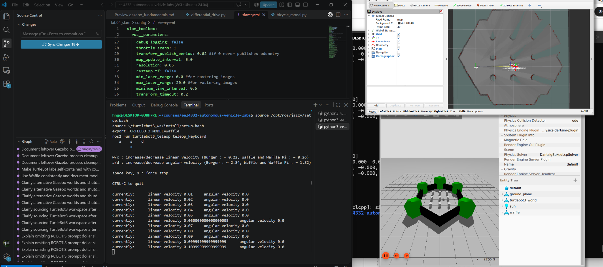
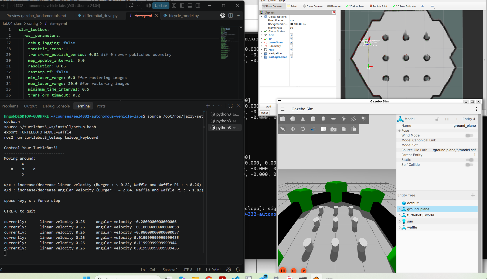

# Lab 4 — Build a Map with SLAM

## Mission

Create and save a map with **Cartographer**, then reuse it in Lab 5. Complete Labs 00–03 first. Earlier Lab 2 installations may use another simulator; check packages below.

Use **VS Code's integrated terminal with the WSL: Ubuntu indicator**, or a separate **Ubuntu/WSL terminal**. Both work. Open additional VS Code terminals with **Terminal → New Terminal** or **+**. Run each long-running node in its own terminal.

Commands below are ready to copy: no leading `$` prompt is included. Keep dollar signs *inside* commands, such as `$PWD` and `$(...)`.

Use **Waffle in TurtleBot3 World** throughout. Before switching worlds, stop motion, stop teleoperation/SLAM/navigation, and press **Ctrl+C in the simulator launch terminal**. Wait for the processes to exit; closing the Gazebo window alone may leave the server running.


## 1. Install and verify

If the required packages are already installed, source the workspace and run the checks at the end of this section. Otherwise complete the installation:

### Install packages (once; skip if the checks already pass)

Use an Ubuntu/WSL terminal, not PowerShell. Keep your existing Ubuntu 24.04, ROS 2 Jazzy, and working modern Gazebo installation. Stop old simulations. Use the system ROS terminal for building; if the course Python environment is active, run `deactivate` first.

```bash
source /opt/ros/jazzy/setup.bash
sudo apt update
sudo apt install git python3-colcon-common-extensions python3-rosdep ros-jazzy-ros-gz ros-jazzy-xacro ros-jazzy-cartographer ros-jazzy-cartographer-ros ros-jazzy-navigation2 ros-jazzy-nav2-bringup
mkdir -p ~/turtlebot3_ws/src
cd ~/turtlebot3_ws/src
```

Download the official Jazzy sources. These commands preserve existing source directories:

```bash
for repository in DynamixelSDK turtlebot3_msgs turtlebot3 turtlebot3_simulations; do
  if [ ! -d "$repository" ]; then
    git clone -b jazzy "https://github.com/ROBOTIS-GIT/$repository.git"
  fi
  git -C "$repository" branch --show-current
done
```

Each branch check should print `jazzy`. If cloning fails or an existing directory is on another branch, stop and ask the instructor; do not delete it or clone duplicate packages elsewhere. `turtlebot3` supplies the core packages; **`turtlebot3_simulations` separately supplies `turtlebot3_gazebo`**.

Install workspace dependencies and build:

```bash
cd ~/turtlebot3_ws
rosdep update
rosdep install --from-paths src --ignore-src -r -y --rosdistro jazzy
colcon build --symlink-install
```

If `rosdep` reports that it is not initialized, run `sudo rosdep init` once, then repeat `rosdep update` and the dependency command. Continue only after dependency installation and the build succeed. Do not use `sudo colcon build`.

Reload the environment **after building**:

```bash
source /opt/ros/jazzy/setup.bash
source ~/turtlebot3_ws/install/setup.bash
export TURTLEBOT3_MODEL=waffle
ros2 pkg prefix turtlebot3_gazebo
ros2 pkg prefix turtlebot3_teleop
ros2 pkg prefix turtlebot3_cartographer
ros2 pkg prefix turtlebot3_navigation2
```

Every check must print an installation path. Sourcing exposes built packages; it does not install missing ones. Robot software belongs in `~/turtlebot3_ws`; student code/results belong in your course fork.


## 2. Start the world — Terminal 1

```bash
source /opt/ros/jazzy/setup.bash
source ~/turtlebot3_ws/install/setup.bash
export TURTLEBOT3_MODEL=waffle
ros2 launch turtlebot3_gazebo turtlebot3_world.launch.py
```

Leave running and confirm Gazebo is playing. Do not start Nav2 during mapping.

## 3. Start mapping — Terminal 2

```bash
source /opt/ros/jazzy/setup.bash
source ~/turtlebot3_ws/install/setup.bash
export TURTLEBOT3_MODEL=waffle
ros2 launch turtlebot3_cartographer cartographer.launch.py use_sim_time:=True
```

Leave running. RViz2 should open; set Fixed Frame to `map` if needed and check the map, laser scan, and robot. Cartographer supplies the mapper; do not also start SLAM Toolbox.

## 4. Explore — Terminal 3

```bash
source /opt/ros/jazzy/setup.bash
source ~/turtlebot3_ws/install/setup.bash
export TURTLEBOT3_MODEL=waffle
ros2 run turtlebot3_teleop teleop_keyboard
```

Click inside Terminal 3. Use `w/x` to increase/decrease linear velocity, `a/d` to change turning velocity, and `s` or Space to stop. Watch the printed velocities and drive slowly. Every terminal needs its own source/export commands; `KeyError: 'TURTLEBOT3_MODEL'` indicates a missing export.

Record **Video 1 — first visit** while exploring previously unseen regions, then **Video 2 — revisit** while returning through an area already mapped. Keep the same simulator and Cartographer session running between recordings so the mapper retains its history. Show both Gazebo and RViz2's map clearly; the terminal does not need to fill the screen. Stop motion before switching windows.

In the revisit video, briefly point out any visible change or state that no clear correction is visible. A revisit does not guarantee a visible loop-closure correction.

<details>
<summary>Expected output — first exploration</summary>



Gazebo shows the robot while RViz2 builds the occupancy map. Your exploration route and map appearance may differ.

</details>

<details>
<summary>Expected output — later exploration / revisit</summary>



Use the same mapping session to revisit known areas. This screenshot illustrates a more complete map; a still image alone does not prove loop closure.

</details>

The screenshots also show an old `slam.yaml` editor tab. It is incidental: this lab runs Cartographer and does not require editing that SLAM Toolbox file.

## 5. Save your map — Terminal 4

Press `s` in Terminal 3 and confirm the robot stops. Keep Gazebo and Cartographer running while saving:

```bash
source /opt/ros/jazzy/setup.bash
source ~/turtlebot3_ws/install/setup.bash
export TURTLEBOT3_MODEL=waffle
cd ~/courses/eel4332-autonomous-vehicle-labs/lab04_slam
mkdir -p results
ros2 run nav2_map_server map_saver_cli -f "$PWD/results/map" --ros-args -p use_sim_time:=true
realpath results/map.yaml
```

Use your actual course path if different. Keep `map.yaml` and its referenced image (normally `map.pgm`) together. Inspect the image and YAML's resolution, origin, and image filename. Record the absolute YAML path for Lab 5.

<details>
<summary>Expected output — map saved successfully</summary>


Look for “Map saved successfully” and the generated map.pgm/map.yaml files. Warnings about unspecified thresholds/image format can accompany a successful save.

</details>


### View the saved .pgm map

A `.pgm` is a grayscale image; VS Code may not preview it directly. From `lab04_slam/`, create a PNG preview:

```bash
sudo apt install python3-pil
python3 -c "from PIL import Image; Image.open('results/map.pgm').save('results/map_preview.png')"
code results/map_preview.png
```

Run these in a normal Ubuntu/WSL terminal (outside a Python virtual environment). Black pixels typically indicate occupied cells, light pixels free space, and gray unknown space; interpret them with the saved YAML thresholds. Keep the original `.pgm` and `.yaml` for Lab 5; the PNG is only a viewing copy.

After saving, stop teleop, Cartographer, and the simulator with Ctrl+C in their terminals. Restart fresh for a new map; restarting only Gazebo does not clear an existing mapper.

## What to Submit

Submit **only two screen-recording videos**:

1. **First visit:** show the robot exploring new areas in Gazebo and the map forming in RViz2.
2. **Revisit:** show the robot returning through previously mapped areas in the **same mapping session**, with the map visible. Briefly describe any observed change, or say that no clear correction was visible.

Keep each recording focused on the relevant motion/map behavior. No separate report, `answers.md`, screenshots, or map upload is required for Lab 4. Still save and retain your map YAML/image pair for Lab 5.

## Discussion Questions (not a separate submission)

1. Why does mapping need robot motion information as well as laser scans?
2. How might revisiting an area improve a map?
3. What parts of your map could cause navigation problems?

## Optional Background

[SLAM background](OPTIONAL_BACKGROUND.md) and [Kalman extension](ALGORITHM_EXPERIMENT.md). SLAM Toolbox examples there describe an optional alternative, not the required mapper.

## Troubleshooting

### Robot missing after relaunch: check leftover Gazebo processes

If the launch reports **Entity creation successful** but the Entity Tree has no `waffle`, and the log warns **Found additional publishers on /clock** or **/stats**, another simulation may still be running. This cleanup resolved that symptom on the instructor's WSL system.

1. Stop motion. Save any map/results you need, then press **Ctrl+C** in all simulator, teleoperation, SLAM, and navigation launch terminals.
2. In a separate Ubuntu/WSL terminal, inspect remaining Gazebo processes:

```bash
pgrep -af 'gz sim|gz-sim'
```

3. If the output lists leftover Gazebo processes and you intend to stop **all Gazebo simulations owned by your user**, run:

```bash
pkill -f 'gz sim'
pkill -f 'gz-sim'
pgrep -af 'gz sim|gz-sim'
```

No output from the final check means no matching processes remain. These commands close matching Gazebo servers/GUI processes, so use them only for cleanup, not during a trial you want to keep.

4. Relaunch **one** world:

```bash
source /opt/ros/jazzy/setup.bash
source ~/turtlebot3_ws/install/setup.bash
export TURTLEBOT3_MODEL=waffle
ros2 launch turtlebot3_gazebo turtlebot3_world.launch.py
```

Confirm `waffle` appears in Gazebo's Entity Tree before restarting teleoperation, SLAM, or navigation in separate sourced terminals. If the robot is still absent, capture the complete launch output rather than repeatedly launching more worlds.


- Package not found: confirm installation/build succeeded, then source the workspace in that terminal.
- No robot motion: click the keyboard terminal, check printed velocities, and confirm Gazebo is playing.
- No map: inspect Cartographer's full error output and check `ros2 topic echo /scan --once`.
- Do not combine this workflow with the earlier Nav2-minimal simulator, custom TF bridges, or mesh workarounds.

The instructor must test installation, mapping, and map handoff on the course WSL image.

## References

These procedures adapt the official **Jazzy** workflow, with explicit per-terminal environment setup:

- [ROBOTIS PC Setup](https://docs.robotis.com/docs/systems/turtlebot3/quick_start_guide/pc_setup/?ros=jazzy)
- [ROBOTIS Gazebo Simulation](https://docs.robotis.com/docs/systems/turtlebot3/simulation/gazebo_simulation/?ros=jazzy)
- [ROBOTIS SLAM Simulation](https://docs.robotis.com/docs/systems/turtlebot3/simulation/slam_simulation/?ros=jazzy)
- [ROBOTIS Navigation Simulation](https://docs.robotis.com/docs/systems/turtlebot3/simulation/navigation_simulation/?ros=jazzy)


Continue to [Lab 5](../lab05_navigation/README.md).
