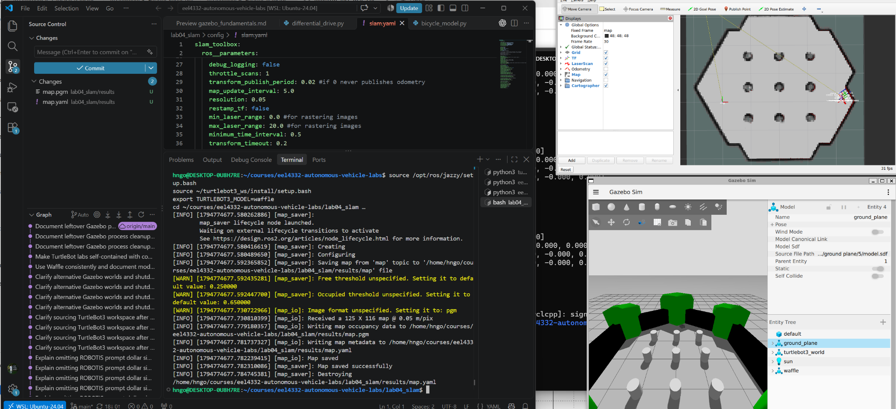

# Lab 4 — Build a Map with SLAM

## Before you start — use the current course files

**Expected branch: `main`.** Run these commands in **Ubuntu/WSL**. Choose the new-copy or existing-copy instructions, then update below.

### New copy: fork and clone

1. Sign in to GitHub, open [the public course repository](https://github.com/hoanbklucky/eel4332-autonomous-vehicle-labs), and choose **Fork → Create fork** under your account. Keep the repository name. One fork serves both labs; do not fork again for Lab 5.
2. Replace `YOUR_USERNAME` below with your GitHub username. Run only if the destination folder does not already exist:

```bash
mkdir -p ~/courses
cd ~/courses
git clone https://github.com/YOUR_USERNAME/eel4332-autonomous-vehicle-labs.git
cd eel4332-autonomous-vehicle-labs
git remote add upstream https://github.com/hoanbklucky/eel4332-autonomous-vehicle-labs.git
git config --local --replace-all remote.upstream.pushurl DISABLED
```

### Existing copy: keep your files and check remotes

If you already cloned your fork, skip this block when the URLs are correct. If you cloned the instructor's public repository, **create your fork on GitHub first**, then replace `YOUR_USERNAME` and run:

```bash
cd ~/courses/eel4332-autonomous-vehicle-labs
git remote set-url origin https://github.com/YOUR_USERNAME/eel4332-autonomous-vehicle-labs.git
git config --local --replace-all remote.origin.pushurl https://github.com/YOUR_USERNAME/eel4332-autonomous-vehicle-labs.git
if git remote get-url upstream >/dev/null 2>&1; then
  git remote set-url upstream https://github.com/hoanbklucky/eel4332-autonomous-vehicle-labs.git
else
  git remote add upstream https://github.com/hoanbklucky/eel4332-autonomous-vehicle-labs.git
fi
git config --local --replace-all remote.upstream.pushurl DISABLED
```

Changing remote URLs preserves files and commits. `origin` is **your fork**, where you push your work; `upstream` is **the instructor's public repository**, where you fetch updates. Its push URL is `DISABLED`. If your folder came from Download ZIP, keep it as a backup, clone your fork into a new folder, and copy your own work into that clone.

### Select the branch and receive updates

```bash
cd ~/courses/eel4332-autonomous-vehicle-labs
git remote -v
git branch --show-current
git status --short
```

Save editor files first. If status lists changes, review them and commit the files you want to keep (`git add PATH_TO_FILE`, then `git commit -m "Save my lab work"`); back up ignored maps/results separately. Continue with a clean working tree. Do not discard work to update.

Fetch, then switch to the expected branch; the conditional creates it only if it does not exist locally. Work committed on another branch stays on that branch.

```bash
git fetch upstream &&
if git show-ref --verify --quiet refs/heads/main; then
  git switch main
else
  git switch --no-track -c main upstream/main
fi
```

After the switch succeeds, receive updates and check that they are included:

```bash
git merge --no-edit upstream/main &&
git merge-base --is-ancestor upstream/main HEAD &&
echo "Current checkout includes the latest fetched main course commits"
```

Stop on any error. Resolve merge conflicts before continuing; `git merge --abort` cancels an in-progress merge. After a successful update, save the combined branch to your fork:

```bash
git push -u origin main
```

**Command breakdown:** `clone` downloads a working copy; `remote` configures repository URLs; `fetch` downloads updates; `switch` selects the local branch; `merge` combines updates with your commits; `merge-base --is-ancestor` verifies inclusion; `push -u origin` uploads the branch and sets its tracking destination.

Reopen **this local README** in VS Code (**WSL: Ubuntu**). Changing the GitHub browser branch or reopening VS Code does not update local files. Git updates files, not installed ROS packages; rebuild only when the lab asks.

**Lab 4 version check:** this lab uses Cartographer in **both TurtleBot3 World (Waffle) and House (Waffle Pi)**. An older one-world or different-SLAM handout is not the current lab. Keep both saved maps for Lab 5.

> [!IMPORTANT]
> **Stop Gazebo with Ctrl+C in its launch terminal—not just the window's × button.** Closing the GUI can leave the simulation server and ROS nodes running, causing duplicate simulations or a GUI that does not match the robot/world queried from the terminal.
>
> **Before relaunching, switching worlds, or finishing:**
> 1. Stop robot motion; save any map/results you need.
> 2. Press **Ctrl+C** in each teleop, SLAM and Nav2 terminal that is running.
> 3. Press **Ctrl+C in the simulator launch terminal** (usually Terminal 1).
> 4. Wait for shutdown messages to finish and the shell prompt to return before launching again.
>
> If you already closed the window, return to its launch terminal and press Ctrl+C there. If shutdown seems incomplete, check `pgrep -af 'gz sim|gz-sim'` and identify leftover simulation processes before restarting.

## Open in VS Code through WSL

After cloning the repository, open **Windows Terminal / PowerShell**, run `wsl`, then run these commands in **Ubuntu/WSL**:

```bash
cd ~/courses/eel4332-autonomous-vehicle-labs
code .
```

Confirm VS Code shows **WSL: Ubuntu** (or your Ubuntu distribution) in the lower-left corner. Open `lab04_slam/README.md` in Explorer. Choose **Terminal → New Terminal**; when working from this lab directory, run:

```bash
cd ~/courses/eel4332-autonomous-vehicle-labs/lab04_slam
```

Use that Ubuntu terminal for the commands below; follow any later `cd` commands as written. This assumes VS Code is installed on Windows with the **WSL extension**. If the repository is not cloned yet, use the inline setup above.

## Mission

Create and save **two maps with Cartographer**: TurtleBot3 World first, then TurtleBot3 House. Reuse **both maps in Lab 5**; House adds practice with rooms, doorways, and revisits. Complete Labs 00–03 first. Earlier Lab 2 installations may use another simulator; check packages below.

Use **VS Code's integrated terminal with the WSL: Ubuntu indicator**, or a separate **Ubuntu/WSL terminal**. Both work. Open additional VS Code terminals with **Terminal → New Terminal** or **+**. Run each long-running node in its own terminal.

Commands below are ready to copy: no leading `$` prompt is included. Keep dollar signs *inside* commands, such as `$PWD` and `$(...)`.

Use **Waffle in TurtleBot3 World**, then **Waffle Pi in TurtleBot3 House**. Set the matching model in every terminal. Before switching worlds, stop motion, stop teleoperation/SLAM/navigation, and press **Ctrl+C in the simulator launch terminal**. Wait for the processes to exit; closing the Gazebo window alone may leave the server running.


## 1. Install and verify

If the required packages are already installed, source the workspace and run the checks at the end of this section. Otherwise complete the installation:

### Install packages (once; skip if the checks already pass)

Use an Ubuntu/WSL terminal, not PowerShell. Keep your existing Ubuntu 24.04, ROS 2 Jazzy, and working modern Gazebo installation. Stop old simulations. Use the system ROS terminal for building; if the course Python environment is active, run `deactivate` first.

```bash
source /opt/ros/jazzy/setup.bash
sudo apt update
sudo apt install git python3-colcon-common-extensions python3-rosdep ros-jazzy-ros-gz ros-jazzy-xacro ros-jazzy-cartographer ros-jazzy-cartographer-ros ros-jazzy-navigation2 ros-jazzy-nav2-bringup
mkdir -p ~/turtlebot3_ws/src
cd ~/turtlebot3_ws/src
```

Download the official Jazzy sources. These commands preserve existing source directories:

```bash
for repository in DynamixelSDK turtlebot3_msgs turtlebot3 turtlebot3_simulations; do
  if [ ! -d "$repository" ]; then
    git clone -b jazzy "https://github.com/ROBOTIS-GIT/$repository.git"
  fi
  git -C "$repository" branch --show-current
done
```

Each branch check should print `jazzy`. If cloning fails or an existing directory is on another branch, stop and ask the instructor; do not delete it or clone duplicate packages elsewhere. `turtlebot3` supplies the core packages; **`turtlebot3_simulations` separately supplies `turtlebot3_gazebo`**.

Install workspace dependencies and build:

```bash
cd ~/turtlebot3_ws
rosdep update
rosdep install --from-paths src --ignore-src -r -y --rosdistro jazzy
colcon build --symlink-install
```

If `rosdep` reports that it is not initialized, run `sudo rosdep init` once, then repeat `rosdep update` and the dependency command. Continue only after dependency installation and the build succeed. Do not use `sudo colcon build`.

Reload the environment **after building**:

```bash
source /opt/ros/jazzy/setup.bash
source ~/turtlebot3_ws/install/setup.bash
export TURTLEBOT3_MODEL=waffle
ros2 pkg prefix turtlebot3_gazebo
ros2 pkg prefix turtlebot3_teleop
ros2 pkg prefix turtlebot3_cartographer
ros2 pkg prefix turtlebot3_navigation2
```

Every check must print an installation path. Sourcing exposes built packages; it does not install missing ones. Robot software belongs in `~/turtlebot3_ws`; student code/results belong in your course fork.


## 2. Start the world — Terminal 1

```bash
source /opt/ros/jazzy/setup.bash
source ~/turtlebot3_ws/install/setup.bash
export TURTLEBOT3_MODEL=waffle
ros2 launch turtlebot3_gazebo turtlebot3_world.launch.py
```

Leave running and confirm Gazebo is playing. Do not start Nav2 during mapping.

## 3. Start mapping — Terminal 2

```bash
source /opt/ros/jazzy/setup.bash
source ~/turtlebot3_ws/install/setup.bash
export TURTLEBOT3_MODEL=waffle
ros2 launch turtlebot3_cartographer cartographer.launch.py use_sim_time:=True
```

Leave running. RViz2 should open; set Fixed Frame to `map` if needed and check the map, laser scan, and robot. Cartographer supplies the mapper; do not also start SLAM Toolbox.

## 4. Explore — Terminal 3

```bash
source /opt/ros/jazzy/setup.bash
source ~/turtlebot3_ws/install/setup.bash
export TURTLEBOT3_MODEL=waffle
ros2 run turtlebot3_teleop teleop_keyboard
```

Click inside Terminal 3. Use `w/x` to increase/decrease linear velocity, `a/d` to change turning velocity, and `s` or Space to stop. Watch the printed velocities and drive slowly. Every terminal needs its own source/export commands; `KeyError: 'TURTLEBOT3_MODEL'` indicates a missing export.

Record **Video 1 — TurtleBot3 World**, showing both first exploration and a later revisit in this same simulator/Cartographer session. You may join short clips; do not restart mapping between the first-visit and revisit portions. Show Gazebo and RViz2's map clearly. Stop motion before switching windows. Briefly point out any visible map change, or say no clear correction is visible; revisiting does not guarantee a visible loop-closure correction.

After saving this World map, repeat the procedure in House below for **Video 2**. Keep each environment's first visit and revisit in its own continuous mapping session.

<details>
<summary>Expected output — first exploration</summary>


Gazebo shows the robot while RViz2 builds the occupancy map. Your exploration route and map appearance may differ.

</details>

<details>
<summary>Expected output — later exploration / revisit</summary>


Use the same mapping session to revisit known areas. This screenshot illustrates a more complete map; a still image alone does not prove loop closure.

</details>

The screenshots also show an old `slam.yaml` editor tab. It is incidental: this lab runs Cartographer and does not require editing that SLAM Toolbox file.

## 5. Save your map — Terminal 4

Press `s` in Terminal 3 and confirm the robot stops. Keep Gazebo and Cartographer running while saving:

```bash
source /opt/ros/jazzy/setup.bash
source ~/turtlebot3_ws/install/setup.bash
export TURTLEBOT3_MODEL=waffle
cd ~/courses/eel4332-autonomous-vehicle-labs/lab04_slam
mkdir -p results
ros2 run nav2_map_server map_saver_cli -f "$PWD/results/map" --ros-args -p use_sim_time:=true
realpath results/map.yaml
```

Use your actual course path if different. Keep `map.yaml` and its referenced image (normally `map.pgm`) together. Inspect the image and YAML's resolution, origin, and image filename. Record the absolute YAML path for Lab 5.

<details>
<summary>Expected output — map saved successfully</summary>



Look for “Map saved successfully” and the generated map.pgm/map.yaml files. Warnings about unspecified thresholds/image format can accompany a successful save.

</details>


### View the saved .pgm map

A `.pgm` is a grayscale image; VS Code may not preview it directly. From `lab04_slam/`, create a PNG preview:

```bash
sudo apt install python3-pil
python3 -c "from PIL import Image; Image.open('results/map.pgm').save('results/map_preview.png')"
code results/map_preview.png
```

Run these in a normal Ubuntu/WSL terminal (outside a Python virtual environment). Black pixels typically indicate occupied cells, light pixels free space, and gray unknown space; interpret them with the saved YAML thresholds. Keep the original `.pgm` and `.yaml` for Lab 5; the PNG is only a viewing copy.

After saving, stop teleop, Cartographer, and the simulator with Ctrl+C in their terminals. Restart fresh for a new map; restarting only Gazebo does not clear an existing mapper.

## 6. Map TurtleBot3 House — required second environment

Save the World map first as `results/map.yaml` + image. Stop motion and **Ctrl+C teleop, Cartographer and the simulator**. Start a fresh mapping session for House; never run two Gazebo worlds or reuse the World mapper state in House.

**Terminal 1 — House:** the ROBOTIS House example uses **`waffle_pi`**.

```bash
source /opt/ros/jazzy/setup.bash
source ~/turtlebot3_ws/install/setup.bash
export TURTLEBOT3_MODEL=waffle_pi
ros2 launch turtlebot3_gazebo turtlebot3_house.launch.py
```

**Terminal 2 — Cartographer:**

```bash
source /opt/ros/jazzy/setup.bash
source ~/turtlebot3_ws/install/setup.bash
export TURTLEBOT3_MODEL=waffle_pi
ros2 launch turtlebot3_cartographer cartographer.launch.py use_sim_time:=True
```

**Terminal 3 — driving:**

```bash
source /opt/ros/jazzy/setup.bash
source ~/turtlebot3_ws/install/setup.bash
export TURTLEBOT3_MODEL=waffle_pi
ros2 run turtlebot3_teleop teleop_keyboard
```

Drive slowly through connected rooms and doorways, turn to observe walls, then revisit an earlier room/corridor. Avoid collisions and getting trapped by furniture. Record **Video 2 — TurtleBot3 House**, showing first exploration and a later revisit in this same mapping session.

Stop the robot and save while Gazebo/Cartographer remain running. **Terminal 4:**

```bash
source /opt/ros/jazzy/setup.bash
source ~/turtlebot3_ws/install/setup.bash
export TURTLEBOT3_MODEL=waffle_pi
cd ~/courses/eel4332-autonomous-vehicle-labs/lab04_slam
mkdir -p results
ros2 run nav2_map_server map_saver_cli -f "$PWD/results/house_map" --ros-args -p use_sim_time:=true
realpath results/house_map.yaml
```

Keep `house_map.yaml` and its image together; do not overwrite the World `map.yaml`/image pair. View House using the same PGM-to-PNG procedure, substituting `house_map.pgm` and `house_map_preview.png`. Stop all House launches after saving. **Lab 5 uses both saved maps:** Waffle + World with `results/map.yaml`, then Waffle Pi + House with `results/house_map.yaml`. Stop all launches before switching; keep each YAML with its matching image.

## What to Submit

Submit **two screen-recording videos and short written answers**:

1. **TurtleBot3 World:** first exploration and a later revisit, with Gazebo and the evolving RViz2 map visible.
2. **TurtleBot3 House:** first exploration and a later revisit, with Gazebo and the evolving RViz2 map visible.
3. **Short written answers to all three Discussion Questions below**, in your own words. Use about 2–4 sentences per question and refer to your World/House observations where relevant. Submit one document or text entry alongside the two videos.

Within each video, the first visit and revisit must use the same mapping session. Briefly explain any visible change, or say no clear correction was visible. Short joined clips are fine; no full-session recording is needed.

The written answers are the only written submission; no additional report, `answers.md`, screenshots, or map upload is required. Save and retain **both** YAML/image pairs locally. Lab 5 uses both maps with their matching worlds/models.

## Discussion Questions — required written answers

1. Why does mapping need robot motion information as well as laser scans?
2. How might revisiting an area improve a map?
3. What parts of your map could cause navigation problems?

## Optional Background

[SLAM background](OPTIONAL_BACKGROUND.md) and [Kalman extension](ALGORITHM_EXPERIMENT.md). SLAM Toolbox examples there describe an optional alternative, not the required mapper.

## Troubleshooting

### Robot missing after relaunch: check leftover Gazebo processes

If the launch reports **Entity creation successful** but the Entity Tree has no `waffle`, and the log warns **Found additional publishers on /clock** or **/stats**, another simulation may still be running. This cleanup resolved that symptom on the instructor's WSL system.

1. Stop motion. Save any map/results you need, then press **Ctrl+C** in all simulator, teleoperation, SLAM, and navigation launch terminals.
2. In a separate Ubuntu/WSL terminal, inspect remaining Gazebo processes:

```bash
pgrep -af 'gz sim|gz-sim'
```

3. If the output lists leftover Gazebo processes and you intend to stop **all Gazebo simulations owned by your user**, run:

```bash
pkill -f 'gz sim'
pkill -f 'gz-sim'
pgrep -af 'gz sim|gz-sim'
```

No output from the final check means no matching processes remain. These commands close matching Gazebo servers/GUI processes, so use them only for cleanup, not during a trial you want to keep.

4. Relaunch **one** world:

```bash
source /opt/ros/jazzy/setup.bash
source ~/turtlebot3_ws/install/setup.bash
export TURTLEBOT3_MODEL=waffle
ros2 launch turtlebot3_gazebo turtlebot3_world.launch.py
```

Confirm `waffle` appears in Gazebo's Entity Tree before restarting teleoperation, SLAM, or navigation in separate sourced terminals. If the robot is still absent, capture the complete launch output rather than repeatedly launching more worlds.


- Package not found: confirm installation/build succeeded, then source the workspace in that terminal.
- No robot motion: click the keyboard terminal, check printed velocities, and confirm Gazebo is playing.
- No map: inspect Cartographer's full error output and check `ros2 topic echo /scan --once`.
- Do not combine this workflow with the earlier Nav2-minimal simulator, custom TF bridges, or mesh workarounds.


## References

These procedures adapt the official **Jazzy** workflow, with explicit per-terminal environment setup:

- [ROBOTIS PC Setup](https://docs.robotis.com/docs/systems/turtlebot3/quick_start_guide/pc_setup/?ros=jazzy)
- [ROBOTIS Gazebo Simulation](https://docs.robotis.com/docs/systems/turtlebot3/simulation/gazebo_simulation/?ros=jazzy)
- [ROBOTIS SLAM Simulation](https://docs.robotis.com/docs/systems/turtlebot3/simulation/slam_simulation/?ros=jazzy)
- [ROBOTIS Navigation Simulation](https://docs.robotis.com/docs/systems/turtlebot3/simulation/navigation_simulation/?ros=jazzy)


Continue to [Lab 5](../lab05_navigation/README.md).
