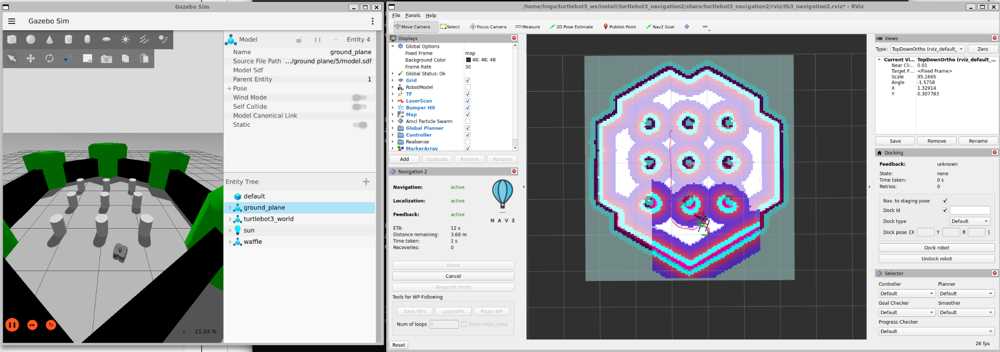

# Lab 5 — Navigate on Your Map

**Lab 05 environments:** TurtleBot3 World (Waffle) and TurtleBot3 House (Waffle Pi), using your saved Lab 04 maps. **IST and campus are used only in the separate final project.**

## Before you start — use the current course files

**Expected branch: `final-project-indoor-outdoor`.** Run these commands in **Ubuntu/WSL**. Choose the new-copy or existing-copy instructions, then update below.

### New copy: fork and clone

1. Sign in to GitHub, open [the public course repository](https://github.com/hoanbklucky/eel4332-autonomous-vehicle-labs), and choose **Fork → Create fork** under your account. Keep the repository name. One fork serves both labs; do not fork again for Lab 5.
2. Replace `YOUR_USERNAME` below with your GitHub username. Run only if the destination folder does not already exist:

```bash
mkdir -p ~/courses
cd ~/courses
git clone https://github.com/YOUR_USERNAME/eel4332-autonomous-vehicle-labs.git
cd eel4332-autonomous-vehicle-labs
git remote add upstream https://github.com/hoanbklucky/eel4332-autonomous-vehicle-labs.git
git config --local --replace-all remote.upstream.pushurl DISABLED
```

### Existing copy: keep your files and check remotes

If you already cloned your fork, skip this block when the URLs are correct. If you cloned the instructor's public repository, **create your fork on GitHub first**, then replace `YOUR_USERNAME` and run:

```bash
cd ~/courses/eel4332-autonomous-vehicle-labs
git remote set-url origin https://github.com/YOUR_USERNAME/eel4332-autonomous-vehicle-labs.git
git config --local --replace-all remote.origin.pushurl https://github.com/YOUR_USERNAME/eel4332-autonomous-vehicle-labs.git
if git remote get-url upstream >/dev/null 2>&1; then
  git remote set-url upstream https://github.com/hoanbklucky/eel4332-autonomous-vehicle-labs.git
else
  git remote add upstream https://github.com/hoanbklucky/eel4332-autonomous-vehicle-labs.git
fi
git config --local --replace-all remote.upstream.pushurl DISABLED
```

Changing remote URLs preserves files and commits. `origin` is **your fork**, where you push your work; `upstream` is **the instructor's public repository**, where you fetch updates. Its push URL is `DISABLED`. If your folder came from Download ZIP, keep it as a backup, clone your fork into a new folder, and copy your own work into that clone.

### Select the branch and receive updates

```bash
cd ~/courses/eel4332-autonomous-vehicle-labs
git remote -v
git branch --show-current
git status --short
```

Save editor files first. If status lists changes, review them and commit the files you want to keep (`git add PATH_TO_FILE`, then `git commit -m "Save my lab work"`); back up ignored maps/results separately. Continue with a clean working tree. Do not discard work to update.

Fetch, then switch to the expected branch; the conditional creates it only if it does not exist locally. Work committed on another branch stays on that branch.

```bash
git fetch upstream &&
if git show-ref --verify --quiet refs/heads/final-project-indoor-outdoor; then
  git switch final-project-indoor-outdoor
else
  git switch --no-track -c final-project-indoor-outdoor upstream/final-project-indoor-outdoor
fi
```

After the switch succeeds, receive updates and check that they are included:

```bash
git merge --no-edit upstream/final-project-indoor-outdoor &&
git merge-base --is-ancestor upstream/final-project-indoor-outdoor HEAD &&
echo "Current checkout includes the latest fetched final-project-indoor-outdoor course commits"
```

Stop on any error. Resolve merge conflicts before continuing; `git merge --abort` cancels an in-progress merge. After a successful update, save the combined branch to your fork:

```bash
git push -u origin final-project-indoor-outdoor
```

**Command breakdown:** `clone` downloads a working copy; `remote` configures repository URLs; `fetch` downloads updates; `switch` selects the local branch; `merge` combines updates with your commits; `merge-base --is-ancestor` verifies inclusion; `push -u origin` uploads the branch and sets its tracking destination.

Reopen **this local README** in VS Code (**WSL: Ubuntu**). Changing the GitHub browser branch or reopening VS Code does not update local files. Git updates files, not installed ROS packages; rebuild only when the lab asks.

**Lab 5 version check:** use **both maps from current Lab 4**: one World goal and two House goals in different rooms. Keep the matching model/map pair; do not follow an archived navigation handout.

> [!IMPORTANT]
> **Stop Gazebo with Ctrl+C in its launch terminal—not just the window's × button.** Closing the GUI can leave the simulation server and ROS nodes running, causing duplicate simulations or a GUI that does not match the robot/world queried from the terminal.
>
> **Before relaunching, switching worlds, or finishing:**
> 1. Stop robot motion; save any map/results you need.
> 2. Press **Ctrl+C** in each teleop, SLAM and Nav2 terminal that is running.
> 3. Press **Ctrl+C in the simulator launch terminal** (usually Terminal 1).
> 4. Wait for shutdown messages to finish and the shell prompt to return before launching again.
>
> If you already closed the window, return to its launch terminal and press Ctrl+C there. If shutdown seems incomplete, check `pgrep -af 'gz sim|gz-sim'` and identify leftover simulation processes before restarting.

## Open in VS Code through WSL

After cloning the repository, open **Windows Terminal / PowerShell**, run `wsl`, then run these commands in **Ubuntu/WSL**:

```bash
cd ~/courses/eel4332-autonomous-vehicle-labs
code .
```

Confirm VS Code shows **WSL: Ubuntu** (or your Ubuntu distribution) in the lower-left corner. Open `lab05_navigation/README.md` in Explorer. Choose **Terminal → New Terminal**; when working from this lab directory, run:

```bash
cd ~/courses/eel4332-autonomous-vehicle-labs/lab05_navigation
```

Use that Ubuntu terminal for the commands below; follow any later `cd` commands as written. This assumes VS Code is installed on Windows with the **WSL extension**. If the repository is not cloned yet, use the inline setup above.

## Mission

Navigate on **both maps saved in Lab 4**: reach **one destination in TurtleBot3 World**, then **two destinations in different rooms of TurtleBot3 House**. Initialize AMCL and confirm scan/map alignment in each environment. Use the matching model/map; a World map cannot be used in House or vice versa.

Use **VS Code's integrated terminal with the WSL: Ubuntu indicator**, or a separate **Ubuntu/WSL terminal**. Both work. Open additional VS Code terminals with **Terminal → New Terminal** or **+**. Run each long-running node in its own terminal.

Commands below are ready to copy: no leading `$` prompt is included. Keep dollar signs *inside* commands, such as `$PWD` and `$(...)`.

Start with **Waffle in TurtleBot3 World**, then switch to **Waffle Pi in TurtleBot3 House**. Before switching worlds, stop motion, stop teleoperation/SLAM/navigation, and press **Ctrl+C in the simulator launch terminal**. Wait for the processes to exit; closing the Gazebo window alone may leave the server running.


## What is AMCL?

**AMCL (Adaptive Monte Carlo Localization)** estimates the robot's position and heading **on an existing map**. It combines the saved map, current LiDAR scans, and odometry (estimated motion).

AMCL maintains many candidate poses, called **particles**. As the robot moves and observes its surroundings, candidates whose predicted scans agree with the measured scans become more likely. “Adaptive” means the number of particles changes with localization uncertainty.

| Lab 4 — SLAM | Lab 5 — AMCL |
|---|---|
| Builds a map while estimating the robot's pose | Estimates the robot's pose using the saved map |
| “What does the environment look like, and where am I?” | “Where am I on this map?” |

In RViz2, **2D Pose Estimate** supplies an initial position/heading guess; it does not command the robot to move there. AMCL refines that guess as observations arrive. Check that laser returns align with mapped walls before sending a goal. Nav2 then uses the estimated pose to plan and control motion toward the destination.

## How does Nav2 work?

For the official TurtleBot3 Jazzy Waffle and Waffle Pi configurations, the **NavFn global planner uses Dijkstra's expansion** (`use_astar: false`), and **DWB** supplies local control. Nav2 is configurable; other parameter files can select different algorithms.

| Component | Role |
|---|---|
| AMCL | Estimates the robot's pose on the saved map. |
| Costmaps | Represent obstacles and costs using the map and live sensor data. Inflation adds higher costs near obstacles. |
| NavFn global planner | Finds a route from the estimated pose to the goal through the global costmap. Setting `use_astar: true` selects A* instead of Dijkstra. |
| DWB local controller | Samples forward/turning velocities, predicts short motions, scores them for obstacle avoidance and path/goal progress, and sends a velocity command. |
| Behavior Tree | Coordinates planning, following, replanning, and recovery. |

When you send a goal, Nav2 plans a route, follows it with repeated velocity commands, and uses new sensor/odometry information to update its decisions. The simulator executes those commands. **Global planning chooses the route; local control chooses what motion to command now.** Colored inflation bands in RViz2 are costs, not physical walls or a guarantee of minimum clearance.

<details>
<summary>Optional — verify the running planner and controller</summary>

In a new sourced Ubuntu/WSL terminal while navigation is running:

```bash
source /opt/ros/jazzy/setup.bash
source ~/turtlebot3_ws/install/setup.bash
export TURTLEBOT3_MODEL=waffle
ros2 param get /planner_server GridBased.plugin
ros2 param get /planner_server GridBased.use_astar
ros2 param get /controller_server FollowPath.plugin
```

The course configuration is expected to report `nav2_navfn_planner::NavfnPlanner`, `False`, and `dwb_core::DWBLocalPlanner`. Plugin IDs/node names can differ if you change configuration.

</details>

## 1. Install and check packages

Lab 4 must be complete, including the core TurtleBot3 and simulation workspace build. Keep both `map.yaml` and `house_map.yaml` with their respective images. Install navigation and the final-project Python API:

```bash
sudo apt update
sudo apt install ros-jazzy-navigation2 ros-jazzy-nav2-bringup ros-jazzy-nav2-simple-commander
source /opt/ros/jazzy/setup.bash
source ~/turtlebot3_ws/install/setup.bash
export TURTLEBOT3_MODEL=waffle
ros2 pkg prefix turtlebot3_gazebo
ros2 pkg prefix turtlebot3_navigation2
ros2 pkg prefix nav2_bringup
ros2 pkg prefix nav2_map_server
ros2 pkg prefix nav2_simple_commander
```

Each check must print a path. **If all checks succeed, skip the recovery block below and go directly to Step 2. No rebuild is needed.**

<details>
<summary>Only if turtlebot3_navigation2 is not found — dependency/build recovery</summary>

Run these commands **only if** `ros2 pkg prefix turtlebot3_navigation2` reports “Package not found” after sourcing the workspace. First verify that the official `turtlebot3` source is in `~/turtlebot3_ws/src` on branch `jazzy`. If the source workspace is missing, complete Lab 4's installation section instead.

```bash
source /opt/ros/jazzy/setup.bash
cd ~/turtlebot3_ws
rosdep install --from-paths src --ignore-src -r -y --rosdistro jazzy
colcon build --symlink-install
source install/setup.bash
ros2 pkg prefix turtlebot3_navigation2
```

Continue only after the recovery check prints an installation path. Ubuntu/ROS do not need reinstalling.

</details>

If another package check fails, resolve that package before continuing; the recovery above specifically addresses `turtlebot3_navigation2`.

## 2. TurtleBot3 World — start fresh in Terminal 1

Stop all previous simulator, Cartographer, and teleoperation processes with Ctrl+C.

```bash
source /opt/ros/jazzy/setup.bash
source ~/turtlebot3_ws/install/setup.bash
export TURTLEBOT3_MODEL=waffle
ros2 launch turtlebot3_gazebo turtlebot3_world.launch.py
```

Use the same world and model used to build the map. Leave this terminal running.

## 3. World navigation — Terminal 2

```bash
source /opt/ros/jazzy/setup.bash
source ~/turtlebot3_ws/install/setup.bash
export TURTLEBOT3_MODEL=waffle
ros2 launch turtlebot3_navigation2 navigation2.launch.py use_sim_time:=True map:="$HOME/courses/eel4332-autonomous-vehicle-labs/lab04_slam/results/map.yaml"
```

Replace the quoted map path if your saved map is elsewhere. Keep this terminal running. This launch starts the model-specific Nav2 configuration and RViz2; do not start Cartographer/SLAM Toolbox or the previous manual lifecycle sequence.

## 4. Initialize localization

In RViz2, click **2D Pose Estimate**, click the robot's approximate starting location **on the saved map**, and drag toward its actual heading. Use Gazebo to identify its location relative to walls/obstacles; the map's orientation may differ from the Gazebo camera view. This supplies a pose guess, not a motion command.

**Check scan/map alignment:**

1. Keep **Map** and **LaserScan** checked in RViz2.
2. If the view is cluttered, temporarily hide **Amcl Particle Swarm** and the costmap displays inside **Global Planner** and **Controller**. Unchecking these display boxes only hides graphics; it does not disable localization, planning, or obstacle avoidance.
3. Zoom in and compare the live laser points with mapped wall edges and the visible sides of circular obstacles. They should approximately overlap, rather than forming a shifted or rotated copy. Occlusion and sensor noise mean not every edge will have matching points.
4. If they are displaced, repeat **2D Pose Estimate** with a better position/heading guess. Small, slow motions using Terminal 3 below may help AMCL refine the estimate. Stop and check again before sending a navigation goal.

**Localization: active** means AMCL is running; it does not by itself prove that the pose is correct. If alignment stays poor, check that you loaded the correct map for the current world/model.

If needed, refine localization with small motions in **Terminal 3**:

```bash
source /opt/ros/jazzy/setup.bash
source ~/turtlebot3_ws/install/setup.bash
export TURTLEBOT3_MODEL=waffle
ros2 run turtlebot3_teleop teleop_keyboard
```

Click that terminal before driving slowly. Press `s` to stop, then **Ctrl+C to terminate teleop before sending navigation goals**. Recheck scan/map alignment as described above.

**Run the source and export commands in each new terminal.** Each separately opened terminal has its own environment: setting `TURTLEBOT3_MODEL=waffle` in Terminal 1 does not set it in Terminal 3. The complete command block above includes everything Terminal 3 needs.

## 5. Reach one destination in World

Click **Navigation2 Goal / Nav2 Goal** in RViz2, click a reachable location, and drag toward the desired final heading. Wait for completion before sending the next goal.

Choose an open-space destination and record the robot navigating to it. Show Gazebo and RViz2 clearly, including the planned path and the robot reaching/stopping at the destination. Show the reported successful goal result in RViz2 or the navigation terminal; an active goal or a visible path alone is not completion evidence.

Complete **one successful World goal** before switching to House. Capture this as the World portion of your single submission video. Keep both maps and navigation notes; no goal CSV or experiment table is required. The final reuses these skills with Goosebot and a new map, not this TurtleBot map.

<details>
<summary>Expected output — selecting a navigation goal</summary>


The green arrow specifies the destination position and final heading. This screenshot shows goal selection, not proof of arrival.

</details>

<details>
<summary>Expected output — navigation in progress</summary>



The path, moving robot, and active feedback show execution. This screenshot is an in-progress example; continue until your goal completes successfully.

</details>

To stop early, use RViz2's navigation cancellation control if available and confirm actual stopping. If unexpected motion continues, pause Gazebo and end the launch processes before restarting. Do not treat a new goal at the current pose as a guaranteed stop.

After finishing, stop navigation (Terminal 2), then simulation (Terminal 1) with Ctrl+C.

## 6. Navigate in TurtleBot3 House — two destinations

Stop any localization teleop, then **Ctrl+C navigation and the World simulator**. Wait for the processes to exit. Launch House in a fresh session; keep SLAM/Cartographer stopped.

| Environment | Model in every terminal | Saved map from Lab 4 | Required successful goals |
|---|---|---|---:|
| TurtleBot3 World | `waffle` | `lab04_slam/results/map.yaml` | 1 |
| TurtleBot3 House | `waffle_pi` | `lab04_slam/results/house_map.yaml` | 2, in different rooms |

**Terminal 1 — House:**

```bash
source /opt/ros/jazzy/setup.bash
source ~/turtlebot3_ws/install/setup.bash
export TURTLEBOT3_MODEL=waffle_pi
ros2 launch turtlebot3_gazebo turtlebot3_house.launch.py
```

**Terminal 2 — saved House map and Waffle Pi navigation:**

```bash
source /opt/ros/jazzy/setup.bash
source ~/turtlebot3_ws/install/setup.bash
export TURTLEBOT3_MODEL=waffle_pi
ros2 launch turtlebot3_navigation2 navigation2.launch.py use_sim_time:=True \
  map:="$HOME/courses/eel4332-autonomous-vehicle-labs/lab04_slam/results/house_map.yaml"
```

Use **2D Pose Estimate** to initialize the robot's current House pose. Compare the **live scan with several saved wall edges**, as in Step 4, before sending a goal. Do not reuse the World pose estimate or its map. The environment, saved map, and model must all match.

If a small motion is needed to improve localization, use **Terminal 3**:

```bash
source /opt/ros/jazzy/setup.bash
source ~/turtlebot3_ws/install/setup.bash
export TURTLEBOT3_MODEL=waffle_pi
ros2 run turtlebot3_teleop teleop_keyboard
```

Stop with `s`, then Ctrl+C teleop before autonomous navigation. In RViz2, send **two goals sequentially in different rooms** so the robot travels through a doorway. Choose open floor space away from walls/furniture; wait for successful completion before sending the next goal. Show the path, movement and successful arrival/stopping for **both House goals** in your video.

Parameter tuning is optional. If a goal fails, first check map identity/coverage, localization alignment and whether the destination has enough clearance. Keep the original saved map; do not remap during navigation. After finishing, stop teleop if used, then navigation and Gazebo.

## What to Submit

Submit only:

1. **One short screen-recording video** with clearly labeled clips showing **one successful World goal and two successful House goals in different rooms**, with Gazebo and RViz2 visible. Include a brief view of scan/map alignment in each environment; clips may be joined.
2. **Short written answers to all three Discussion Questions below**, in your own words. Use about 2–4 sentences per question and refer to your World/House runs where relevant. Submit one document or text entry alongside the video.

The discussion answers are the only written submission; no additional report, screenshots, `answers.md`, goal CSV, or results table is required. Keep both saved maps and working setups for reference.

## Discussion Questions — required written answers

1. How do **AMCL, the costmaps, the global planner, and the local controller** work together to move the robot from its estimated pose to a goal? Distinguish localization, path planning, and velocity commands.
2. Why must you set an initial pose and check **laser-scan/map alignment** before sending goals? Describe what poor alignment would look like and what you would check or correct.
3. Compare navigation in **TurtleBot3 World and House** using your runs. Which features made a route easier or harder (for example, doorways, narrow passages, or turns)? Explain how map quality and costmap inflation could affect the robot's ability to reach a goal; distinguish what you observed from what you would expect.

## Final Handoff and Optional Background

The [final project](../final_project_simulation/README.md) is a separate assignment with its own robot, environments, procedures and deliverables. Follow this Lab 05 README for TurtleBot3 World and House only. [Navigation background](OPTIONAL_BACKGROUND.md) and [algorithm exercises](ALGORITHM_EXPERIMENTS.md) are optional.

## Troubleshooting

### Robot missing after relaunch: check leftover Gazebo processes

If the launch reports **Entity creation successful** but the Entity Tree has no `waffle`, and the log warns **Found additional publishers on /clock** or **/stats**, another simulation may still be running. This cleanup resolved that symptom on the instructor's WSL system.

1. Stop motion. Save any map/results you need, then press **Ctrl+C** in all simulator, teleoperation, SLAM, and navigation launch terminals.
2. In a separate Ubuntu/WSL terminal, inspect remaining Gazebo processes:

```bash
pgrep -af 'gz sim|gz-sim'
```

3. If the output lists leftover Gazebo processes and you intend to stop **all Gazebo simulations owned by your user**, run:

```bash
pkill -f 'gz sim'
pkill -f 'gz-sim'
pgrep -af 'gz sim|gz-sim'
```

No output from the final check means no matching processes remain. These commands close matching Gazebo servers/GUI processes, so use them only for cleanup, not during a trial you want to keep.

4. Relaunch **one** world:

```bash
source /opt/ros/jazzy/setup.bash
source ~/turtlebot3_ws/install/setup.bash
export TURTLEBOT3_MODEL=waffle
ros2 launch turtlebot3_gazebo turtlebot3_world.launch.py
```

Confirm `waffle` appears in Gazebo's Entity Tree before restarting teleoperation, SLAM, or navigation in separate sourced terminals. If the robot is still absent, capture the complete launch output rather than repeatedly launching more worlds.


Package errors: check the build and sourcing. Misaligned scans: check map, initial pose, and world/model. Conflicting motion: stop all teleoperation publishers. Record the exact command and full error when requesting help.

The instructor must pilot saved-map localization, World navigation, both House goals, model-specific configuration, and cancellation on the course WSL image.

## References

These procedures adapt the official **Jazzy** workflow, with explicit per-terminal environment setup:

- [ROBOTIS PC Setup](https://docs.robotis.com/docs/systems/turtlebot3/quick_start_guide/pc_setup/?ros=jazzy)
- [ROBOTIS Gazebo Simulation](https://docs.robotis.com/docs/systems/turtlebot3/simulation/gazebo_simulation/?ros=jazzy)
- [ROBOTIS SLAM Simulation](https://docs.robotis.com/docs/systems/turtlebot3/simulation/slam_simulation/?ros=jazzy)
- [ROBOTIS Navigation Simulation](https://docs.robotis.com/docs/systems/turtlebot3/simulation/navigation_simulation/?ros=jazzy)


Algorithm references: [TurtleBot3 Jazzy Waffle Pi parameters](https://github.com/ROBOTIS-GIT/turtlebot3/blob/jazzy/turtlebot3_navigation2/param/waffle_pi.yaml), [TurtleBot3 Jazzy Waffle parameters](https://github.com/ROBOTIS-GIT/turtlebot3/blob/jazzy/turtlebot3_navigation2/param/waffle.yaml), [NavFn planner](https://docs.nav2.org/jazzy/configuration_and_development/configuration_guide/planners_plugins/configuring_navfn/), and [DWB controller](https://docs.nav2.org/jazzy/configuration_and_development/first_time_robot_setup_guide/navigation_plugins/setup_navigation_plugins/).
