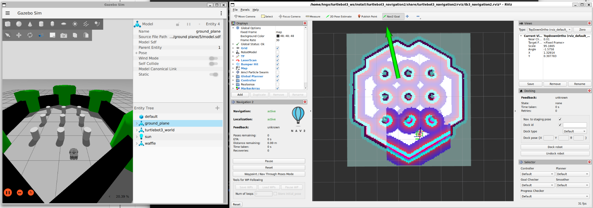

# Lab 5 — Navigate on Your Map

## Open in VS Code through WSL

After cloning the repository, open **Windows Terminal / PowerShell**, run `wsl`, then run these commands in **Ubuntu/WSL**:

```bash
cd ~/courses/eel4332-autonomous-vehicle-labs
code .
```

Confirm VS Code shows **WSL: Ubuntu** (or your Ubuntu distribution) in the lower-left corner. Open `lab05_navigation/README.md` in Explorer. Choose **Terminal → New Terminal**; when working from this lab directory, run:

```bash
cd ~/courses/eel4332-autonomous-vehicle-labs/lab05_navigation
```

Use that Ubuntu terminal for the commands below; follow any later `cd` commands as written. This assumes VS Code is installed on Windows with the **WSL extension**. If the repository is not cloned yet, complete Lab 00's clone step first.

## Mission

Load the **TurtleBot3 World map** saved in Lab 4 (`results/map.yaml` + image), localize **Waffle** with AMCL, and complete a successful navigation to a chosen destination with Nav2. Lab 4's House map is additional practice and must not be loaded into TurtleBot3 World.

Use **VS Code's integrated terminal with the WSL: Ubuntu indicator**, or a separate **Ubuntu/WSL terminal**. Both work. Open additional VS Code terminals with **Terminal → New Terminal** or **+**. Run each long-running node in its own terminal.

Commands below are ready to copy: no leading `$` prompt is included. Keep dollar signs *inside* commands, such as `$PWD` and `$(...)`.

Use **Waffle in TurtleBot3 World** throughout. Before switching worlds, stop motion, stop teleoperation/SLAM/navigation, and press **Ctrl+C in the simulator launch terminal**. Wait for the processes to exit; closing the Gazebo window alone may leave the server running.


## What is AMCL?

**AMCL (Adaptive Monte Carlo Localization)** estimates the robot's position and heading **on an existing map**. It combines the saved map, current LiDAR scans, and odometry (estimated motion).

AMCL maintains many candidate poses, called **particles**. As the robot moves and observes its surroundings, candidates whose predicted scans agree with the measured scans become more likely. “Adaptive” means the number of particles changes with localization uncertainty.

| Lab 4 — SLAM | Lab 5 — AMCL |
|---|---|
| Builds a map while estimating the robot's pose | Estimates the robot's pose using the saved map |
| “What does the environment look like, and where am I?” | “Where am I on this map?” |

In RViz2, **2D Pose Estimate** supplies an initial position/heading guess; it does not command the robot to move there. AMCL refines that guess as observations arrive. Check that laser returns align with mapped walls before sending a goal. Nav2 then uses the estimated pose to plan and control motion toward the destination.

## How does Nav2 work?

For the official TurtleBot3 Jazzy Waffle configuration, the **NavFn global planner uses Dijkstra's expansion** (`use_astar: false`), and **DWB** supplies local control. Nav2 is configurable; other parameter files can select different algorithms.

| Component | Role |
|---|---|
| AMCL | Estimates the robot's pose on the saved map. |
| Costmaps | Represent obstacles and costs using the map and live sensor data. Inflation adds higher costs near obstacles. |
| NavFn global planner | Finds a route from the estimated pose to the goal through the global costmap. Setting `use_astar: true` selects A* instead of Dijkstra. |
| DWB local controller | Samples forward/turning velocities, predicts short motions, scores them for obstacle avoidance and path/goal progress, and sends a velocity command. |
| Behavior Tree | Coordinates planning, following, replanning, and recovery. |

When you send a goal, Nav2 plans a route, follows it with repeated velocity commands, and uses new sensor/odometry information to update its decisions. The simulator executes those commands. **Global planning chooses the route; local control chooses what motion to command now.** Colored inflation bands in RViz2 are costs, not physical walls or a guarantee of minimum clearance.

<details>
<summary>Optional — verify the running planner and controller</summary>

In a new sourced Ubuntu/WSL terminal while navigation is running:

```bash
source /opt/ros/jazzy/setup.bash
source ~/turtlebot3_ws/install/setup.bash
export TURTLEBOT3_MODEL=waffle
ros2 param get /planner_server GridBased.plugin
ros2 param get /planner_server GridBased.use_astar
ros2 param get /controller_server FollowPath.plugin
```

The course configuration is expected to report `nav2_navfn_planner::NavfnPlanner`, `False`, and `dwb_core::DWBLocalPlanner`. Plugin IDs/node names can differ if you change configuration.

</details>

## 1. Install and check packages

Lab 4 must be complete, including the core TurtleBot3 and simulation workspace build. Keep its `map.yaml` and image together. Install navigation and the final-project Python API:

```bash
sudo apt update
sudo apt install ros-jazzy-navigation2 ros-jazzy-nav2-bringup ros-jazzy-nav2-simple-commander
source /opt/ros/jazzy/setup.bash
source ~/turtlebot3_ws/install/setup.bash
export TURTLEBOT3_MODEL=waffle
ros2 pkg prefix turtlebot3_gazebo
ros2 pkg prefix turtlebot3_navigation2
ros2 pkg prefix nav2_bringup
ros2 pkg prefix nav2_map_server
ros2 pkg prefix nav2_simple_commander
```

Each check must print a path. **If all checks succeed, skip the recovery block below and go directly to Step 2. No rebuild is needed.**

<details>
<summary>Only if turtlebot3_navigation2 is not found — dependency/build recovery</summary>

Run these commands **only if** `ros2 pkg prefix turtlebot3_navigation2` reports “Package not found” after sourcing the workspace. First verify that the official `turtlebot3` source is in `~/turtlebot3_ws/src` on branch `jazzy`. If the source workspace is missing, complete Lab 4's installation section instead.

```bash
source /opt/ros/jazzy/setup.bash
cd ~/turtlebot3_ws
rosdep install --from-paths src --ignore-src -r -y --rosdistro jazzy
colcon build --symlink-install
source install/setup.bash
ros2 pkg prefix turtlebot3_navigation2
```

Continue only after the recovery check prints an installation path. Ubuntu/ROS do not need reinstalling.

</details>

If another package check fails, resolve that package before continuing; the recovery above specifically addresses `turtlebot3_navigation2`.

## 2. Start a fresh world — Terminal 1

Stop all previous simulator, Cartographer, and teleoperation processes with Ctrl+C.

```bash
source /opt/ros/jazzy/setup.bash
source ~/turtlebot3_ws/install/setup.bash
export TURTLEBOT3_MODEL=waffle
ros2 launch turtlebot3_gazebo turtlebot3_world.launch.py
```

Use the same world and model used to build the map. Leave this terminal running.

## 3. Start navigation — Terminal 2

```bash
source /opt/ros/jazzy/setup.bash
source ~/turtlebot3_ws/install/setup.bash
export TURTLEBOT3_MODEL=waffle
ros2 launch turtlebot3_navigation2 navigation2.launch.py use_sim_time:=True map:="$HOME/courses/eel4332-autonomous-vehicle-labs/lab04_slam/results/map.yaml"
```

Replace the quoted map path if your saved map is elsewhere. Keep this terminal running. This launch starts the model-specific Nav2 configuration and RViz2; do not start Cartographer/SLAM Toolbox or the previous manual lifecycle sequence.

## 4. Initialize localization

In RViz2, click **2D Pose Estimate**, click the robot's approximate starting location **on the saved map**, and drag toward its actual heading. Use Gazebo to identify its location relative to walls/obstacles; the map's orientation may differ from the Gazebo camera view. This supplies a pose guess, not a motion command.

**Check scan/map alignment:**

1. Keep **Map** and **LaserScan** checked in RViz2.
2. If the view is cluttered, temporarily hide **Amcl Particle Swarm** and the costmap displays inside **Global Planner** and **Controller**. Unchecking these display boxes only hides graphics; it does not disable localization, planning, or obstacle avoidance.
3. Zoom in and compare the live laser points with mapped wall edges and the visible sides of circular obstacles. They should approximately overlap, rather than forming a shifted or rotated copy. Occlusion and sensor noise mean not every edge will have matching points.
4. If they are displaced, repeat **2D Pose Estimate** with a better position/heading guess. Small, slow motions using Terminal 3 below may help AMCL refine the estimate. Stop and check again before sending a navigation goal.

**Localization: active** means AMCL is running; it does not by itself prove that the pose is correct. If alignment stays poor, check that you loaded the correct map for the current world/model.

If needed, refine localization with small motions in **Terminal 3**:

```bash
source /opt/ros/jazzy/setup.bash
source ~/turtlebot3_ws/install/setup.bash
export TURTLEBOT3_MODEL=waffle
ros2 run turtlebot3_teleop teleop_keyboard
```

Click that terminal before driving slowly. Press `s` to stop, then **Ctrl+C to terminate teleop before sending navigation goals**. Recheck scan/map alignment as described above.

**Run the source and export commands in each new terminal.** Each separately opened terminal has its own environment: setting `TURTLEBOT3_MODEL=waffle` in Terminal 1 does not set it in Terminal 3. The complete command block above includes everything Terminal 3 needs.

## 5. Send a goal and navigate

Click **Navigation2 Goal / Nav2 Goal** in RViz2, click a reachable location, and drag toward the desired final heading. Wait for completion before sending the next goal.

Choose an open-space destination and record the robot navigating to it. Show Gazebo and RViz2 clearly, including the planned path and the robot reaching/stopping at the destination. Show the reported successful goal result in RViz2 or the navigation terminal; an active goal or a visible path alone is not completion evidence.

You may practice additional destinations, but only **one successful navigation video** is required. Keep your map and useful destination/home poses for the final; no goal CSV or experiment table is required for this lab.

<details>
<summary>Expected output — selecting a navigation goal</summary>



The green arrow specifies the destination position and final heading. This screenshot shows goal selection, not proof of arrival.

</details>

<details>
<summary>Expected output — navigation in progress</summary>


The path, moving robot, and active feedback show execution. This screenshot is an in-progress example; continue until your goal completes successfully.

</details>

To stop early, use RViz2's navigation cancellation control if available and confirm actual stopping. If unexpected motion continues, pause Gazebo and end the launch processes before restarting. Do not treat a new goal at the current pose as a guaranteed stop.

After finishing, stop navigation (Terminal 2), then simulation (Terminal 1) with Ctrl+C.

## What to Submit

Submit only:

1. **One screen-recording video** showing a successful navigation to a chosen goal, with Gazebo and RViz2 visible.
2. **One short paragraph in your own words** explaining how AMCL, the costmap, the global planner, and the local controller work together to move the robot to that goal.

No separate screenshots, report, `answers.md`, goal CSV, or results table is required. Keep your saved map and working setup for the final project.

## Final Handoff and Optional Background

Reuse the map, goals, and launch sequence in the [delivery final](../final_project_simulation/README.md). Its mission-client scaffold and recorder are in `src/`. [Navigation background](OPTIONAL_BACKGROUND.md) and [algorithm exercises](ALGORITHM_EXPERIMENTS.md) are optional.

## Troubleshooting

### Robot missing after relaunch: check leftover Gazebo processes

If the launch reports **Entity creation successful** but the Entity Tree has no `waffle`, and the log warns **Found additional publishers on /clock** or **/stats**, another simulation may still be running. This cleanup resolved that symptom on the instructor's WSL system.

1. Stop motion. Save any map/results you need, then press **Ctrl+C** in all simulator, teleoperation, SLAM, and navigation launch terminals.
2. In a separate Ubuntu/WSL terminal, inspect remaining Gazebo processes:

```bash
pgrep -af 'gz sim|gz-sim'
```

3. If the output lists leftover Gazebo processes and you intend to stop **all Gazebo simulations owned by your user**, run:

```bash
pkill -f 'gz sim'
pkill -f 'gz-sim'
pgrep -af 'gz sim|gz-sim'
```

No output from the final check means no matching processes remain. These commands close matching Gazebo servers/GUI processes, so use them only for cleanup, not during a trial you want to keep.

4. Relaunch **one** world:

```bash
source /opt/ros/jazzy/setup.bash
source ~/turtlebot3_ws/install/setup.bash
export TURTLEBOT3_MODEL=waffle
ros2 launch turtlebot3_gazebo turtlebot3_world.launch.py
```

Confirm `waffle` appears in Gazebo's Entity Tree before restarting teleoperation, SLAM, or navigation in separate sourced terminals. If the robot is still absent, capture the complete launch output rather than repeatedly launching more worlds.


Package errors: check the build and sourcing. Misaligned scans: check map, initial pose, and world/model. Conflicting motion: stop all teleoperation publishers. Record the exact command and full error when requesting help.

The instructor must test saved-map navigation and cancellation on the course WSL image.

## References

These procedures adapt the official **Jazzy** workflow, with explicit per-terminal environment setup:

- [ROBOTIS PC Setup](https://docs.robotis.com/docs/systems/turtlebot3/quick_start_guide/pc_setup/?ros=jazzy)
- [ROBOTIS Gazebo Simulation](https://docs.robotis.com/docs/systems/turtlebot3/simulation/gazebo_simulation/?ros=jazzy)
- [ROBOTIS SLAM Simulation](https://docs.robotis.com/docs/systems/turtlebot3/simulation/slam_simulation/?ros=jazzy)
- [ROBOTIS Navigation Simulation](https://docs.robotis.com/docs/systems/turtlebot3/simulation/navigation_simulation/?ros=jazzy)


Algorithm references: [TurtleBot3 Jazzy Waffle parameters](https://github.com/ROBOTIS-GIT/turtlebot3/blob/jazzy/turtlebot3_navigation2/param/waffle.yaml), [NavFn planner](https://docs.nav2.org/jazzy/configuration_and_development/configuration_guide/planners_plugins/configuring_navfn/), and [DWB controller](https://docs.nav2.org/jazzy/configuration_and_development/first_time_robot_setup_guide/navigation_plugins/setup_navigation_plugins/).
